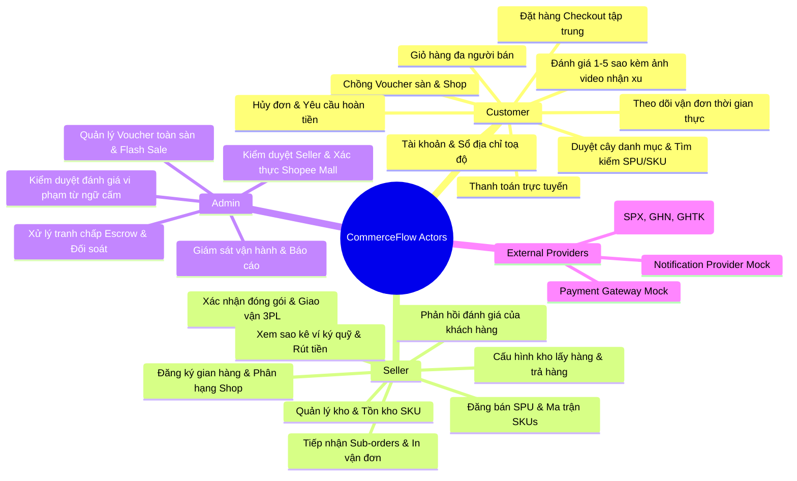

# TÀI LIỆU YÊU CẦU NGHIỆP VỤ (BUSINESS REQUIREMENTS DOCUMENT - BRD)
**Dự án:** CommerceFlow Enterprise Multi-vendor Marketplace  
**Kiến trúc:** Microservices & Event-Driven Distributed Architecture  
**Phiên bản:** 2.0.0 (Comprehensive Shopee-Grade Specification)  

---

## 1. MỤC TIÊU DỰ ÁN & BỐI CẢNH DOANH NGHIỆP
CommerceFlow là nền tảng thương mại điện tử đa người bán (Multi-vendor Marketplace) hướng tới mô hình kinh doanh tương tự Shopee. Hệ thống kết nối ba nhóm chủ thể chính:
- **Người mua (Customer)**: Tìm kiếm, duyệt cây danh mục, xem chi tiết sản phẩm và các biến thể phân loại (Màu sắc, Kích cỡ), lựa chọn sản phẩm từ nhiều người bán vào cùng 1 giỏ hàng, áp dụng đồng thời Voucher Sàn và Voucher Shop, thanh toán tập trung một lần, theo dõi vận đơn thời gian thực, gửi đánh giá nhận xu và yêu cầu khiếu nại/hoàn tiền.
- **Người bán (Seller)**: Đăng ký gian hàng, cấu hình kho lấy hàng và trả hàng, đăng tải sản phẩm gốc (SPU) và ma trận biến thể (SKU), thiết lập giá bán và ảnh bìa, tiếp nhận đơn đặt hàng con (Sub-Orders), đóng gói giao cho vận chuyển và nhận tiền thanh toán (Payout) sau thời hạn ký quỹ Escrow.
- **Quản trị viên (Admin)**: Duyệt gian hàng, xét duyệt nhãn Shopee Mall, kiểm duyệt nội dung sản phẩm/đánh giá, cấu hình chiến dịch khuyến mãi và khung giờ Flash Sale toàn sàn, can thiệp xử lý tranh chấp khiếu nại và giám sát vận hành hệ thống.

---

## 2. PHÂN TÍCH CÁC CHỦ THỂ NGHIỆP VỤ (ACTOR ROLES & RESPONSIBILITIES)

---

## 3. CÁC NĂNG LỰC DOANH NGHIỆP CỐT LÕI (CORE BUSINESS CAPABILITIES)

### 3.1. Trưng bày Sản phẩm SPU/SKU & Gian hàng (Catalog & Storefront Display)
1. **Phân rã SPU và SKU**: Phân tách giữa thông tin chung (SPU - Standard Product Unit: Tên, mô tả, ảnh tổng quan) và biến thể bán hàng (SKU - Stock Keeping Unit: Màu sắc $\times$ Kích cỡ, giá niêm yết, tồn kho, cân nặng).
2. **Cây danh mục ngành hàng đa cấp**: Cung cấp cấu trúc danh mục 3 cấp giúp người mua dễ dàng lọc và tìm kiếm sản phẩm theo ngành hàng.
3. **Gian hàng người bán (Shop Profile)**: Trang cá nhân của shop với biểu ngữ banner, logo, phân loại shop (Chuẩn, Yêu thích, Mall), danh mục riêng do shop tự tạo và tỷ lệ phản hồi chat.

### 3.2. Giỏ hàng & Cơ chế Đặt hàng Đa người bán (Multi-Seller Checkout)
1. **Gom cụm giỏ hàng theo Shop**: Giỏ hàng hiển thị trực quan các mặt hàng được nhóm theo từng Seller.
2. **Cơ chế tách đơn (Order Splitting)**:
   - Khi khách hàng tiến hành Checkout, hệ thống tạo ra **1 Parent Order (Global Order)** để đại diện cho toàn bộ giao dịch thanh toán của khách.
   - Hệ thống tự động phân rã thành **$N$ Sub-Orders**, mỗi Sub-Order tương ứng với chính xác 1 Seller để đảm bảo tính độc lập trong vận hành đóng gói, tính cước vận chuyển và xử lý khiếu nại.
3. **Phân bổ chiết khấu (Promotion Allocation)**:
   - *Shop Voucher*: Chỉ áp dụng trên tổng giá trị hàng của chính Shop phát hành voucher.
   - *Platform Voucher*: Được phân bổ theo tỷ lệ giá trị đơn hàng (Pro-rata basis) giữa các Sub-Orders đủ điều kiện.
   - *Shipping Voucher*: Giảm trừ trực tiếp vào chi phí vận chuyển của từng Sub-Order.

### 3.3. Quản lý Tồn kho & Chống Bán Quá Số Lượng (Inventory & Anti-Overselling)
1. **Hai pha quản lý tồn kho (Two-Phase Stock Reservation)**:
   - **Phase 1: Soft Reservation (Khóa tạm thời)**: Khi đơn hàng vừa tạo và chờ thanh toán (`PENDING_PAYMENT`), tồn kho khả dụng bị khóa với thời gian sống (TTL) cố định (15 phút cho đơn thông thường, 3 phút cho Flash Sale).
   - **Phase 2: Hard Deduction (Khấu trừ thực tế)**: Khi cổng thanh toán xác nhận giao dịch thành công, số lượng tồn kho vật lý bị trừ vĩnh viễn (`COMMITTED`).
   - **Auto-Release (Tự động hoàn trả)**: Nếu khách hàng không hoàn tất thanh toán trước khi TTL hết hạn hoặc chủ động hủy đơn, số lượng khóa tạm thời lập tức được hoàn trả về tồn kho khả dụng.
2. **Flash Sale Protection**: Cam kết không xảy ra tình trạng âm kho (Negative Stock) dù có hàng chục nghìn lượt truy cập đồng thời vào một SKU hữu hạn nhờ phối hợp Redis In-Memory Pre-Allocation và SQL Invariant Updates.

### 3.4. Dòng tiền & Tài khoản Ký quỹ (Escrow & Seller Payout)
1. **Thu tiền tập trung (Centralized Collection)**: Khách hàng thanh toán toàn bộ giá trị của Parent Order cho sàn thông qua Cổng thanh toán.
2. **Tài khoản Ký quỹ (Escrow Hold)**: Tiền thanh toán của khách được giữ tại tài khoản Escrow của sàn. Seller chưa được phép rút tiền ngay.
3. **Giải ngân (Payout Settlement)**: Tiền của từng Sub-Order chỉ được chuyển vào số dư ví của Seller sau khi:
   - Sub-Order được cập nhật trạng thái `DELIVERED` bởi đơn vị vận chuyển.
   - Hết thời hạn khiếu nại (Return/Refund Window - ví dụ: 3 ngày kể từ lúc giao hàng thành công).

### 3.5. Vận chuyển Động & Vận đơn Thời gian thực (Logistics & Shipments)
1. **Tính cước động theo khoảng cách & tải trọng**: Cước phí vận chuyển được tính tự động dựa trên vị trí kho lấy hàng của Shop và sổ địa chỉ nhận hàng của Khách.
2. **Tích hợp đối tác giao vận 3PL**: Tự động cấp mã vận đơn (`waybill_number`) và nhận tín hiệu webhook cập nhật dòng thời gian di chuyển của kiện hàng.

### 3.6. Đánh giá Sản phẩm & Khách hàng Thân thiết (Reviews & Loyalty Rewards)
1. **Đánh giá sau khi nhận hàng**: Người mua đánh giá chất lượng sản phẩm 1-5 sao kèm ảnh chụp và video mở hộp.
2. **Thưởng xu & Tích lũy hạng thẻ**: Tự động thưởng Shopee Xu khi đánh giá có hình ảnh/video, cộng điểm chi tiêu để nâng hạng thành viên (Bronze $\rightarrow$ Silver $\rightarrow$ Gold $\rightarrow$ Platinum).

---

## 4. MA TRẬN MỐI QUAN HỆ PARENT ORDER VÀ SUB-ORDER

| Tiêu chí | Parent Order (Đơn tổng) | Sub-Order (Đơn người bán) |
|---|---|---|
| **Chủ thể sở hữu** | Khách hàng (Customer) | Người bán cụ thể (Seller) |
| **Ranh giới thanh toán** | Duy nhất 1 Transaction thanh toán cho toàn bộ Parent Order | Không thanh toán độc lập; kế thừa trạng thái thanh toán từ Parent Order |
| **Vận chuyển & Đóng gói** | Không có thông tin vận đơn vật lý | Sở hữu mã vận đơn riêng (Waybill/Tracking Code), đơn vị 3PL riêng |
| **Vòng đời trạng thái** | `PENDING_PAYMENT`, `CONFIRMED`, `COMPLETED`, `CANCELLED` | `PENDING_CONFIRMATION`, `PROCESSING`, `SHIPPED`, `DELIVERED`, `CANCELLED`, `RETURNED` |
| **Hủy đơn hàng** | Khi khách hủy trước khi thanh toán $\rightarrow$ Hủy toàn bộ Parent Order & các Sub-Orders | Khi khách hủy sau khi thanh toán: Có thể hủy lẻ từng Sub-Order nếu Seller chưa đóng gói |
| **Đối soát & Ký quỹ** | Đại diện cho tổng số tiền nhận từ Payment Gateway | Cơ sở để giải ngân doanh thu cho từng Seller sau khi trừ phí hoa hồng sàn |
