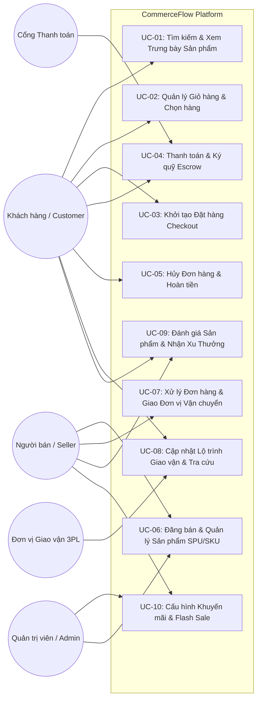

# ĐẶC TẢ USE CASES NGHIỆP VỤ (BUSINESS USE CASES)
**Dự án:** CommerceFlow Enterprise Multi-vendor Marketplace  
**Kiến trúc:** Microservices & Event-Driven Architecture  
**Phiên bản:** 2.0.0 (Comprehensive Multi-vendor Marketplace)  

---

## 1. SƠ ĐỒ TỔNG THỂ USE CASE (USE CASE DIAGRAM)

---

## 2. CHI TIẾT CÁC USE CASE NGHIỆP VỤ TRỌNG YẾU

### 2.1. USE CASE UC-01: TÌM KIẾM & XEM TRƯNG BÀY SẢN PHẨM (CATALOG DISPLAY)
- **Actor:** Khách hàng (Customer) / Khách vãng lai (Guest).
- **Tiền điều kiện:** Không yêu cầu đăng nhập.
- **Hậu điều kiện:** Khách hàng xem được thông tin chi tiết sản phẩm, danh sách biến thể khả dụng, giá bán và hình ảnh tương ứng.
- **Luồng sự kiện chính (Happy Path):**
  1. Khách hàng nhập từ khóa tìm kiếm hoặc bấm chọn danh mục ngành hàng.
  2. Hệ thống trả về danh sách sản phẩm tóm tắt (SPU) kèm ảnh đại diện, khoảng giá (`minPrice` - `maxPrice`), số sao đánh giá và số lượng đã bán.
  3. Khách hàng lọc theo khoảng giá hoặc sắp xếp theo "Bán chạy nhất".
  4. Khách hàng bấm vào một sản phẩm cụ thể để vào trang chi tiết (Product Detail Page).
  5. Hệ thống hiển thị:
     - Thư viện ảnh/video sản phẩm.
     - Mô tả chi tiết sản phẩm, chính sách bảo hành, xuất xứ.
     - Nhóm phân loại (ví dụ: Màu sắc, Kích cỡ).
     - Thông tin gian hàng (Tên shop, tỷ lệ phản hồi, đánh giá trung bình).
     - Danh sách đánh giá thực tế của người mua trước đó.
  6. Khách hàng bấm chọn phân loại hàng (ví dụ: chọn Màu Đen, Size XL) $\rightarrow$ Hệ thống cập nhật hiển thị giá bán chính xác của SKU đó, số lượng tồn kho khả dụng hiện tại và ảnh minh họa tương ứng.

---

### 2.2. USE CASE UC-06: ĐĂNG BÁN & QUẢN LÝ SẢN PHẨM SPU/SKU (SELLER PRODUCT ONBOARDING)
- **Actor:** Người bán (Seller).
- **Tiền điều kiện:** Người bán đã kích hoạt gian hàng thành công (`status = 'ACTIVE'`).
- **Hậu điều kiện:** Sản phẩm mới được tạo lập, các SKU biến thể được lưu vào Catalog DB và khởi tạo bản ghi tồn kho ban đầu tại Inventory DB.
- **Luồng sự kiện chính (Happy Path):**
  1. Người bán chọn "Thêm Sản Phẩm Mới" trên Kênh Người Bán (Seller Center).
  2. Người bán chọn ngành hàng (Category) phù hợp từ cây danh mục 3 cấp.
  3. Người bán nhập thông tin chung SPU: Tên sản phẩm, mô tả, thương hiệu, tải lên bộ sưu tập ảnh và video sản phẩm.
  4. Người bán bật tính năng "Phân loại hàng" và thiết lập 2 nhóm thuộc tính (ví dụ: Nhóm 1: "Màu sắc" gồm [Đen, Trắng]; Nhóm 2: "Kích cỡ" gồm [S, M, L]).
  5. Hệ thống tự động sinh ra ma trận gồm 6 SKU tương ứng (Đen-S, Đen-M, Đen-L, Trắng-S, Trắng-M, Trắng-L).
  6. Người bán nhập giá niêm yết, giá bán, số lượng tồn kho ban đầu, cân nặng và kích thước đóng gói cho từng SKU.
  7. Người bán bấm "Lưu và Đăng bán".
  8. Hệ thống lưu SPU và các SKUs vào `commerceflow_product_db`, đồng thời phát event `ProductCreatedEvent` sang Kafka để `inventory-service` khởi tạo bản ghi tồn kho và Search Service đánh chỉ mục tìm kiếm.

---

### 2.3. USE CASE UC-03: KHỞI TẠO ĐẶT HÀNG (CHECKOUT MULTI-SELLER)
- **Actor:** Khách hàng (Customer).
- **Tiền điều kiện:** 
  1. Khách hàng đã đăng nhập.
  2. Giỏ hàng có tối thiểu 1 sản phẩm.
  3. Đã chọn địa chỉ nhận hàng hợp lệ.
- **Hậu điều kiện:**
  1. Parent Order được tạo ở trạng thái `PENDING_PAYMENT`.
  2. Các Sub-Orders được tạo tương ứng với từng Seller ở trạng thái `PENDING_PAYMENT`.
  3. Tồn kho của các SKU liên quan được khóa tạm thời (`RESERVED`) với thời gian hết hạn 15 phút.
  4. Voucher được giữ chỗ (`RESERVED`).
- **Luồng chính (Happy Path):**
  1. Khách hàng bấm "Thanh Toán" từ giỏ hàng.
  2. Hệ thống kiểm tra giá niêm yết, tính phí vận chuyển động từ từng kho của Shop đến địa chỉ nhận của Khách.
  3. Hệ thống áp dụng đồng thời Voucher Sàn (Freeship) và Voucher riêng của Shop.
  4. Khởi tạo Saga Orchestration:
     - Gửi `ReserveInventoryCommand` sang Inventory Service.
     - Gửi `ReserveVoucherCommand` sang Promotion Service.
  5. Khi toàn bộ các bước đặt trước thành công, tạo bản ghi `parent_orders` và $N$ bản ghi `sub_orders`.
  6. Trả về Payment URL cho khách hàng.

---

### 2.4. USE CASE UC-08: CẬP NHẬT LỘ TRÌNH GIAO VẬN & TRA CỨU HÀNH TRÌNH
- **Actor:** Đối tác Giao vận 3PL (Mock Provider), Khách hàng (Customer).
- **Tiền điều kiện:** Sub-Order đã được người bán đóng gói và bàn giao cho tài xế giao nhận, đã có mã vận đơn (`waybill_number`).
- **Luồng chính (Happy Path):**
  1. Đơn vị vận chuyển phát tín hiệu cập nhật hành trình qua Webhook: Kiện hàng đã đến kho phân loại trung tâm.
  2. `shipping-service` tiếp nhận, xác thực chữ ký HMAC và ghi nhận bản ghi mới vào `shipment_tracking_events`.
  3. Khi tài xế giao hàng thành công đến tay người mua, 3PL gửi Webhook trạng thái `DELIVERED`.
  4. `shipping-service` cập nhật trạng thái vận đơn sang `DELIVERED`, đồng thời phát tán event `ShipmentDeliveredEvent` lên Kafka.
  5. `order-service` lắng nghe event và chuyển trạng thái Sub-Order sang `DELIVERED`.
  6. `payment-service` lắng nghe event, kích hoạt bộ đếm thời gian ký quỹ Escrow: sau 3 ngày nếu khách không khiếu nại trả hàng, tự động giải ngân tiền bán hàng cho Seller.
  7. Khách hàng mở ứng dụng, truy cập mục "Đơn mua" $\rightarrow$ Xem được toàn bộ dòng thời gian lộ trình di chuyển của kiện hàng.

---

### 2.5. USE CASE UC-09: ĐÁNH GIÁ SẢN PHẨM & TÍCH LŨY ĐIỂM THƯỞNG
- **Actor:** Khách hàng (Customer), Người bán (Seller).
- **Tiền điều kiện:** Sub-Order đang ở trạng thái `DELIVERED` và người dùng chưa từng đánh giá sản phẩm này trong đơn.
- **Luồng chính (Happy Path):**
  1. Khách hàng vào mục "Đơn Mua", bấm nút "Đánh Giá" tại sản phẩm đã mua.
  2. Khách hàng chọn số sao (1 đến 5 sao), viết nội dung nhận xét, tải lên 2 ảnh chụp thực tế và 1 video mở hộp.
  3. Khách hàng bấm "Gửi Đánh Giá".
  4. Hệ thống lưu đánh giá vào `commerceflow_review_db`, phát tán event `ReviewSubmittedEvent`.
  5. `customer-service` lắng nghe event, tự động cộng 200 Shopee Xu / Điểm thưởng Loyalty vào tài khoản khách hàng.
  6. `seller-service` và `product-service` cập nhật lại điểm đánh giá trung bình (`rating_average`) và tổng số lượt đánh giá (`rating_count`) của sản phẩm và gian hàng.
  7. Người bán nhận được thông báo về đánh giá mới và gửi phản hồi cảm ơn khách hàng.
