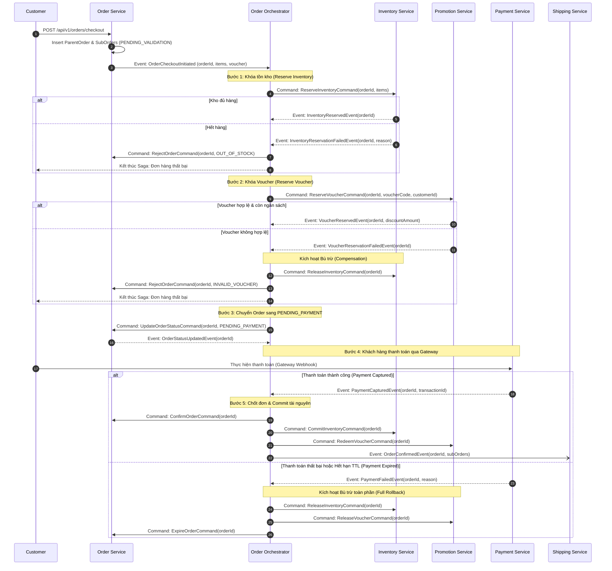

# THIẾT KẾ SAGA: HYBRID ORCHESTRATION & CHOREOGRAPHY
**Hệ thống:** CommerceFlow Distributed Transaction Engine  
**Phiên bản:** 1.0.0  

---

## 1. TỔNG QUAN CHIẾN LƯỢC SAGA (HYBRID SAGA STRATEGY)

Trong môi trường Microservices sở hữu Database độc lập, các giao dịch phân tán không thể sử dụng cơ chế Two-Phase Commit (2PC) truyền thống do vấn đề khóa tài nguyên kéo dài (Lock Contention), độ trễ cao và điểm lỗi đơn lẻ (Single Point of Failure).

CommerceFlow triển khai mô hình **Hybrid Saga**:
1. **Saga Orchestration (Điều phối tập trung)**: Áp dụng cho chu trình Checkout $\rightarrow$ Inventory Reservation $\rightarrow$ Voucher Reservation $\rightarrow$ Payment Processing $\rightarrow$ Confirmation.
   - *Lý do*: Luồng này có logic điều kiện phức tạp, yêu cầu tính toàn vẹn tài chính và kho hàng cao, đồng thời đòi hỏi chuỗi giao dịch bù trừ (Compensating Transactions) nghiêm ngặt theo thứ tự nghịch đảo khi có lỗi xảy ra.
2. **Saga Choreography (Biên đạo phi tập trung)**: Áp dụng cho các giai đoạn Fulfillment và Downstream Notifications (`OrderConfirmed` $\rightarrow$ `Shipping Service` $\rightarrow$ `Notification Service`).
   - *Lý do*: Các dịch vụ này chỉ phản ứng thụ động với các sự kiện đã hoàn tất của đơn hàng, không thể làm rollback giao dịch thanh toán thành công, giúp hệ thống mở rộng độc lập và giảm tải cho Orchestrator.

---

## 2. PHÂN TÍCH CRITICAL REVIEW: TẠO ĐƠN TRƯỚC HAY KHÓA TỒN KHO TRƯỚC?

Một trong những câu hỏi kiến trúc kinh điển là: **Nên tạo đơn hàng trong Database trước hay gửi lệnh giữ tồn kho trước?**

### Đánh giá so sánh:

| Phương án | Luồng thực hiện | Ưu điểm | Nhược điểm & Rủi ro |
|---|---|---|---|
| **Phương án 1: Khóa kho trước $\rightarrow$ Tạo đơn sau** | Client Checkout $\rightarrow$ Call Inventory Reserve $\rightarrow$ Nếu OK thì mới tạo Order DB. | Không sinh rác (orphan orders) trong bảng đơn hàng nếu hết kho. | 1. Mất dấu vết giao dịch (No Audit Trail) nếu Client mất mạng ngay sau khi kho vừa khóa. 2. Không có `orderId` làm khóa định danh duy nhất (Correlation Key) để theo dõi và giải phóng reservation khi timeout. 3. Dễ phát sinh rò rỉ tồn kho (Phantom Stock Leak). |
| **Phương án 2 (Được chọn): Tạo đơn PENDING trước $\rightarrow$ Khởi tạo Saga khóa kho** | Client Checkout $\rightarrow$ Order Service tạo Parent Order trạng thái `PENDING_VALIDATION` $\rightarrow$ Kích hoạt Saga với `orderId`. | 1. Có ngay `orderId` làm khóa điều phối xuyên suốt mọi event. 2. Mọi trạng thái đều được lưu vết đầy đủ trong Audit DB. 3. Nếu giữ kho thất bại, Saga chỉ cần chuyển trạng thái Order sang `REJECTED_OUT_OF_STOCK` và đóng transaction an toàn. | Bảng đơn hàng có một lượng bản ghi đơn không thành công (Hoàn toàn giải quyết được bằng Partitioning DB theo tháng hoặc Soft-delete Archive). |

**Quyết định kiến trúc:** Hệ thống chọn **Phương án 2**. `ParentOrder` được khởi tạo trước với trạng thái `PENDING_VALIDATION` để đóng vai trò là Aggregate Root và Correlation Key cho toàn bộ luồng Saga.

---

## 3. LUỒNG ĐIỀU PHỐI CHECKOUT SAGA CHI TIẾT (STEP-BY-STEP WORKFLOW)

---

## 4. MA TRẬN ĐIỀU PHỐI BƯỚC SAGA (SAGA EXECUTION MATRIX)

| Bước | Hành động (Action) | Lệnh / Sự kiện gửi đi | Sự kiện phản hồi thành công | Sự kiện thất bại | Hành động bù trừ khi lỗi (Compensation) |
|---|---|---|---|---|---|
| **1** | Khởi tạo đơn | `OrderCheckoutInitiated` | `OrderCreated` | N/A | Cập nhật `Order = REJECTED` |
| **2** | Khóa tồn kho | `ReserveInventoryCommand` | `InventoryReserved` | `InventoryReservationFailed` | Hủy đơn, không cần bù trừ kho vì chưa khóa được |
| **3** | Khóa voucher | `ReserveVoucherCommand` | `VoucherReserved` | `VoucherReservationFailed` | Gửi `ReleaseInventoryCommand` để nhả lại kho đã khóa ở Bước 2 |
| **4** | Chờ thanh toán | `UpdateOrder(PENDING_PAYMENT)` | `OrderAwaitingPayment` | N/A | Bắt đầu đếm ngược Timer TTL (15 phút) |
| **5** | Ghi nhận thanh toán | Webhook Web Client | `PaymentCaptured` | `PaymentFailed` / `PaymentTimeout` | Gửi `ReleaseInventoryCommand` + `ReleaseVoucherCommand` + `CancelOrder` |
| **6** | Hoàn tất giao dịch | `ConfirmOrderCommand` | `OrderConfirmed` | N/A | Chuyển trạng thái sang `PROCESSING`, kích hoạt luồng vận chuyển (Choreography) |
