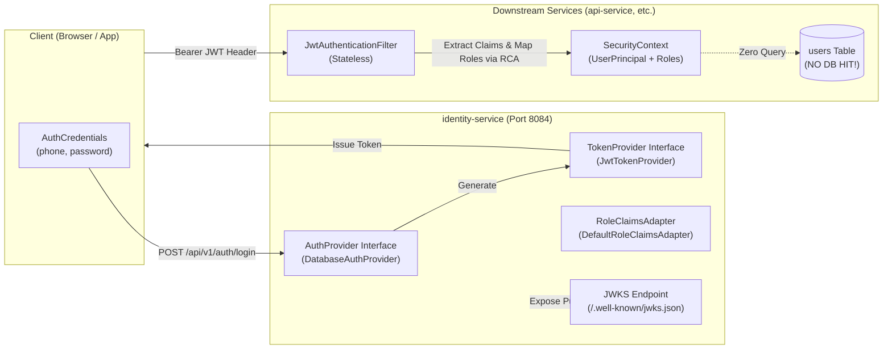

# COMMERCEFLOW — SYSTEM ARCHITECTURE SPECIFICATION
## BẢN ĐẶC TẢ KIẾN TRÚC HỆ THỐNG PHÂN TÁN
**Tài liệu:** Kiến trúc hệ thống tổng thể (System Architecture Document)  
**Mục tiêu:** Cung cấp bức tranh toàn cảnh về thành phần, luồng dữ liệu, ranh giới truyền thông và cơ chế an toàn phân tán.

---

## 1. MÔ HÌNH KIẾN TRÚC TỔNG THỂ (C4 CONTAINER DIAGRAM)

```mermaid
graph TD
    %% ==========================================
    %% CLIENT TIER
    %% ==========================================
    subgraph ClientTier["Client Application Tier"]
        Web["Web Frontend - React SPA"]
        Mobile["Mobile App - Flutter Client"]
    end

    %% ==========================================
    %% EDGE & SECURITY TIER
    %% ==========================================
    subgraph EdgeTier["Edge & Security Tier"]
        APIGW["API Gateway - Spring Cloud Gateway (Port 8080)"]
        RateLimiter["Redis Rate Limiter - Token Bucket"]
        AuthServer["Identity Service (Port 8084) - OIDC / JWT Server"]
    end

    %% ==========================================
    %% CORE MICROSERVICES TIER
    %% ==========================================
    subgraph CoreTier["Core Microservices Tier - Database per Service"]
        OrderSvc["Order Service (in api-service Port 8081)"]
        OrchSvc["Order Orchestrator - Saga Engine (Port 8082)"]
        InvSvc["Inventory Service (in event-consumer Port 8083)"]
        PaySvc["Payment & Escrow Service"]
        PromoSvc["Promotion Service"]
        CartSvc["Cart Service"]
        ProdSvc["Product Catalog Service"]
        ShipSvc["Shipping Service"]
        ReviewSvc["Review & Feedback Service"]
        NotiSvc["Notification Service"]
        CustSvc["Customer Service"]
        SellerSvc["Seller Service"]
    end

    %% ==========================================
    %% DATA & STORAGE TIER
    %% ==========================================
    subgraph DataTier["Data & Storage Tier"]
        OrderDB[("PostgreSQL - Order DB")]
        OrchDB[("PostgreSQL - Saga DB")]
        InvDB[("PostgreSQL - Inventory DB")]
        PayDB[("PostgreSQL - Payment DB")]
        PromoDB[("PostgreSQL - Promo DB")]
        ProdDB[("PostgreSQL - Catalog DB")]
        CustDB[("PostgreSQL - Customer & User DB")]
        SellerDB[("PostgreSQL - Seller DB")]
        ShipDB[("PostgreSQL - Shipping DB")]
        ReviewDB[("PostgreSQL - Review DB")]
        CartCache[("Redis - Cart Store")]
        FlashSaleCache[("Redis - Flash Sale Counter")]
    end

    %% ==========================================
    %% MESSAGING & CDC BACKBONE
    %% ==========================================
    subgraph MessagingTier["Messaging & CDC Backbone"]
        KafkaCluster[("Apache Kafka Cluster - 3 Brokers")]
        Debezium["Debezium CDC Connector Engine"]
    end

    %% ==========================================
    %% OBSERVABILITY TIER
    %% ==========================================
    subgraph ObservabilityTier["Observability Tier"]
        OTel["OpenTelemetry Collector"]
        Prom["Prometheus Metrics Engine"]
        Graf["Grafana Dashboards"]
        Jaeger["Jaeger Distributed Tracing"]
    end

    %% ==========================================
    %% CLIENT TO EDGE
    %% ==========================================
    Web -->|"1. Đăng nhập / Lấy Token"| AuthServer
    Mobile -->|"1. Đăng nhập / Lấy Token"| AuthServer
    Web -->|"2. HTTPS REST + Bearer Token"| APIGW
    Mobile -->|"2. HTTPS REST + Bearer Token"| APIGW

    %% ==========================================
    %% EDGE & SECURITY
    %% ==========================================
    APIGW --> RateLimiter
    APIGW -.->|"Verify Signature (JWKS)"| AuthServer

    APIGW --> OrderSvc
    APIGW --> CartSvc
    APIGW --> ProdSvc
    APIGW --> CustSvc
    APIGW --> SellerSvc
    APIGW --> PromoSvc
    APIGW --> ShipSvc
    APIGW --> ReviewSvc

    %% ==========================================
    %% SERVICE TO DATABASE
    %% ==========================================
    AuthServer --- CustDB
    OrderSvc --- OrderDB
    OrchSvc --- OrchDB
    InvSvc --- InvDB
    PaySvc --- PayDB
    PromoSvc --- PromoDB
    ProdSvc --- ProdDB
    CustSvc --- CustDB
    SellerSvc --- SellerDB
    ShipSvc --- ShipDB
    ReviewSvc --- ReviewDB
    CartSvc --- CartCache

    InvSvc --- FlashSaleCache

    %% ==========================================
    %% CDC & OUTBOX TO KAFKA
    %% ==========================================
    OrderDB -.->|"WAL CDC"| Debezium
    OrchDB -.->|"WAL CDC"| Debezium
    InvDB -.->|"WAL CDC"| Debezium
    PayDB -.->|"WAL CDC"| Debezium
    ShipDB -.->|"WAL CDC"| Debezium
    ReviewDB -.->|"WAL CDC"| Debezium

    Debezium -->|"Publish Outbox Events"| KafkaCluster

    %% ==========================================
    %% KAFKA INTERACTIONS
    %% ==========================================
    KafkaCluster <--> OrchSvc
    KafkaCluster <--> InvSvc
    KafkaCluster <--> PaySvc
    KafkaCluster <--> PromoSvc
    KafkaCluster <--> ShipSvc
    KafkaCluster <--> ReviewSvc
    KafkaCluster <--> ProdSvc
    KafkaCluster --> NotiSvc

    %% ==========================================
    %% OBSERVABILITY WIRING
    %% ==========================================
    OrderSvc -.->|"gRPC OTLP"| OTel
    OrchSvc -.->|"gRPC OTLP"| OTel
    InvSvc -.->|"gRPC OTLP"| OTel
    PaySvc -.->|"gRPC OTLP"| OTel
    PromoSvc -.->|"gRPC OTLP"| OTel
    CartSvc -.->|"gRPC OTLP"| OTel
    ProdSvc -.->|"gRPC OTLP"| OTel
    ShipSvc -.->|"gRPC OTLP"| OTel
    ReviewSvc -.->|"gRPC OTLP"| OTel
    NotiSvc -.->|"gRPC OTLP"| OTel
    CustSvc -.->|"gRPC OTLP"| OTel
    SellerSvc -.->|"gRPC OTLP"| OTel

    OTel --> Prom
    OTel --> Jaeger
    Prom --> Graf
```

---

## 2. PHÂN ĐỊNH RANH GIỚI TRUYỀN THÔNG (COMMUNICATION BOUNDARIES)

Hệ thống phân tách rành mạch hai phương thức giao tiếp:

### 2.1. Đồng bộ (Synchronous HTTP/REST qua API Gateway)
- **Mục đích**: Phục vụ các thao tác tra cứu dữ liệu (Queries), thao tác giỏ hàng thời gian thực, duyệt danh mục/trưng bày sản phẩm, xem hồ sơ shop và tiếp nhận yêu cầu ghi ban đầu từ phía Client.
- **Ràng buộc**: Tuyệt đối không thực hiện chuỗi gọi HTTP lồng nhau giữa các dịch vụ nội bộ (No Nested HTTP Cascades) trong luồng ghi trạng thái để tránh tích tụ độ trễ và lỗi dây chuyền (Cascading Failure).
- **Ví dụ**:
  - `GET /api/v1/products/{id}`: Trả về chi tiết sản phẩm kèm cache Redis.
  - `POST /api/v1/cart/items`: Thao tác trực tiếp trên Redis store của Cart Service.
  - `POST /api/v1/orders/checkout`: Order Service tiếp nhận, lưu Parent Order và đẩy vào Outbox rồi trả về kết quả tiếp nhận ngay lập tức cho Client.

### 2.2. Bất đồng bộ (Asynchronous Event-Driven Messaging qua Kafka)
- **Mục đích**: Điều phối toàn bộ các nghiệp vụ thay đổi trạng thái phân tán (Mutations & Workflows): Khóa tồn kho, xác thực voucher, trừ tiền, xác nhận đơn hàng, lập vận đơn, cập nhật lộ trình giao hàng, đánh giá và giải ngân ký quỹ Escrow.
- **Đặc tính**:
  - Dữ liệu sự kiện được lưu trữ bền vững (Persistent Log).
  - Khả năng đệm tải (Buffering) và chịu áp lực tương tranh cực hạn (Load Leveling).
  - Giảm thiểu hoàn toàn sự phụ thuộc thời gian thực (Temporal Decoupling) giữa các dịch vụ.

---

## 3. NGUYÊN TẮC DATABASE PER SERVICE & CHỐNG CHIA SẺ DỮ LIỆU

1. **Schema Autonomy**: Mỗi microservice sở hữu một PostgreSQL Database hoặc Schema riêng biệt với User/Password phân quyền độc lập. Dịch vụ $A$ không được cấp quyền truy cập vào tables của dịch vụ $B$.
2. **Entity Duplication for Performance**: Khi một dịch vụ cần thông tin từ dịch vụ khác (ví dụ: Order Service cần tên sản phẩm, hình ảnh và giá niêm yết tại thời điểm mua), Order Service sẽ lưu snapshot các trường dữ liệu này trực tiếp vào bảng `order_items` thay vì truy vấn chéo sang Product Service mỗi khi đọc đơn hàng.
3. **Eventual Consistency Projections**: Dữ liệu đọc phục vụ tìm kiếm hoặc báo cáo tổng hợp được đồng bộ hóa bất đồng bộ thông qua việc tiêu thụ Kafka Domain Events.
4. **Centralized Table Definitions & Migrations (`common-model`)**: Nhằm đảm bảo kiểm soát tập trung toàn bộ schema, chống tình trạng lệch định nghĩa dữ liệu (Schema Drift) giữa các microservice:
   - Toàn bộ các bảng dữ liệu (JPA `@Entity`) đại diện cho các Bounded Contexts được định nghĩa tập trung tại module `common-model` (`com.commerce.common_model.entity.*`).
   - Toàn bộ các kịch bản tiến hóa cơ sở dữ liệu (Flyway Migrations `V1` - `V10`) được lưu trữ tại `common-model/src/main/resources/db/migration/` và thực thi tập trung qua `mvn flyway:migrate -pl projects/common-model` hoặc `DatabaseMigrationRunner`.
   - Các ứng dụng microservice (`identity-service`, `api-service`, `event-consumer`, `saga-orchestrator`...) tái sử dụng trực tiếp các Entity này, giúp code nhất quán và loại bỏ hoàn toàn việc định nghĩa trùng lặp mô hình bảng.

---

## 4. KIẾN TRÚC XÁC THỰC & PHÂN QUYỀN STATELESS (IDENTITY & BASE AUTH)

Nhằm đảm bảo khả năng chuyển đổi linh hoạt giữa hệ thống In-house và các Identity Provider (IdP) tiêu chuẩn công nghiệp như Keycloak, Okta, Auth0, kiến trúc bảo mật của CommerceFlow tuân thủ nghiêm ngặt **3 nguyên tắc kiến trúc cốt lõi**:

### 4.1. Nguyên tắc 1: JWT chuẩn OIDC Claims (RFC 7519 / OpenID Connect)
Token phát hành từ `identity-service` luôn tuân thủ chuẩn OIDC Claims để các dịch vụ downstream hoặc API Gateway có thể hiểu và xác thực một cách đồng nhất:
* `sub` (Subject): Định danh UUID duy nhất của người dùng (`users.id`).
* `iss` (Issuer): Đơn vị cấp phát (mặc định: `https://auth.commerceflow.com`).
* `aud` (Audience): Đối tượng nhận token (mặc định: `commerce-api`).
* `exp` (Expiration): Thời điểm hết hạn (UNIX epoch seconds).
* `iat` (Issued At): Thời điểm phát hành.
* `jti` (JWT ID): Mã UUID ngẫu nhiên của token, phục vụ kiểm tra danh sách đen thu hồi (Token Revocation List / Redis Blacklist).
* `preferred_username`: Số điện thoại hoặc tên tài khoản của người dùng.
* `email`: Email người dùng.
* `roles`: Danh sách quyền ứng dụng (`["ROLE_CUSTOMER"]`, `["ROLE_SELLER"]`, `["ROLE_ADMIN"]`).
* `realm_access`: Định dạng OIDC tương thích Keycloak (`{ "roles": ["ROLE_CUSTOMER"] }`).
* `token_type`: Phân loại token (`access` hoặc `refresh`).

### 4.2. Nguyên tắc 2: Tách lớp AuthProvider & RoleClaimsAdapter Interface
Hệ thống **không hard-code logic xác thực/sinh token vào business services**. Tầng xác thực được trừu tượng hóa thành 3 interface độc lập đặt tại `common-model`:
1. **`AuthProvider`**:
   - Định nghĩa các hành vi nghiệp vụ: `authenticate()`, `refreshToken()`, `revokeToken()`, `validate()`.
   - Triển khai hiện tại: `DatabaseAuthProvider` (kiểm tra mật khẩu qua `BCryptPasswordEncoder` và bảng `users`).
   - Khả năng mở rộng: Khi chuyển sang **Keycloak**, **Okta** hoặc **Auth0**, chỉ cần tạo implementation mới `KeycloakAuthProvider` mà không cần thay đổi bất kỳ code nào trong business service.
2. **`TokenProvider`**:
   - Trừu tượng hóa việc sinh và parse JWT (`generateTokens()`, `parseAndValidateToken()`, `validateToken()`).
   - Độc lập với thư viện ký (JJWT, Nimbus-JOSE, Spring Authorization Server).
3. **`RoleClaimsAdapter`**:
   - Interface bóc tách roles từ các định dạng IdP khác nhau: `DefaultRoleClaimsAdapter` hỗ trợ cả OIDC `roles` array, Keycloak `realm_access.roles`, và OAuth2 `scope`. Khi đổi IdP, chỉ cần cấu hình lại Adapter map role.

### 4.3. Nguyên tắc 3: Phân quyền Stateless dựa trên Claims/Roles thay vì phụ thuộc DB Users
* **Không Query Bảng `users` trong Filter**: Tại các dịch vụ downstream (`api-service`, `gateway-service`), `JwtAuthenticationFilter` giải mã chữ ký JWT và đọc trực tiếp các claims `sub`, `roles`, `email` vào đối tượng `UserPrincipal`.
* **Zero Database Overhead**: Mọi kiểm tra phân quyền `@PreAuthorize("hasRole('SELLER')")` hoặc `hasRole('ADMIN')` đều thực hiện trong bộ nhớ (In-memory) từ `SecurityContext`, loại bỏ hoàn toàn các câu lệnh `SELECT * FROM users WHERE id = ?` gây nghẽn database ở quy mô triệu request.
