# KIẾN TRÚC TỔNG THỂ HỆ THỐNG (SYSTEM ARCHITECTURE SPECIFICATION)
**Dự án:** CommerceFlow Enterprise Multi-vendor Marketplace  
**Mô hình:** Event-Driven Microservices Architecture  
**Phiên bản:** 2.0.0 (Comprehensive Shopee-Grade Architecture)  

---

## 1. MÔ HÌNH KIẾN TRÚC TỔNG THỂ (C4 CONTAINER DIAGRAM)

```mermaid
graph TB
    %% ==========================================
    %% CLIENT TIER
    %% ==========================================
    subgraph ClientTier["Client Tier"]
        Web["Single Page Application - React"]
        Mobile["Mobile Application - Flutter / Native"]
    end

    %% ==========================================
    %% EDGE & SECURITY TIER
    %% ==========================================
    subgraph EdgeTier["Edge & Security Tier"]
        APIGW["API Gateway - Spring Cloud Gateway"]
        RateLimiter["Redis Rate Limiter - Token Bucket"]
        AuthServer["Identity Service - OAuth2 / JWT Server"]
    end

    %% ==========================================
    %% CORE MICROSERVICES TIER
    %% ==========================================
    subgraph CoreTier["Core Microservices Tier - Database per Service"]
        OrderSvc["Order Service"]
        OrchSvc["Order Orchestrator - Saga Engine"]
        InvSvc["Inventory Service"]
        PaySvc["Payment & Escrow Service"]
        PromoSvc["Promotion Service"]
        CartSvc["Cart Service"]
        ProdSvc["Product Catalog Service"]
        ShipSvc["Shipping Service"]
        ReviewSvc["Review & Feedback Service"]
        NotiSvc["Notification Service"]
        CustSvc["Customer Service"]
        SellerSvc["Seller Service"]
    end

    %% ==========================================
    %% DATA & STORAGE TIER
    %% ==========================================
    subgraph DataTier["Data & Storage Tier"]
        OrderDB[("PostgreSQL - Order DB")]
        OrchDB[("PostgreSQL - Saga DB")]
        InvDB[("PostgreSQL - Inventory DB")]
        PayDB[("PostgreSQL - Payment DB")]
        PromoDB[("PostgreSQL - Promo DB")]
        ProdDB[("PostgreSQL - Catalog DB")]
        CustDB[("PostgreSQL - Customer DB")]
        SellerDB[("PostgreSQL - Seller DB")]
        ShipDB[("PostgreSQL - Shipping DB")]
        ReviewDB[("PostgreSQL - Review DB")]
        CartCache[("Redis - Cart Store")]
        FlashSaleCache[("Redis - Flash Sale Counter")]
    end

    %% ==========================================
    %% MESSAGING & CDC BACKBONE
    %% ==========================================
    subgraph MessagingTier["Messaging & CDC Backbone"]
        KafkaCluster[("Apache Kafka Cluster - 3 Brokers")]
        Debezium["Debezium CDC Connector Engine"]
    end

    %% ==========================================
    %% OBSERVABILITY TIER
    %% ==========================================
    subgraph ObservabilityTier["Observability Tier"]
        OTel["OpenTelemetry Collector"]
        Prom["Prometheus Metrics Engine"]
        Graf["Grafana Dashboards"]
        Jaeger["Jaeger Distributed Tracing"]
    end

    %% ==========================================
    %% CLIENT TO EDGE
    %% ==========================================
    Web -->|"HTTPS REST"| APIGW
    Mobile -->|"HTTPS REST"| APIGW

    %% ==========================================
    %% EDGE & SECURITY
    %% ==========================================
    APIGW --> RateLimiter
    APIGW --> AuthServer

    APIGW --> OrderSvc
    APIGW --> CartSvc
    APIGW --> ProdSvc
    APIGW --> CustSvc
    APIGW --> SellerSvc
    APIGW --> PromoSvc
    APIGW --> ShipSvc
    APIGW --> ReviewSvc

    %% ==========================================
    %% SERVICE TO DATABASE
    %% ==========================================
    OrderSvc --- OrderDB
    OrchSvc --- OrchDB
    InvSvc --- InvDB
    PaySvc --- PayDB
    PromoSvc --- PromoDB
    ProdSvc --- ProdDB
    CustSvc --- CustDB
    SellerSvc --- SellerDB
    ShipSvc --- ShipDB
    ReviewSvc --- ReviewDB
    CartSvc --- CartCache

    InvSvc --- FlashSaleCache

    %% ==========================================
    %% CDC & OUTBOX TO KAFKA
    %% ==========================================
    OrderDB -.->|"WAL CDC"| Debezium
    OrchDB -.->|"WAL CDC"| Debezium
    InvDB -.->|"WAL CDC"| Debezium
    PayDB -.->|"WAL CDC"| Debezium
    ShipDB -.->|"WAL CDC"| Debezium
    ReviewDB -.->|"WAL CDC"| Debezium

    Debezium -->|"Publish Outbox Events"| KafkaCluster

    %% ==========================================
    %% KAFKA INTERACTIONS
    %% ==========================================
    KafkaCluster <--> OrchSvc
    KafkaCluster <--> InvSvc
    KafkaCluster <--> PaySvc
    KafkaCluster <--> PromoSvc
    KafkaCluster <--> ShipSvc
    KafkaCluster <--> ReviewSvc
    KafkaCluster <--> ProdSvc
    KafkaCluster --> NotiSvc

    %% ==========================================
    %% OBSERVABILITY WIRING
    %% ==========================================
    OrderSvc -.->|"gRPC OTLP"| OTel
    OrchSvc -.->|"gRPC OTLP"| OTel
    InvSvc -.->|"gRPC OTLP"| OTel
    PaySvc -.->|"gRPC OTLP"| OTel
    PromoSvc -.->|"gRPC OTLP"| OTel
    CartSvc -.->|"gRPC OTLP"| OTel
    ProdSvc -.->|"gRPC OTLP"| OTel
    ShipSvc -.->|"gRPC OTLP"| OTel
    ReviewSvc -.->|"gRPC OTLP"| OTel
    NotiSvc -.->|"gRPC OTLP"| OTel
    CustSvc -.->|"gRPC OTLP"| OTel
    SellerSvc -.->|"gRPC OTLP"| OTel

    OTel --> Prom
    OTel --> Jaeger
    Prom --> Graf
```

---

## 2. PHÂN ĐỊNH RANH GIỚI TRUYỀN THÔNG (COMMUNICATION BOUNDARIES)

Hệ thống phân tách rành mạch hai phương thức giao tiếp:

### 2.1. Đồng bộ (Synchronous HTTP/REST qua API Gateway)
- **Mục đích**: Phục vụ các thao tác tra cứu dữ liệu (Queries), thao tác giỏ hàng thời gian thực, duyệt danh mục/trưng bày sản phẩm, xem hồ sơ shop và tiếp nhận yêu cầu ghi ban đầu từ phía Client.
- **Ràng buộc**: Tuyệt đối không thực hiện chuỗi gọi HTTP lồng nhau giữa các dịch vụ nội bộ (No Nested HTTP Cascades) trong luồng ghi trạng thái để tránh tích tụ độ trễ và lỗi dây chuyền (Cascading Failure).
- **Ví dụ**:
  - `GET /api/v1/products/{id}`: Trả về chi tiết sản phẩm kèm cache Redis.
  - `POST /api/v1/cart/items`: Thao tác trực tiếp trên Redis store của Cart Service.
  - `POST /api/v1/orders/checkout`: Order Service tiếp nhận, lưu Parent Order và đẩy vào Outbox rồi trả về kết quả tiếp nhận ngay lập tức cho Client.

### 2.2. Bất đồng bộ (Asynchronous Event-Driven Messaging qua Kafka)
- **Mục đích**: Điều phối toàn bộ các nghiệp vụ thay đổi trạng thái phân tán (Mutations & Workflows): Khóa tồn kho, xác thực voucher, trừ tiền, xác nhận đơn hàng, lập vận đơn, cập nhật lộ trình giao hàng, đánh giá và giải ngân ký quỹ Escrow.
- **Đặc tính**:
  - Dữ liệu sự kiện được lưu trữ bền vững (Persistent Log).
  - Khả năng đệm tải (Buffering) và chịu áp lực tương tranh cực hạn (Load Leveling).
  - Giảm thiểu hoàn toàn sự phụ thuộc thời gian thực (Temporal Decoupling) giữa các dịch vụ.

---

## 3. NGUYÊN TẮC DATABASE PER SERVICE & CHỐNG CHIA SẺ DỮ LIỆU

1. **Schema Autonomy**: Mỗi microservice sở hữu một PostgreSQL Database hoặc Schema riêng biệt với User/Password phân quyền độc lập. Dịch vụ $A$ không được cấp quyền truy cập vào tables của dịch vụ $B$.
2. **Entity Duplication for Performance**: Khi một dịch vụ cần thông tin từ dịch vụ khác (ví dụ: Order Service cần tên sản phẩm, hình ảnh và giá niêm yết tại thời điểm mua), Order Service sẽ lưu snapshot các trường dữ liệu này trực tiếp vào bảng `order_items` thay vì truy vấn chéo sang Product Service mỗi khi đọc đơn hàng.
3. **Eventual Consistency Projections**: Dữ liệu đọc phục vụ tìm kiếm hoặc báo cáo tổng hợp được đồng bộ hóa bất đồng bộ thông qua việc tiêu thụ Kafka Domain Events.
