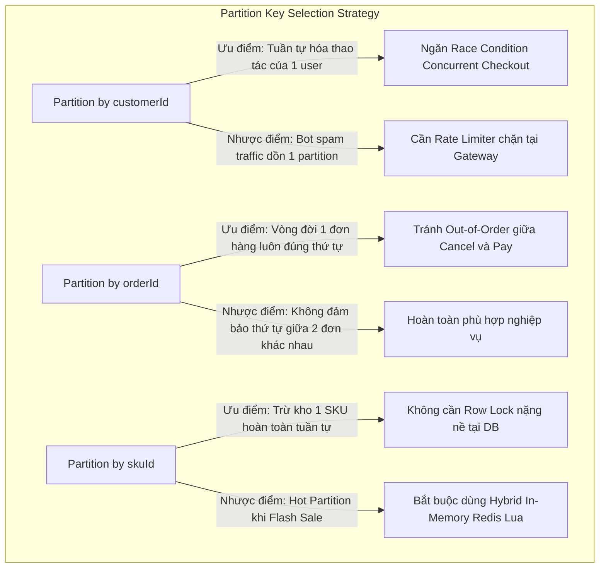
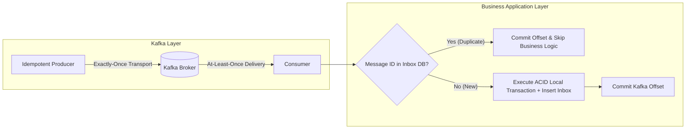
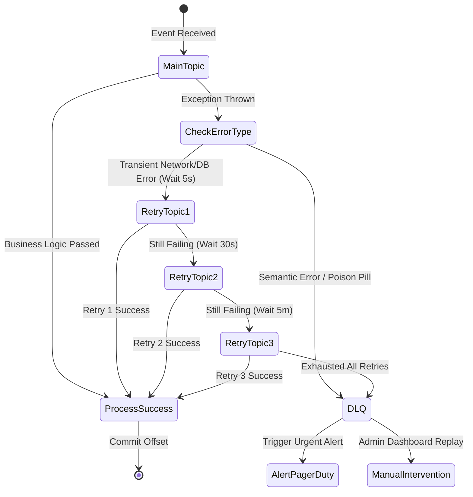
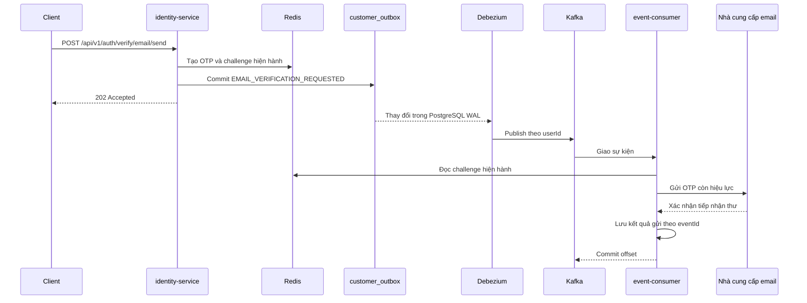

# KIẾN TRÚC KAFKA & MESSAGE DELIVERY SEMANTICS
**Hệ thống:** CommerceFlow Event Backbone  
**Phiên bản:** 1.0.0  

---

## 1. THIẾT KẾ TỔNG THỂ TOPIC & PHÂN VÙNG (TOPOLOGY & PARTITIONING)

### 1.1. Bảng cấu hình Topics trọng yếu

| Topic Name | Partitions | Replication | Min In-Sync Replicas | Partition Key | Mục đích nghiệp vụ |
|---|---|---|---|---|---|
| `order.checkout.initiated` | 12 | 3 | 2 | `customerId` | Xếp hàng yêu cầu checkout theo Customer, ngăn chặn duplicate checkout |
| `order.commands` | 12 | 3 | 2 | `orderId` | Gửi lệnh điều phối trạng thái đơn từ Orchestrator sang Order Service |
| `order.events` | 12 | 3 | 2 | `orderId` | Phát tán trạng thái đơn hàng (`Confirmed`, `Cancelled`, `Expired`) |
| `inventory.commands` | 24 | 3 | 2 | `skuId` | Đảm bảo tuần tự hóa các lệnh khóa/trừ kho cho từng sản phẩm |
| `inventory.events` | 24 | 3 | 2 | `orderId` | Báo kết quả giữ kho về cho Order Orchestrator |
| `payment.commands` | 12 | 3 | 2 | `orderId` | Tuần tự hóa lệnh thanh toán/hoàn tiền cho một đơn hàng |
| `payment.events` | 12 | 3 | 2 | `orderId` | Trả kết quả Capture/Refund về Orchestrator |
| `promotion.commands` | 12 | 3 | 2 | `voucherCode` | Tuần tự hóa lệnh giữ chỗ/khấu trừ voucher |
| `promotion.events` | 12 | 3 | 2 | `orderId` | Báo kết quả giữ voucher về cho Orchestrator |
| `product.events` | 12 | 3 | 2 | `productId` | Đồng bộ dữ liệu SPU/SKU sang Search Service và khởi tạo tồn kho |
| `shipping.events` | 12 | 3 | 2 | `subOrderId` | Cập nhật hành trình vận chuyển theo từng gói hàng của Seller |
| `review.events` | 12 | 3 | 2 | `productId` | Phát tán đánh giá mới, cập nhật Rating Shop/SPU và cộng xu thưởng |
| `identity.email-verification.requested` | 3 | 3 | 2 | `userId` | Tiếp nhận yêu cầu gửi OTP xác thực email. Cấu hình khởi điểm cho cụm 3 broker. |

---

## 2. CHIẾN LƯỢC ĐẶT PARTITION KEY & ĐÁNH ĐỔI (TRADE-OFFS)



### Phân tích Hot Partition rủi ro cao nhất: `inventory.commands` (skuId)
- Khi một sản phẩm Flash Sale thu hút 50,000 lượt mua trong 10 giây, toàn bộ 50,000 message sẽ bị băm (`murmur2_hash(skuId) % 24`) và dồn vào **duy nhất 1 Partition**.
- Việc tăng số lượng partition từ 24 lên 100 **không giải quyết được bài toán** vì một key cố định luôn chỉ ánh xạ vào một partition duy nhất.
- **Giải pháp áp dụng**: Sử dụng cơ chế **Redis In-Memory Pre-Allocation**:
  1. Kho khả dụng được nạp vào Redis Key: `flashsale:stock:{skuId}`.
  2. Dùng Redis Lua Script để kiểm tra và trừ tồn kho nguyên tử ngay tại tầng Edge.
  3. Chỉ những request trừ Redis thành công (tối đa đúng bằng số lượng hàng tồn, ví dụ: 50 items) mới được cấp `ReservationTicket` và đẩy vào Kafka.
  4. Nhờ đó, partition Kafka chỉ tiếp nhận đúng 50 messages thay vì 50,000 messages, triệt tiêu 100% tình trạng Hot Partition nghẽn queue.

---

## 3. CẤU HÌNH PRODUCER & CONSUMER CHUẨN DOANH NGHIỆP

### 3.1. Producer Configuration (Đảm bảo Không mất dữ liệu & Chống trùng)
```properties
# Bắt buộc toàn bộ In-sync Replicas xác nhận trước khi báo thành công
acks=all
# Kích hoạt Idempotent Producer ngăn trùng message khi network retry
enable.idempotence=true
retries=2147483647
max.in.flight.requests.per.connection=5
# Gom batch tối ưu thông lượng mạng
compression.type=zstd
linger.ms=20
batch.size=32768
```

### 3.2. Consumer Configuration (Kiểm soát cam kết Offset & Tái cân bằng an toàn)
```properties
# Vô hiệu hóa auto-commit để kiểm soát commit thủ công sau khi xử lý xong DB
enable.auto.commit=false
# Đọc chỉ các bản ghi đã commit an toàn
isolation.level=read_committed
# Tái cân bằng linh hoạt không dừng toàn bộ consumer group
partition.assignment.strategy=org.apache.kafka.clients.consumer.CooperativeStickyAssignor
max.poll.interval.ms=300000
max.poll.records=500
```

---

## 4. MESSAGE DELIVERY SEMANTICS: TỪ KAFKA ĐẾN NGHIỆP VỤ

Rất nhiều kỹ sư nhầm lẫn giữa Kafka Exactly-Once Semantics (EOS) và Business-Level Exactly-Once.



- **Kafka EOS**: Chỉ đảm bảo giữa Kafka Broker và Kafka Streams/Transactions trong phạm vi luồng read-process-write nội bộ Kafka.
- **Business Exactly-Once**: Khi ghi dữ liệu sang PostgreSQL, hệ thống bắt buộc phải áp dụng **Inbox Pattern**:
  ```sql
  CREATE TABLE consumer_inbox (
      message_id VARCHAR(64) PRIMARY KEY,
      consumer_group VARCHAR(100) NOT NULL,
      processed_at TIMESTAMP WITH TIME ZONE DEFAULT NOW()
  );
  ```
  Nếu Consumer gặp sự cố sau khi ghi DB nhưng trước khi commit Kafka offset, khi partition được rebalance và giao lại message đó, câu lệnh `INSERT INTO consumer_inbox` sẽ vi phạm khóa chính $\rightarrow$ Consumer phát hiện trùng lặp và commit offset ngay lập tức mà không thực thi lại nghiệp vụ trừ tiền hay trừ kho.

---

## 5. MÔ HÌNH RETRY HIERARCHY & DEAD LETTER QUEUE (DLQ)



---

## 6. Luồng gửi OTP xác thực email

Đây là thiết kế mục tiêu cho [API xác thực email](../06-api/api-specifications.md#29-yêu-cầu-gửi-otp-xác-thực-email-send-email-verification), theo [ADR-002](../11-adr/ADR-002-transactional-outbox-inbox-cdc.md). `identity-service` quản lý OTP và trạng thái xác thực. `event-consumer` xử lý gửi email qua SMTP hoặc nhà cung cấp email.



### Tiếp nhận và phát sự kiện

1. `identity-service` xác định `userId` từ JWT và đối chiếu email đã chuẩn hóa với tài khoản trước khi cấp OTP. Redis ghi nguyên tử challenge hiện hành và cooldown 60 giây theo tài khoản. Challenge gắn với email tại thời điểm cấp, tồn tại tối đa 15 phút và bị vô hiệu hóa khi được dùng hoặc bị thay thế.
2. Service ghi `customer_outbox` sau khi lưu challenge. Dùng `aggregate_id` là `userId` và `event_type` là `EMAIL_VERIFICATION_REQUESTED`. Redis và PostgreSQL có transaction riêng. Nếu outbox chắc chắn rollback, chỉ dọn OTP và cooldown khi chúng vẫn thuộc yêu cầu vừa thất bại. Nếu chưa xác định được kết quả commit, để Redis tự hết hạn. API trả `202` sau khi xác nhận outbox đã commit.
3. Cấu hình Kafka Connect với Debezium PostgreSQL, logical replication và publication cho `customer_outbox`. Định tuyến theo `event_type` và ánh xạ `aggregate_id` thành Kafka key. Giá trị Kafka theo [hợp đồng `EMAIL_VERIFICATION_REQUESTED`](event-contracts.md#27-email_verification_requested), với `correlationId` lấy từ yêu cầu API để truy vết từ lúc tiếp nhận đến lúc gửi.

### Gửi, retry và chống trùng

- Worker kiểm tra `expiresAt` và đối chiếu `challengeId` với challenge hiện hành trong Redis ngay trước mỗi lần gửi. Challenge hết hạn, đã dùng hoặc bị thay thế được ghi nhận là bỏ qua rồi commit offset. Redis tạm thời lỗi được xử lý như lỗi có thể retry.
- Lưu trạng thái gửi phía `event-consumer` theo `eventId`. Dùng thao tác nguyên tử để một worker giành quyền gửi có thời hạn. Khi nhà cung cấp tiếp nhận thư, ghi kết quả bền vững rồi commit offset. Bản giao lại của sự kiện đã gửi được xác nhận ngay. Nếu nhà cung cấp hỗ trợ idempotency key, dùng `eventId` cho mọi lần thử. Với SMTP thuần, worker vẫn có thể gửi trùng nếu SMTP đã tiếp nhận thư trước khi worker kịp lưu kết quả.
- Dùng retry topic không chặn với khoảng chờ 5 giây, 30 giây và 5 phút. Sau lỗi vĩnh viễn hoặc khi đã hết lượt thử, chuyển sự kiện sang `identity.email-verification.requested.dlq`. Chỉ commit offset nguồn sau khi lưu được kết quả cuối hoặc xác nhận đã chuyển thành công sang retry topic/DLQ. Khi replay, vẫn áp dụng kiểm tra challenge và hạn dùng.
- Theo dõi độ trễ từ lúc tiếp nhận đến lúc nhà cung cấp nhận thư, tỷ lệ retry, số challenge hết hạn trước khi gửi và số event vào DLQ. Ghi log bằng `eventId` và `correlationId`. Giữ OTP và email đầy đủ ngoài log, Kafka và DLQ.

### Kiểm thử tích hợp

- Yêu cầu hợp lệ nhận `202`, đi qua outbox và Kafka rồi đến hộp thư SMTP kiểm thử. OTP nhận được xác thực được bằng endpoint hiện hành.
- Khi Kafka tạm gián đoạn, bản ghi outbox vẫn tồn tại. Sau khi broker phục hồi, worker gửi nếu challenge còn hiệu lực hoặc bỏ qua nếu đã hết hạn.
- Khi Kafka giao lại một `eventId` đã gửi, worker chỉ xác nhận offset. Khi người dùng đã yêu cầu mã mới, sự kiện retry của mã cũ được bỏ qua.
