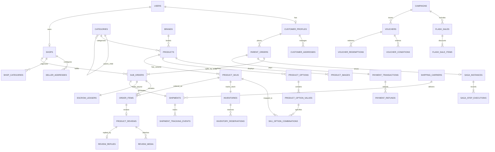

# THIẾT KẾ CƠ SỞ DỮ LIỆU & DATA MODELS (DATABASE & ERD SPECIFICATION)
**Hệ thống:** CommerceFlow Enterprise Multi-vendor Marketplace  
**Kiến trúc:** Database-per-Service Model (PostgreSQL 16 Enterprise)  
**Phiên bản:** 2.0.0 (Comprehensive E-Commerce Specification)  

---

## 1. TỔNG QUAN HỆ THỐNG CƠ SỞ DỮ LIỆU & BOUNDED CONTEXTS

Hệ thống CommerceFlow được thiết kế theo mô hình **Database-per-Service**, tuân thủ nghiêm ngặt nguyên tắc cô lập dữ liệu (Data Isolation) của kiến trúc Microservices. Mỗi microservice hoàn toàn làm chủ một Database Schema/Instance độc lập. Không cho phép bất kỳ truy vấn chéo schema (Cross-database Join) hoặc chia sẻ Connection Pool nào. Mọi liên kết thực thể liên dịch vụ đều được duy trì qua các định danh bất biến (Logical UUID / Business Key) và được đồng bộ dữ liệu thông qua cơ chế Event-Driven (Apache Kafka + Debezium CDC Outbox Pattern).

### Bản đồ Bounded Contexts & Database Instances

| STT | Microservice | Database Name | Trách nhiệm dữ liệu cốt lõi |
|:---:|---|---|---|
| 1 | **Customer & Identity** | `commerceflow_customer_db` | Tài khoản, hồ sơ khách hàng, phân hạng loyalty, sổ địa chỉ nhận hàng |
| 2 | **Seller & Shop** | `commerceflow_seller_db` | Hồ sơ gian hàng, chứng nhận Mall/Yêu thích, kho lấy hàng, danh mục shop |
| 3 | **Product Catalog** | `commerceflow_product_db` | Cây danh mục, thương hiệu, sản phẩm gốc (SPU), biến thể (SKU), thuộc tính trưng bày |
| 4 | **Inventory Service** | `commerceflow_inventory_db` | Tồn kho vật lý, tồn kho khả dụng, phiên khóa kho (Reservations), Audit Logs |
| 5 | **Order Service** | `commerceflow_order_db` | Vòng đời đơn hàng cha (Parent Order), đơn hàng con theo shop (Sub-Orders), Items |
| 6 | **Order Orchestrator** | `commerceflow_orchestrator_db` | Quản lý phiên Saga phân tán, nhật ký từng bước thực thi (Step Executions) |
| 7 | **Payment Service** | `commerceflow_payment_db` | Giao dịch thanh toán cổng, tài khoản ký quỹ người bán (Escrow Ledger), Hoàn tiền |
| 8 | **Promotion Service** | `commerceflow_promotion_db` | Chiến dịch Campaign, Flash Sale, Voucher sàn/shop, điều kiện áp dụng, hạn ngạch |
| 9 | **Shipping Service** | `commerceflow_shipping_db` | Đơn vị vận chuyển (Carriers), biểu phí, vận đơn (Shipments), lịch trình lộ trình |
| 10 | **Review Service** | `commerceflow_review_db` | Đánh giá sao, nhận xét sản phẩm, ảnh/video feedback, phản hồi của Shop |
| 11 | **Cart Service** | `Redis Cache (Cluster)` | Lưu trữ giỏ hàng linh hoạt `cart:{customerId}` với TTL 30 ngày (Sub-5ms) |

---

## 2. SƠ ĐỒ THỰC THỂ QUAN HỆ TỔNG THỂ (LOGICAL ERD)



---

## 3. DATABASE DDL SCHEMAS CHI TIẾT THEO TỪNG MICROSERVICE

### 3.1. Customer & Identity Service Database (`commerceflow_customer_db`)

```sql
-- Bảng Tài khoản người dùng (Xác thực và Ủy quyền cơ sở)
CREATE TABLE users (
    id UUID PRIMARY KEY DEFAULT gen_random_uuid(),
    phone_number VARCHAR(20) NOT NULL UNIQUE,
    email VARCHAR(128) UNIQUE,
    password_hash VARCHAR(255) NOT NULL,
    role VARCHAR(32) NOT NULL DEFAULT 'CUSTOMER', -- CUSTOMER, SELLER, ADMIN
    status VARCHAR(32) NOT NULL DEFAULT 'ACTIVE', -- ACTIVE, LOCKED, SUSPENDED
    created_at TIMESTAMPTZ NOT NULL DEFAULT NOW(),
    updated_at TIMESTAMPTZ NOT NULL DEFAULT NOW()
);

-- Hồ sơ Khách hàng & Loyalty
CREATE TABLE customer_profiles (
    customer_id UUID PRIMARY KEY REFERENCES users(id) ON DELETE CASCADE,
    full_name VARCHAR(128) NOT NULL,
    avatar_url VARCHAR(512),
    gender VARCHAR(16), -- MALE, FEMALE, OTHER
    date_of_birth DATE,
    loyalty_tier VARCHAR(32) NOT NULL DEFAULT 'BRONZE', -- BRONZE, SILVER, GOLD, PLATINUM
    reward_points INT NOT NULL DEFAULT 0 CHECK (reward_points >= 0),
    created_at TIMESTAMPTZ NOT NULL DEFAULT NOW(),
    updated_at TIMESTAMPTZ NOT NULL DEFAULT NOW()
);

-- Sổ địa chỉ nhận hàng của Khách hàng
CREATE TABLE customer_addresses (
    id UUID PRIMARY KEY DEFAULT gen_random_uuid(),
    customer_id UUID NOT NULL REFERENCES users(id) ON DELETE CASCADE,
    receiver_name VARCHAR(128) NOT NULL,
    phone_number VARCHAR(20) NOT NULL,
    province_city VARCHAR(100) NOT NULL,
    district VARCHAR(100) NOT NULL,
    ward VARCHAR(100) NOT NULL,
    street_address VARCHAR(255) NOT NULL,
    postal_code VARCHAR(16),
    latitude NUMERIC(10, 7),
    longitude NUMERIC(10, 7),
    is_default BOOLEAN NOT NULL DEFAULT FALSE,
    created_at TIMESTAMPTZ NOT NULL DEFAULT NOW(),
    updated_at TIMESTAMPTZ NOT NULL DEFAULT NOW()
);

CREATE INDEX idx_customer_addresses_cid ON customer_addresses(customer_id);
```

---

### 3.2. Seller & Shop Service Database (`commerceflow_seller_db`)

```sql
-- Bảng Hồ sơ Gian hàng / Người bán
CREATE TABLE shops (
    id UUID PRIMARY KEY DEFAULT gen_random_uuid(),
    user_id UUID NOT NULL UNIQUE, -- Liên kết logic với users.id tại Auth
    shop_name VARCHAR(128) NOT NULL UNIQUE,
    shop_slug VARCHAR(150) NOT NULL UNIQUE,
    logo_url VARCHAR(512),
    banner_url VARCHAR(512),
    description TEXT,
    shop_type VARCHAR(32) NOT NULL DEFAULT 'STANDARD', -- STANDARD, FAVORITE, MALL
    status VARCHAR(32) NOT NULL DEFAULT 'ACTIVE',      -- PENDING_APPROVAL, ACTIVE, SUSPENDED, CLOSED
    rating_average NUMERIC(3, 2) NOT NULL DEFAULT 5.00,
    rating_count INT NOT NULL DEFAULT 0,
    response_rate INT NOT NULL DEFAULT 100, -- Phần trăm phản hồi chat
    created_at TIMESTAMPTZ NOT NULL DEFAULT NOW(),
    updated_at TIMESTAMPTZ NOT NULL DEFAULT NOW()
);

-- Địa chỉ Kho của Người bán (Kho lấy hàng & Kho trả hàng)
CREATE TABLE seller_addresses (
    id UUID PRIMARY KEY DEFAULT gen_random_uuid(),
    shop_id UUID NOT NULL REFERENCES shops(id) ON DELETE CASCADE,
    address_type VARCHAR(32) NOT NULL, -- PICKUP, RETURN
    contact_name VARCHAR(128) NOT NULL,
    phone_number VARCHAR(20) NOT NULL,
    province_city VARCHAR(100) NOT NULL,
    district VARCHAR(100) NOT NULL,
    ward VARCHAR(100) NOT NULL,
    street_address VARCHAR(255) NOT NULL,
    latitude NUMERIC(10, 7),
    longitude NUMERIC(10, 7),
    is_default BOOLEAN NOT NULL DEFAULT FALSE,
    created_at TIMESTAMPTZ NOT NULL DEFAULT NOW()
);

CREATE INDEX idx_seller_addresses_shop ON seller_addresses(shop_id);

-- Danh mục phân loại do Shop tự tạo để trưng bày trên trang cá nhân
CREATE TABLE shop_categories (
    id UUID PRIMARY KEY DEFAULT gen_random_uuid(),
    shop_id UUID NOT NULL REFERENCES shops(id) ON DELETE CASCADE,
    name VARCHAR(128) NOT NULL,
    display_order INT NOT NULL DEFAULT 0,
    is_active BOOLEAN NOT NULL DEFAULT TRUE,
    created_at TIMESTAMPTZ NOT NULL DEFAULT NOW()
);
```

---

### 3.3. Product Catalog & Display Service Database (`commerceflow_product_db`)

```sql
-- Cây danh mục ngành hàng toàn sàn (Multi-level Categories)
CREATE TABLE categories (
    id UUID PRIMARY KEY DEFAULT gen_random_uuid(),
    parent_id UUID REFERENCES categories(id) ON DELETE RESTRICT,
    name VARCHAR(128) NOT NULL,
    slug VARCHAR(150) NOT NULL UNIQUE,
    level INT NOT NULL DEFAULT 1, -- 1: Ngành hàng lớn, 2: Nhóm hàng, 3: Chi tiết
    icon_url VARCHAR(512),
    display_order INT NOT NULL DEFAULT 0,
    is_active BOOLEAN NOT NULL DEFAULT TRUE,
    created_at TIMESTAMPTZ NOT NULL DEFAULT NOW()
);

CREATE INDEX idx_categories_parent ON categories(parent_id);

-- Danh mục Thương hiệu (Brands & Shopee Mall verification)
CREATE TABLE brands (
    id UUID PRIMARY KEY DEFAULT gen_random_uuid(),
    name VARCHAR(128) NOT NULL UNIQUE,
    slug VARCHAR(150) NOT NULL UNIQUE,
    logo_url VARCHAR(512),
    is_mall_brand BOOLEAN NOT NULL DEFAULT FALSE,
    status VARCHAR(32) NOT NULL DEFAULT 'ACTIVE',
    created_at TIMESTAMPTZ NOT NULL DEFAULT NOW()
);

-- Sản phẩm Gốc (SPU - Standard Product Unit: Quản lý thông tin trưng bày chung)
CREATE TABLE products (
    id UUID PRIMARY KEY DEFAULT gen_random_uuid(),
    shop_id UUID NOT NULL,       -- Liên kết logic sang shops.id
    category_id UUID NOT NULL REFERENCES categories(id),
    brand_id UUID REFERENCES brands(id),
    name VARCHAR(255) NOT NULL,
    slug VARCHAR(300) NOT NULL,
    short_description VARCHAR(500),
    description TEXT NOT NULL,
    condition VARCHAR(32) NOT NULL DEFAULT 'NEW', -- NEW, REFURBISHED, USED
    warranty_months INT DEFAULT 0,
    status VARCHAR(32) NOT NULL DEFAULT 'ACTIVE', -- DRAFT, PENDING, ACTIVE, REJECTED, BANNED
    created_at TIMESTAMPTZ NOT NULL DEFAULT NOW(),
    updated_at TIMESTAMPTZ NOT NULL DEFAULT NOW()
);

CREATE INDEX idx_products_shop ON products(shop_id);
CREATE INDEX idx_products_category ON products(category_id);
CREATE INDEX idx_products_status ON products(status);

-- Hình ảnh & Video trưng bày của Sản phẩm
CREATE TABLE product_images (
    id UUID PRIMARY KEY DEFAULT gen_random_uuid(),
    product_id UUID NOT NULL REFERENCES products(id) ON DELETE CASCADE,
    image_url VARCHAR(512) NOT NULL,
    is_primary BOOLEAN NOT NULL DEFAULT FALSE,
    display_order INT NOT NULL DEFAULT 0,
    created_at TIMESTAMPTZ NOT NULL DEFAULT NOW()
);

CREATE INDEX idx_product_images_prod ON product_images(product_id);

-- Nhóm phân loại biến thể sản phẩm (Option Groups: Màu sắc, Kích cỡ)
CREATE TABLE product_options (
    id UUID PRIMARY KEY DEFAULT gen_random_uuid(),
    product_id UUID NOT NULL REFERENCES products(id) ON DELETE CASCADE,
    name VARCHAR(64) NOT NULL, -- Ví dụ: "Màu sắc", "Kích cỡ"
    display_order INT NOT NULL DEFAULT 0
);

-- Giá trị phân loại cụ thể (Option Values: Đen, Trắng, S, M, XL)
CREATE TABLE product_option_values (
    id UUID PRIMARY KEY DEFAULT gen_random_uuid(),
    option_id UUID NOT NULL REFERENCES product_options(id) ON DELETE CASCADE,
    value_name VARCHAR(64) NOT NULL,
    image_url VARCHAR(512) -- Hình ảnh minh họa theo phân loại (ảnh giày màu đen)
);

-- Biến thể bán hàng thực tế (SKU - Stock Keeping Unit)
CREATE TABLE product_skus (
    id VARCHAR(64) PRIMARY KEY, -- SKU Code dạng 'SKU-SHOP1-PROD1-BLACK-L'
    product_id UUID NOT NULL REFERENCES products(id) ON DELETE CASCADE,
    shop_id UUID NOT NULL,
    sku_name VARCHAR(255) NOT NULL,
    original_price NUMERIC(15, 2) NOT NULL,
    sale_price NUMERIC(15, 2) NOT NULL,
    barcode VARCHAR(64),
    weight_grams INT NOT NULL DEFAULT 200 CHECK (weight_grams > 0),
    length_cm INT NOT NULL DEFAULT 10,
    width_cm INT NOT NULL DEFAULT 10,
    height_cm INT NOT NULL DEFAULT 10,
    status VARCHAR(32) NOT NULL DEFAULT 'ACTIVE', -- ACTIVE, INACTIVE
    created_at TIMESTAMPTZ NOT NULL DEFAULT NOW(),
    updated_at TIMESTAMPTZ NOT NULL DEFAULT NOW()
);

CREATE INDEX idx_skus_product ON product_skus(product_id);
CREATE INDEX idx_skus_shop ON product_skus(shop_id);

-- Bảng ánh xạ kết hợp Option Values để tạo ra một SKU
CREATE TABLE sku_option_combinations (
    id UUID PRIMARY KEY DEFAULT gen_random_uuid(),
    sku_id VARCHAR(64) NOT NULL REFERENCES product_skus(id) ON DELETE CASCADE,
    option_value_id UUID NOT NULL REFERENCES product_option_values(id) ON DELETE CASCADE,
    CONSTRAINT uq_sku_option UNIQUE (sku_id, option_value_id)
);
```

---

### 3.4. Inventory Service Database (`commerceflow_inventory_db`)

```sql
-- Tồn kho vật lý và Tồn kho khả dụng của từng SKU
CREATE TABLE inventories (
    sku_id VARCHAR(64) PRIMARY KEY,
    seller_id UUID NOT NULL,
    physical_quantity INT NOT NULL DEFAULT 0 CHECK (physical_quantity >= 0),
    reserved_quantity INT NOT NULL DEFAULT 0 CHECK (reserved_quantity >= 0),
    version BIGINT NOT NULL DEFAULT 0,
    created_at TIMESTAMPTZ NOT NULL DEFAULT NOW(),
    updated_at TIMESTAMPTZ NOT NULL DEFAULT NOW(),
    CONSTRAINT chk_stock_integrity CHECK (physical_quantity >= reserved_quantity)
);

CREATE INDEX idx_inventories_seller ON inventories(seller_id);

-- Phiên khóa giữ tồn kho tạm thời (Inventory Reservation) trong tiến trình Checkout/Saga
CREATE TABLE inventory_reservations (
    id UUID PRIMARY KEY DEFAULT gen_random_uuid(),
    order_id UUID NOT NULL,
    sku_id VARCHAR(64) NOT NULL REFERENCES inventories(sku_id),
    quantity INT NOT NULL CHECK (quantity > 0),
    status VARCHAR(32) NOT NULL, -- PENDING, RESERVED, COMMITTED, RELEASED, EXPIRED
    expires_at TIMESTAMPTZ NOT NULL,
    created_at TIMESTAMPTZ NOT NULL DEFAULT NOW(),
    updated_at TIMESTAMPTZ NOT NULL DEFAULT NOW()
);

CREATE INDEX idx_inv_res_order_id ON inventory_reservations(order_id);
CREATE INDEX idx_inv_res_status_expires ON inventory_reservations(status, expires_at);

-- Nhật ký kiểm toán mọi biến động kho hàng (Audit Trail)
CREATE TABLE inventory_audit_logs (
    id UUID PRIMARY KEY DEFAULT gen_random_uuid(),
    sku_id VARCHAR(64) NOT NULL,
    seller_id UUID NOT NULL,
    change_type VARCHAR(32) NOT NULL, -- INBOUND_RESTOCK, RESERVATION_HOLD, COMMIT_DEDUCT, RELEASE_RETURN, MANUAL_ADJUST
    quantity_delta INT NOT NULL,
    balance_physical INT NOT NULL,
    balance_reserved INT NOT NULL,
    reference_id VARCHAR(64) NOT NULL, -- Order ID hoặc Inbound PO Code
    created_at TIMESTAMPTZ NOT NULL DEFAULT NOW()
);

CREATE INDEX idx_inv_audit_sku ON inventory_audit_logs(sku_id);
```

---

### 3.5. Order Service Database (`commerceflow_order_db`)

```sql
-- Đơn hàng Tổng (Parent Order: Đại diện cho 1 lần bấm Thanh toán của Khách hàng)
CREATE TABLE parent_orders (
    id UUID PRIMARY KEY DEFAULT gen_random_uuid(),
    customer_id UUID NOT NULL,
    status VARCHAR(32) NOT NULL, -- PENDING_VALIDATION, PENDING_PAYMENT, CONFIRMED, CANCELLED, EXPIRED, COMPLETED
    total_amount NUMERIC(15, 2) NOT NULL,
    discount_amount NUMERIC(15, 2) NOT NULL DEFAULT 0.00,
    shipping_fee NUMERIC(15, 2) NOT NULL DEFAULT 0.00,
    grand_total NUMERIC(15, 2) NOT NULL, -- (total_amount - discount_amount + shipping_fee)
    payment_method VARCHAR(32) NOT NULL, -- COD, WALLET, VNPAY, MOMO
    idempotency_key VARCHAR(64) NOT NULL,
    shipping_address_snapshot JSONB NOT NULL, -- Lưu cứng địa chỉ nhận hàng tại thời điểm đặt
    version BIGINT NOT NULL DEFAULT 0,
    created_at TIMESTAMPTZ NOT NULL DEFAULT NOW(),
    updated_at TIMESTAMPTZ NOT NULL DEFAULT NOW(),
    CONSTRAINT uq_customer_idempotency UNIQUE (customer_id, idempotency_key)
);

CREATE INDEX idx_parent_orders_customer ON parent_orders(customer_id);
CREATE INDEX idx_parent_orders_status ON parent_orders(status);

-- Đơn hàng Con theo Shop (Sub-Orders: Mỗi Shop nhận 1 đơn riêng để đóng gói & giao)
CREATE TABLE sub_orders (
    id UUID PRIMARY KEY DEFAULT gen_random_uuid(),
    parent_order_id UUID NOT NULL REFERENCES parent_orders(id) ON DELETE CASCADE,
    seller_id UUID NOT NULL,
    status VARCHAR(32) NOT NULL, -- PENDING_CONFIRMATION, PROCESSING, READY_TO_SHIP, SHIPPED, DELIVERED, CANCELLED, RETURNED
    subtotal NUMERIC(15, 2) NOT NULL,
    shipping_fee NUMERIC(15, 2) NOT NULL DEFAULT 0.00,
    discount_amount NUMERIC(15, 2) NOT NULL DEFAULT 0.00,
    seller_payout NUMERIC(15, 2) NOT NULL DEFAULT 0.00, -- Số tiền thực trả shop sau trừ hoa hồng sàn
    waybill_code VARCHAR(64),
    created_at TIMESTAMPTZ NOT NULL DEFAULT NOW(),
    updated_at TIMESTAMPTZ NOT NULL DEFAULT NOW()
);

CREATE INDEX idx_sub_orders_parent ON sub_orders(parent_order_id);
CREATE INDEX idx_sub_orders_seller ON sub_orders(seller_id);
CREATE INDEX idx_sub_orders_status ON sub_orders(status);

-- Chi tiết từng mặt hàng trong đơn con (Order Items)
CREATE TABLE order_items (
    id UUID PRIMARY KEY DEFAULT gen_random_uuid(),
    sub_order_id UUID NOT NULL REFERENCES sub_orders(id) ON DELETE CASCADE,
    sku_id VARCHAR(64) NOT NULL,
    product_id UUID NOT NULL,
    product_name VARCHAR(255) NOT NULL,
    sku_name VARCHAR(255) NOT NULL,
    product_image_url VARCHAR(512),
    quantity INT NOT NULL CHECK (quantity > 0),
    unit_price NUMERIC(15, 2) NOT NULL,
    total_price NUMERIC(15, 2) NOT NULL,
    created_at TIMESTAMPTZ NOT NULL DEFAULT NOW()
);

CREATE INDEX idx_order_items_sub_order ON order_items(sub_order_id);
```

---

### 3.6. Saga Orchestrator Service Database (`commerceflow_orchestrator_db`)

```sql
-- Thực thể phiên Saga phân tán
CREATE TABLE saga_instances (
    id UUID PRIMARY KEY DEFAULT gen_random_uuid(),
    saga_type VARCHAR(64) NOT NULL, -- CHECKOUT_SAGA, ORDER_CANCEL_SAGA, REFUND_SAGA
    correlation_id VARCHAR(64) NOT NULL UNIQUE,
    order_id UUID NOT NULL,
    status VARCHAR(32) NOT NULL,    -- STARTED, IN_PROGRESS, COMPLETED, COMPENSATING, FAILED
    current_step VARCHAR(64) NOT NULL,
    payload JSONB NOT NULL,
    error_message TEXT,
    created_at TIMESTAMPTZ NOT NULL DEFAULT NOW(),
    updated_at TIMESTAMPTZ NOT NULL DEFAULT NOW()
);

CREATE INDEX idx_saga_status ON saga_instances(status);
CREATE INDEX idx_saga_order ON saga_instances(order_id);

-- Nhật ký từng bước thực thi (Command & Event Response Log)
CREATE TABLE saga_step_executions (
    id UUID PRIMARY KEY DEFAULT gen_random_uuid(),
    saga_instance_id UUID NOT NULL REFERENCES saga_instances(id) ON DELETE CASCADE,
    step_name VARCHAR(64) NOT NULL,      -- RESERVE_STOCK, APPLY_PROMOTION, INITIATE_PAYMENT
    target_service VARCHAR(64) NOT NULL, -- inventory-service, promotion-service, payment-service
    status VARCHAR(32) NOT NULL,         -- PENDING, SUCCESS, FAILED, COMPENSATING, COMPENSATED
    request_payload JSONB,
    response_payload JSONB,
    retry_count INT NOT NULL DEFAULT 0,
    error_detail TEXT,
    started_at TIMESTAMPTZ NOT NULL DEFAULT NOW(),
    completed_at TIMESTAMPTZ
);

CREATE INDEX idx_saga_steps_instance ON saga_step_executions(saga_instance_id);
```

---

### 3.7. Payment Service Database (`commerceflow_payment_db`)

```sql
-- Giao dịch Thanh toán Đơn hàng
CREATE TABLE payment_transactions (
    id UUID PRIMARY KEY DEFAULT gen_random_uuid(),
    order_id UUID NOT NULL UNIQUE,
    gateway_transaction_id VARCHAR(128) UNIQUE,
    amount NUMERIC(15, 2) NOT NULL,
    currency VARCHAR(8) NOT NULL DEFAULT 'VND',
    status VARCHAR(32) NOT NULL, -- INITIATED, PENDING, AUTHORIZED, CAPTURED, FAILED, REFUNDED
    payment_method VARCHAR(32) NOT NULL,
    raw_response JSONB,
    created_at TIMESTAMPTZ NOT NULL DEFAULT NOW(),
    updated_at TIMESTAMPTZ NOT NULL DEFAULT NOW()
);

-- Ký quỹ người bán (Escrow Ledger: Giữ tiền đến khi người mua nhận hàng thành công)
CREATE TABLE escrow_ledgers (
    id UUID PRIMARY KEY DEFAULT gen_random_uuid(),
    sub_order_id UUID NOT NULL UNIQUE,
    seller_id UUID NOT NULL,
    net_payout_amount NUMERIC(15, 2) NOT NULL,
    platform_fee NUMERIC(15, 2) NOT NULL,
    status VARCHAR(32) NOT NULL, -- HELD, RELEASED_TO_SELLER, REFUNDED_TO_BUYER
    release_due_at TIMESTAMPTZ NOT NULL,
    settled_at TIMESTAMPTZ,
    created_at TIMESTAMPTZ NOT NULL DEFAULT NOW()
);

CREATE INDEX idx_escrow_seller ON escrow_ledgers(seller_id);
CREATE INDEX idx_escrow_status_due ON escrow_ledgers(status, release_due_at);

-- Nhật ký hoàn tiền giao dịch (Refunds)
CREATE TABLE payment_refunds (
    id UUID PRIMARY KEY DEFAULT gen_random_uuid(),
    order_id UUID NOT NULL,
    sub_order_id UUID,
    refund_gateway_id VARCHAR(128) UNIQUE,
    amount NUMERIC(15, 2) NOT NULL,
    reason VARCHAR(255) NOT NULL,
    status VARCHAR(32) NOT NULL, -- REQUESTED, PROCESSING, COMPLETED, REJECTED
    created_at TIMESTAMPTZ NOT NULL DEFAULT NOW()
);
```

---

### 3.8. Promotion & Flash Sale Service Database (`commerceflow_promotion_db`)

```sql
-- Chiến dịch Marketing (Campaign: 11.11 Mega Sale, Lương Về Sale...)
CREATE TABLE campaigns (
    id UUID PRIMARY KEY DEFAULT gen_random_uuid(),
    title VARCHAR(255) NOT NULL,
    slug VARCHAR(255) NOT NULL UNIQUE,
    banner_url VARCHAR(512),
    start_time TIMESTAMPTZ NOT NULL,
    end_time TIMESTAMPTZ NOT NULL,
    status VARCHAR(32) NOT NULL DEFAULT 'UPCOMING', -- UPCOMING, ACTIVE, PAUSED, ENDED
    created_at TIMESTAMPTZ NOT NULL DEFAULT NOW()
);

-- Bảng Mã giảm giá (Vouchers / Coupons: Hỗ trợ cả Voucher Sàn và Voucher Shop)
CREATE TABLE vouchers (
    id UUID PRIMARY KEY DEFAULT gen_random_uuid(),
    campaign_id UUID REFERENCES campaigns(id),
    seller_id UUID, -- NULL: Voucher Sàn toàn hệ thống; NOT NULL: Voucher riêng của Shop
    code VARCHAR(64) NOT NULL UNIQUE,
    name VARCHAR(255) NOT NULL,
    discount_type VARCHAR(32) NOT NULL, -- PERCENTAGE, FIXED_AMOUNT, FREESHIP
    discount_value NUMERIC(15, 2) NOT NULL,
    max_discount_amount NUMERIC(15, 2), -- Mức giảm tối đa nếu tính theo %
    min_spend NUMERIC(15, 2) NOT NULL DEFAULT 0.00,
    total_usage_limit INT NOT NULL DEFAULT 1000,
    current_usage_count INT NOT NULL DEFAULT 0,
    per_user_limit INT NOT NULL DEFAULT 1,
    valid_from TIMESTAMPTZ NOT NULL,
    expires_at TIMESTAMPTZ NOT NULL,
    is_active BOOLEAN NOT NULL DEFAULT TRUE,
    created_at TIMESTAMPTZ NOT NULL DEFAULT NOW(),
    CONSTRAINT chk_voucher_usage CHECK (current_usage_count <= total_usage_limit)
);

CREATE INDEX idx_vouchers_code ON vouchers(code);
CREATE INDEX idx_vouchers_seller ON vouchers(seller_id);

-- Điều kiện ràng buộc áp dụng Voucher (Conditions)
CREATE TABLE voucher_conditions (
    id UUID PRIMARY KEY DEFAULT gen_random_uuid(),
    voucher_id UUID NOT NULL REFERENCES vouchers(id) ON DELETE CASCADE,
    condition_type VARCHAR(64) NOT NULL, -- APPLICABLE_CATEGORY, REQUIRED_PAYMENT_METHOD, MIN_LOYALTY_TIER
    condition_value JSONB NOT NULL       -- Ví dụ: {"category_ids": ["uuid-1", "uuid-2"]}
);

-- Nhật ký đặt trước và sử dụng Voucher trong tiến trình Checkout
CREATE TABLE voucher_redemptions (
    id UUID PRIMARY KEY DEFAULT gen_random_uuid(),
    voucher_id UUID NOT NULL REFERENCES vouchers(id),
    customer_id UUID NOT NULL,
    order_id UUID NOT NULL,
    discount_amount NUMERIC(15, 2) NOT NULL,
    status VARCHAR(32) NOT NULL, -- RESERVED, COMMITTED, CANCELLED
    redeemed_at TIMESTAMPTZ NOT NULL DEFAULT NOW()
);

CREATE INDEX idx_voucher_redemp_cust ON voucher_redemptions(customer_id, voucher_id);

-- Quản lý Phiên Flash Sale theo khung giờ vàng
CREATE TABLE flash_sales (
    id UUID PRIMARY KEY DEFAULT gen_random_uuid(),
    campaign_id UUID REFERENCES campaigns(id),
    title VARCHAR(128) NOT NULL, -- "Flash Sale 0h - 9h"
    start_time TIMESTAMPTZ NOT NULL,
    end_time TIMESTAMPTZ NOT NULL,
    status VARCHAR(32) NOT NULL DEFAULT 'SCHEDULED', -- SCHEDULED, ACTIVE, ENDED
    created_at TIMESTAMPTZ NOT NULL DEFAULT NOW()
);

-- Sản phẩm đăng ký tham gia Flash Sale với giá và số lượng đặc biệt
CREATE TABLE flash_sale_items (
    id UUID PRIMARY KEY DEFAULT gen_random_uuid(),
    flash_sale_id UUID NOT NULL REFERENCES flash_sales(id) ON DELETE CASCADE,
    sku_id VARCHAR(64) NOT NULL,
    flash_sale_price NUMERIC(15, 2) NOT NULL,
    stock_allocated INT NOT NULL CHECK (stock_allocated > 0),
    stock_sold INT NOT NULL DEFAULT 0,
    user_purchase_limit INT NOT NULL DEFAULT 1,
    created_at TIMESTAMPTZ NOT NULL DEFAULT NOW(),
    CONSTRAINT uq_flash_sale_sku UNIQUE (flash_sale_id, sku_id),
    CONSTRAINT chk_flash_stock CHECK (stock_sold <= stock_allocated)
);
```

---

### 3.9. Shipping & Fulfillment Service Database (`commerceflow_shipping_db`)

```sql
-- Đối tác Vận chuyển liên kết (Logistics Providers: SPX Express, GHN, GHTK...)
CREATE TABLE shipping_carriers (
    id UUID PRIMARY KEY DEFAULT gen_random_uuid(),
    carrier_code VARCHAR(32) NOT NULL UNIQUE, -- SPX, GHN, GHTK, VTPOST
    carrier_name VARCHAR(128) NOT NULL,
    contact_hotline VARCHAR(20),
    api_endpoint VARCHAR(255),
    is_active BOOLEAN NOT NULL DEFAULT TRUE,
    created_at TIMESTAMPTZ NOT NULL DEFAULT NOW()
);

-- Vận đơn giao hàng cho từng Sub-Order (Shipments)
CREATE TABLE shipments (
    id UUID PRIMARY KEY DEFAULT gen_random_uuid(),
    sub_order_id UUID NOT NULL UNIQUE,
    carrier_id UUID NOT NULL REFERENCES shipping_carriers(id),
    waybill_number VARCHAR(64) NOT NULL UNIQUE,
    status VARCHAR(32) NOT NULL, -- CREATED, PICKED_UP, IN_TRANSIT, OUT_FOR_DELIVERY, DELIVERED, FAILED, RETURNED
    pickup_address_snapshot JSONB NOT NULL,
    delivery_address_snapshot JSONB NOT NULL,
    package_weight_grams INT NOT NULL,
    cod_amount NUMERIC(15, 2) NOT NULL DEFAULT 0.00,
    shipping_fee NUMERIC(15, 2) NOT NULL,
    estimated_delivery_at TIMESTAMPTZ,
    actual_delivery_at TIMESTAMPTZ,
    created_at TIMESTAMPTZ NOT NULL DEFAULT NOW(),
    updated_at TIMESTAMPTZ NOT NULL DEFAULT NOW()
);

CREATE INDEX idx_shipments_carrier ON shipments(carrier_id);
CREATE INDEX idx_shipments_waybill ON shipments(waybill_number);

-- Lịch sử lộ trình chi tiết của Vận đơn (Tracking Events)
CREATE TABLE shipment_tracking_events (
    id UUID PRIMARY KEY DEFAULT gen_random_uuid(),
    shipment_id UUID NOT NULL REFERENCES shipments(id) ON DELETE CASCADE,
    event_status VARCHAR(64) NOT NULL, -- WAREHOUSE_RECEIVED, DISPATCHED, HUB_SORTING, DELIVERED
    hub_location VARCHAR(255),
    event_description TEXT NOT NULL,
    occurred_at TIMESTAMPTZ NOT NULL,
    created_at TIMESTAMPTZ NOT NULL DEFAULT NOW()
);

CREATE INDEX idx_tracking_shipment ON shipment_tracking_events(shipment_id);
```

---

### 3.10. Product Review & Feedback Service Database (`commerceflow_review_db`)

```sql
-- Đánh giá sản phẩm của Khách hàng sau khi nhận hàng thành công
CREATE TABLE product_reviews (
    id UUID PRIMARY KEY DEFAULT gen_random_uuid(),
    order_item_id UUID NOT NULL UNIQUE, -- Mỗi item trong đơn chỉ được đánh giá 1 lần
    product_id UUID NOT NULL,
    sku_id VARCHAR(64) NOT NULL,
    customer_id UUID NOT NULL,
    shop_id UUID NOT NULL,
    rating_star INT NOT NULL CHECK (rating_star BETWEEN 1 AND 5),
    comment TEXT,
    is_anonymous BOOLEAN NOT NULL DEFAULT FALSE,
    is_hidden BOOLEAN NOT NULL DEFAULT FALSE,
    created_at TIMESTAMPTZ NOT NULL DEFAULT NOW(),
    updated_at TIMESTAMPTZ NOT NULL DEFAULT NOW()
);

CREATE INDEX idx_reviews_product ON product_reviews(product_id);
CREATE INDEX idx_reviews_shop ON product_reviews(shop_id);

-- Hình ảnh & Video đính kèm đánh giá (Nhận thêm Shopee Xu)
CREATE TABLE review_media (
    id UUID PRIMARY KEY DEFAULT gen_random_uuid(),
    review_id UUID NOT NULL REFERENCES product_reviews(id) ON DELETE CASCADE,
    media_type VARCHAR(16) NOT NULL, -- IMAGE, VIDEO
    media_url VARCHAR(512) NOT NULL,
    display_order INT NOT NULL DEFAULT 0,
    created_at TIMESTAMPTZ NOT NULL DEFAULT NOW()
);

-- Phản hồi của Shop đối với từng đánh giá
CREATE TABLE review_replies (
    id UUID PRIMARY KEY DEFAULT gen_random_uuid(),
    review_id UUID NOT NULL UNIQUE REFERENCES product_reviews(id) ON DELETE CASCADE,
    shop_id UUID NOT NULL,
    reply_content TEXT NOT NULL,
    created_at TIMESTAMPTZ NOT NULL DEFAULT NOW(),
    updated_at TIMESTAMPTZ NOT NULL DEFAULT NOW()
);
```

---

## 4. CHUẨN OUTBOX & INBOX TRANSACTIONAL PATTERN (ÁP DỤNG TẤT CẢ SERVICE)

Mỗi service đều sở hữu cặp bảng `outbox` và `inbox` chuyên dụng ngay trong schema của mình để đảm bảo mô hình chuyển giao tin cậy qua Kafka kết hợp Debezium CDC:

```sql
-- Bảng Outbox (Lưu cùng Transaction nghiệp vụ, Debezium CDC quét WAL để bắn sang Kafka)
CREATE TABLE <service_name>_outbox (
    id UUID PRIMARY KEY DEFAULT gen_random_uuid(),
    aggregate_type VARCHAR(64) NOT NULL,
    aggregate_id VARCHAR(64) NOT NULL,
    event_type VARCHAR(128) NOT NULL,
    payload JSONB NOT NULL,
    created_at TIMESTAMPTZ NOT NULL DEFAULT NOW()
);

-- Bảng Inbox (Lọc trùng lặp Event tại Consumer, bảo đảm tính Idempotent xử lý chính xác một lần)
CREATE TABLE <service_name>_inbox (
    message_id VARCHAR(64) PRIMARY KEY,
    consumer_group VARCHAR(128) NOT NULL,
    processed_at TIMESTAMPTZ NOT NULL DEFAULT NOW()
);
```

---

## 5. CHIẾN LƯỢC TRANSACTION BOUNDARIES, LOCKING & PARTITIONING

### 5.1. Transaction Isolation Level
* Toàn hệ thống thiết lập mặc định ở mức **`READ COMMITTED`** trên PostgreSQL 16. Mức này tối ưu thông lượng (Throughput) cho các hệ thống e-commerce quy mô lớn và triệt tiêu nguy cơ xảy ra lỗi `SerializationFailureException` thường thấy ở `SERIALIZABLE`.

### 5.2. Kỹ thuật Locking & Concurrency Control
1. **Optimistic Locking (`@Version`)**:
   * Áp dụng tại `parent_orders`, `sub_orders`, `inventories`.
   * Cột `version BIGINT` kiểm tra điều kiện cập nhật: `WHERE id = :id AND version = :currentVersion`.
2. **Conditional Atomic Invariant Update (Chống Overselling Tuyệt đối)**:
   * Loại bỏ hoàn toàn `SELECT FOR UPDATE` giữ lock dài hạn (gây nghẽn thread pool).
   * Thực hiện trừ kho trực tiếp bằng 1 câu lệnh nguyên tử:
     ```sql
     UPDATE inventories 
     SET reserved_quantity = reserved_quantity + :qty,
         version = version + 1,
         updated_at = NOW()
     WHERE sku_id = :skuId 
       AND (physical_quantity - reserved_quantity) >= :qty;
     ```
   * Nếu `row_affected == 0`, ứng dụng lập tức nhận biết SKU đã hết hàng và kích hoạt Event thất bại mà không tốn công khóa dòng.

### 5.3. Chiến lược Sharding & Phân vùng dữ liệu (Table Partitioning)
* Đối với các bảng có khối lượng giao dịch cực lớn theo thời gian (`parent_orders`, `sub_orders`, `inventory_audit_logs`, `shipment_tracking_events`), áp dụng **PostgreSQL Declarative Range Partitioning** theo tháng (`created_at`):
  ```sql
  CREATE TABLE parent_orders_2026_11 PARTITION OF parent_orders
      FOR VALUES FROM ('2026-11-01 00:00:00+07') TO ('2026-12-01 00:00:00+07');
  ```
* Cơ chế này giúp tối ưu quét chỉ mục (Index Pruning), giải phóng bảng lịch sử cũ và duy trì tốc độ đọc ghi ổn định ngay cả khi sàn tích lũy hàng chục triệu đơn hàng mỗi năm.

---

## 6. QUẢN LÝ ĐỊNH NGHĨA TABLE & MIGRATION TẬP TRUNG TẠI COMMON-MODEL

Nhằm đảm bảo tính toàn vẹn schema, loại bỏ hoàn toàn hiện tượng lệch phiên bản bảng (Schema Drift) và giảm chi phí bảo trì code giữa các microservices, dự án áp dụng chiến lược **Centralized Table Definitions & Migrations** tại module `common-model`.

### 6.1. Quy hoạch Table Entities (`com.commerce.common_model.entity`)

Mọi bảng trong hệ thống đều được định nghĩa thành các thực thể JPA (`@Entity`) tại `common-model/src/main/java/com/commerce/common_model/entity/`:

| STT | Bounded Context | Bảng DDL PostgreSQL | Thực thể Java (JPA Entity) | Class kế thừa / Ghi chú |
|:---:|---|---|---|---|
| 1 | Identity & Customer | `users`, `customer_profiles`, `customer_addresses` | `User`, `CustomerProfile`, `CustomerAddress` | Kế thừa `BaseEntity`, UUIDv7 PK |
| 2 | Seller & Shop | `shops`, `seller_addresses`, `shop_categories` | `Shop`, `SellerAddress`, `ShopCategory` | Kế thừa `BaseEntity` |
| 3 | Product Catalog | `categories`, `brands`, `products`, `product_images`, `product_options`, `product_option_values`, `product_skus`, `sku_option_combinations` | `Category`, `Brand`, `Product`, `ProductImage`, `ProductOption`, `ProductOptionValue`, `ProductSku`, `SkuOptionCombination` | Quan hệ phân cấp SPU-SKU |
| 4 | Inventory | `inventories`, `inventory_reservations`, `inventory_audit_logs` | `Inventory`, `InventoryReservation`, `InventoryAuditLog` | `@Version` Optimistic Locking |
| 5 | Order | `parent_orders`, `sub_orders`, `order_items` | `ParentOrder`, `SubOrder`, `OrderItem` | Idempotency Key, Cascading |
| 6 | Saga Orchestrator | `saga_instances`, `saga_step_executions` | `SagaInstance`, `SagaStepExecution` | JSONB Payload, Step log |
| 7 | Payment & Escrow | `payment_transactions`, `escrow_ledgers`, `payment_refunds` | `PaymentTransaction`, `EscrowLedger`, `PaymentRefund` | Ký quỹ và giao dịch |
| 8 | Promotion | `campaigns`, `vouchers`, `voucher_conditions`, `voucher_redemptions`, `flash_sales`, `flash_sale_items` | `Campaign`, `Voucher`, `VoucherCondition`, `VoucherRedemption`, `FlashSale`, `FlashSaleItem` | Khung giờ Flash Sale, Voucher |
| 9 | Shipping | `shipping_carriers`, `shipments`, `shipment_tracking_events` | `ShippingCarrier`, `Shipment`, `ShipmentTrackingEvent` | Snapshots địa chỉ, vận đơn |
| 10 | Review | `product_reviews`, `review_media`, `review_replies` | `ProductReview`, `ReviewMedia`, `ReviewReply` | Đánh giá & phản hồi shop |

### 6.2. Danh mục Migration Scripts (Flyway Versioned Scripts)

Toàn bộ các tệp SQL migration được đặt tại thư mục `common-model/src/main/resources/db/migration/`:
- `V1__init_customer_identity_schema.sql`
- `V2__init_seller_shop_schema.sql`
- `V3__init_product_catalog_schema.sql`
- `V4__init_inventory_schema.sql`
- `V5__init_order_schema.sql`
- `V6__init_saga_orchestrator_schema.sql`
- `V7__init_payment_schema.sql`
- `V8__init_promotion_schema.sql`
- `V9__init_shipping_schema.sql`
- `V10__init_review_schema.sql`

### 6.3. Quy trình thực thi Migration
1. **Lệnh Maven CLI**:
   ```bash
   mvn flyway:migrate -pl common-model
   ```
2. **Java Migration Runner**:
   ```bash
   mvn compile exec:java -pl common-model -Dexec.mainClass="com.commerce.common_model.migration.DatabaseMigrationRunner"
   ```
3. **Các Microservices sử dụng**:
   Các project `api-service`, `event-consumer`, `saga-orchestrator` khai báo dependency `common-model`, cấu hình `@EntityScan(basePackages = "com.commerce.common_model.entity")` và trực tiếp tiêm (inject) các Repository JPA thao tác với dữ liệu.
