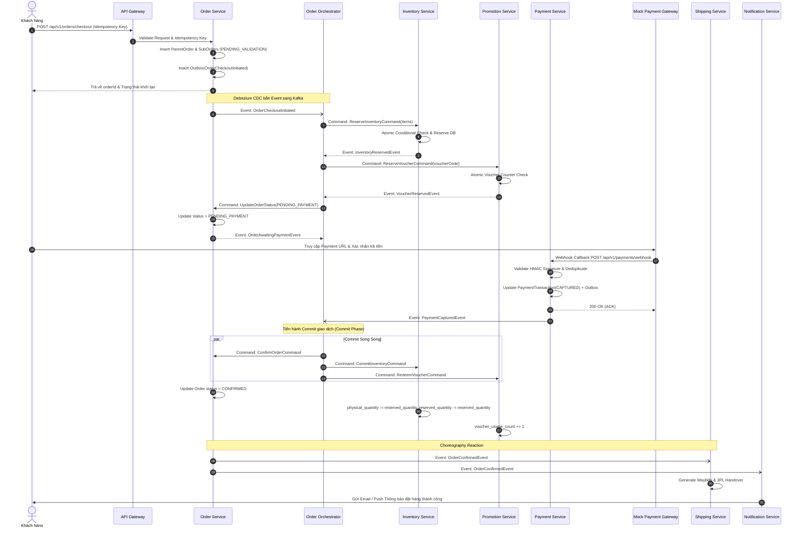
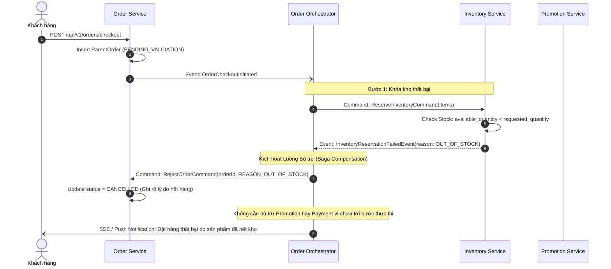
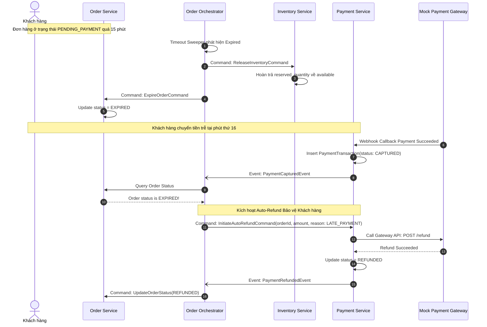
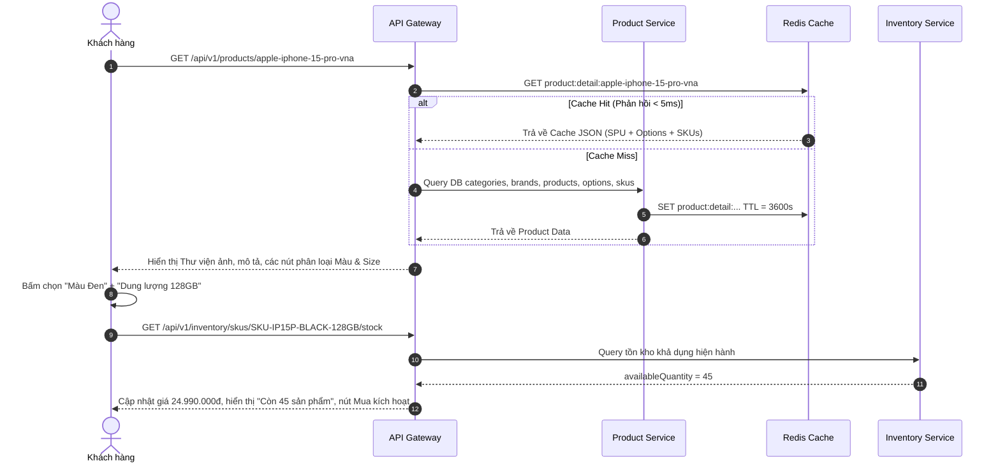
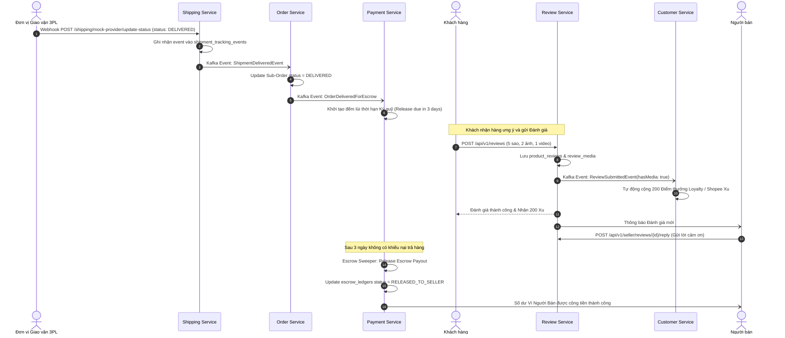

# SƠ ĐỒ TUẦN TỰ CÁC LUỒNG TRỌNG YẾU (SEQUENCE DIAGRAMS)
**Hệ thống:** CommerceFlow Enterprise Multi-vendor Marketplace  
**Kiến trúc:** Microservices, Event-Driven & Saga Orchestration  
**Phiên bản:** 2.0.0 (Comprehensive Multi-vendor Marketplace)  

---

## 1. LUỒNG CHECKOUT & THANH TOÁN THÀNH CÔNG (HAPPY PATH)

---

## 2. LUỒNG THẤT BẠI DO HẾT HÀNG & BÙ TRỪ SAGA (COMPENSATION FLOW)

---

## 3. LUỒNG WEBHOOK THANH TOÁN ĐẾN MUỘN SAU KHI ĐƠN HẾT HẠN (LATE PAYMENT & AUTO-REFUND)

---

## 4. LUỒNG TRƯNG BÀY SẢN PHẨM & TƯƠNG TÁC BIẾN THỂ (CATALOG DISPLAY & SKU SELECTION)

---

## 5. LUỒNG GIAO HÀNG, ĐÁNH GIÁ SẢN PHẨM & GIẢI NGÂN KÝ QUỸ (DELIVERY, REVIEW & ESCROW)

