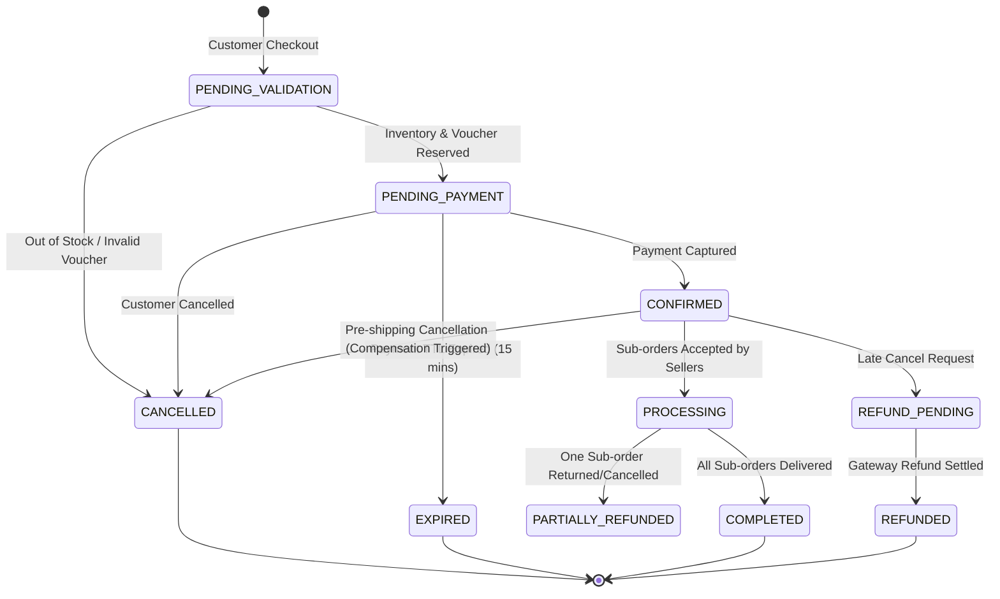
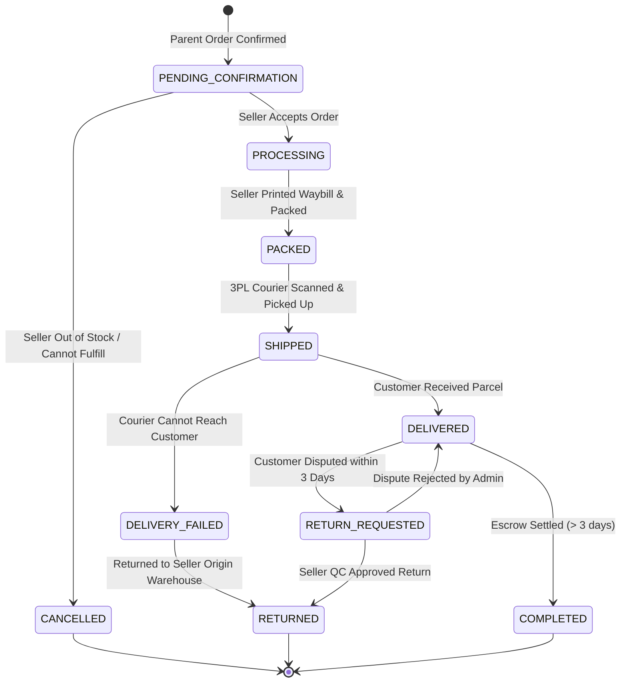
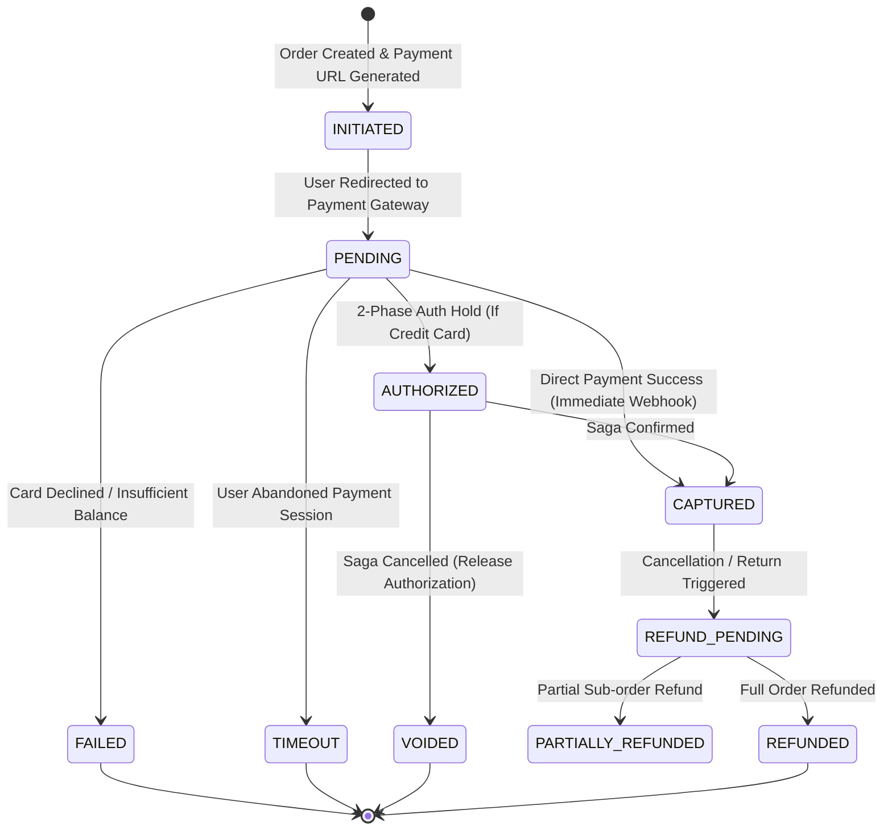
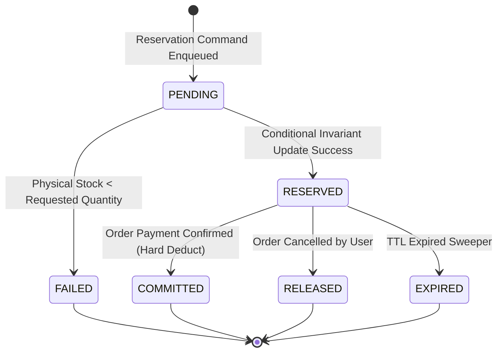
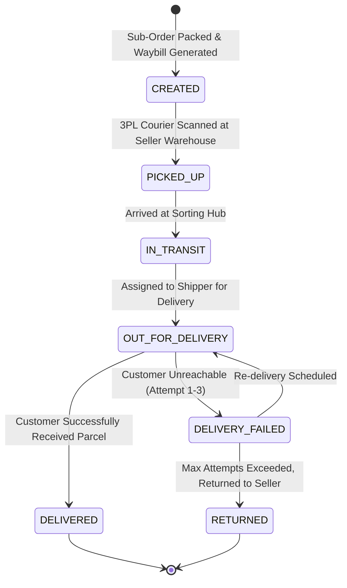
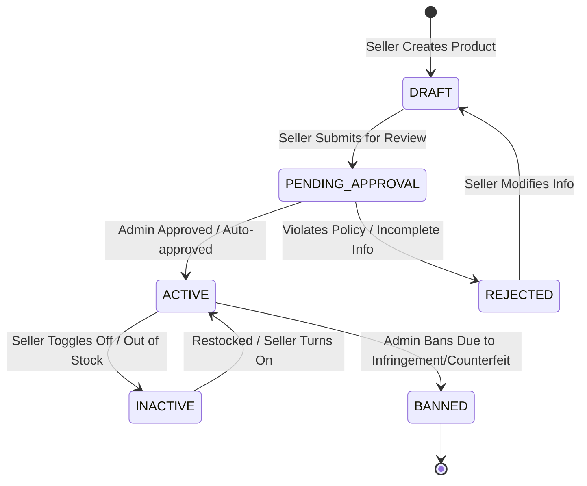

# MÔ HÌNH MÁY TRẠNG THÁI HỆ THỐNG (STATE MACHINES SPECIFICATION)
**Hệ thống:** CommerceFlow Enterprise Multi-vendor Marketplace  
**Kiến trúc:** State Pattern & Distributed State Transition  
**Phiên bản:** 2.0.0 (Comprehensive Shopee-Grade Specification)  

---

## 1. MÁY TRẠNG THÁI ĐƠN HÀNG TỔNG (PARENT ORDER STATE MACHINE)



### Bảng chuyển dịch trạng thái Parent Order (Transition Table)
| Trạng thái nguồn | Sự kiện kích hoạt | Điều kiện bảo vệ (Guards) | Trạng thái đích | Dịch vụ chịu trách nhiệm |
|---|---|---|---|---|
| `PENDING_VALIDATION` | `InventoryReserved` & `VoucherReserved` | Tồn kho và voucher đã giữ chỗ thành công | `PENDING_PAYMENT` | `order-orchestrator` |
| `PENDING_VALIDATION` | `ReservationFailed` | Thiếu hàng hoặc voucher không hợp lệ | `CANCELLED` | `order-orchestrator` |
| `PENDING_PAYMENT` | `PaymentCaptured` | Số tiền khớp 100% với `total_amount` | `CONFIRMED` | `order-orchestrator` |
| `PENDING_PAYMENT` | `PaymentTimeout` | Thời gian vượt quá `expires_at` | `EXPIRED` | `order-orchestrator` |
| `PENDING_PAYMENT` | `CustomerCancelled` | Khách hàng chủ động bấm hủy | `CANCELLED` | `order-service` |
| `CONFIRMED` | `CancelRequested` | Seller chưa chuyển sang trạng thái đóng gói | `REFUND_PENDING` | `order-orchestrator` |
| `REFUND_PENDING` | `PaymentRefunded` | Gateway xác nhận hoàn tiền thành công | `REFUNDED` | `payment-service` |

---

## 2. MÁY TRẠNG THÁI ĐƠN CON CỦA SELLER (SUB-ORDER STATE MACHINE)



---

## 3. MÁY TRẠNG THÁI GIAO DỊCH THANH TOÁN (PAYMENT STATE MACHINE)



---

## 4. MÁY TRẠNG THÁI KHÓA TỒN KHO (INVENTORY RESERVATION STATE MACHINE)



---

## 5. MÁY TRẠNG THÁI VẬN CHUYỂN & VẬN ĐƠN (SHIPMENT STATE MACHINE)



---

## 6. MÁY TRẠNG THÁI VÒNG ĐỜI SẢN PHẨM TRƯNG BÀY (PRODUCT SPU LIFECYCLE)



---

## 7. CƠ CHẾ BẢO VỆ CHUYỂN DỊCH BẤT HỢP PHÁP (ILLEGAL TRANSITION GUARDS)

Nhằm triệt tiêu lỗi Out-of-Order hoặc Race Condition làm sai lệch dữ liệu:
1. **Nghiêm cấm cập nhật ngược**: Không cho phép chuyển từ `CANCELLED` hoặc `EXPIRED` sang `CONFIRMED`.
2. **Nghiêm cấm Refund đơn chưa trả tiền**: Không thể kích hoạt `RefundPaymentCommand` nếu `payment_status != 'CAPTURED'`.
3. **Database Constraint & Enum Check**: Trạng thái được kiểm soát bằng kiểu dữ liệu `VARCHAR` kết hợp `CHECK (status IN (...))` và kiểm tra `@Version` của JPA Entity:
   ```java
   if (!currentState.canTransitionTo(nextState)) {
       throw new IllegalStateTransitionException(
           String.format("Invalid transition from %s to %s for Order %s", 
               currentState, nextState, orderId)
       );
   }
   ```
