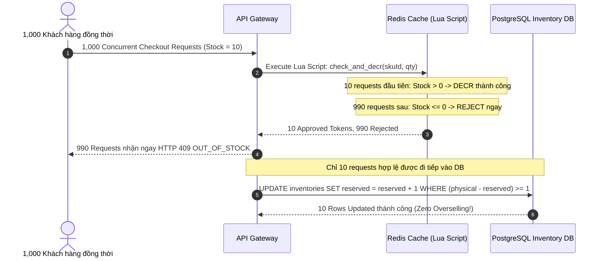
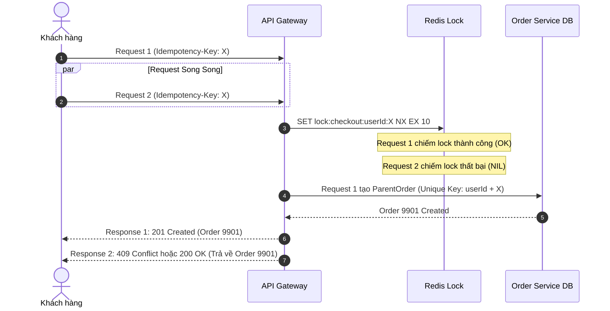
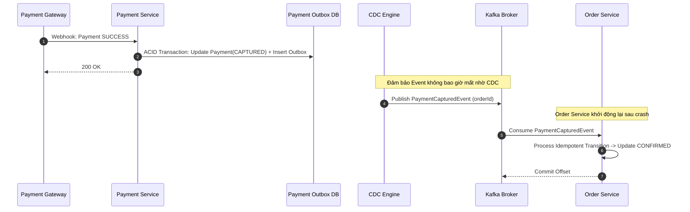

# PHÂN TÍCH CHUYÊN SÂU 12 KỊCH BẢN PHÂN TÁN NÂNG CAO (ADVANCED DISTRIBUTED SCENARIOS)
**Hệ thống:** CommerceFlow Reliability Architecture  
**Phiên bản:** 1.0.0  

---

## SCENARIO 1: FLASH SALE OVERSELLING (BÁN QUÁ SỐ LƯỢNG KHO)

### 1. Business Impact & Root Cause
- **Tác động nghiệp vụ**: Bán âm kho (Negative Stock), không đủ sản phẩm giao cho khách hàng, hủy đơn hàng loạt gây tổn hại uy tín thương hiệu nghiêm trọng và chịu phạt tài chính từ các cơ quan bảo vệ người tiêu dùng.
- **Nguyên nhân gốc rễ**: Tồn kho 10 sản phẩm nhưng có 1,000 requests cùng ập tới trong 100ms. Thao tác kiểm tra số lượng và trừ kho bị tách rời (`SELECT available_quantity` sau đó mới `UPDATE`). 1,000 threads cùng đọc thấy `available_quantity = 10` và cùng thực hiện trừ kho.

### 2. Timeline Diagram


### 3. Technical Solution & Trade-offs
- **Giải pháp kỹ thuật đa tầng**:
  1. *Lớp 1 (Redis Lua In-memory Admission Control)*: Tồn kho Flash Sale được nạp trước vào Redis. Script Lua thực thi nguyên tử:
     ```lua
     local stock = redis.call('get', KEYS[1])
     if not stock or tonumber(stock) < tonumber(ARGV[1]) then
         return 0
     end
     redis.call('decrby', KEYS[1], ARGV[1])
     return 1
     ```
  2. *Lớp 2 (Database Conditional Invariant Update)*:
     ```sql
     UPDATE inventories 
     SET reserved_quantity = reserved_quantity + :qty, version = version + 1
     WHERE sku_id = :skuId AND (physical_quantity - reserved_quantity) >= :qty;
     ```
- **Đánh đổi (Trade-offs)**: Phải duy trì tính đồng bộ giữa Redis và PostgreSQL. Nếu Redis node sập trước khi đồng bộ DB, cần cơ chế reconciliation từ nhật ký giao dịch.

### 4. Database & Kafka Implications
- **Database**: Không sử dụng `SELECT ... FOR UPDATE` kéo dài để tránh cạn kiệt connection pool.
- **Kafka**: Không đẩy toàn bộ 1,000 message thô vào Kafka; chỉ đẩy 10 messages đã được Redis cấp vé hợp lệ.

### 5. Recovery Mechanism & Test Cases
- **Phục hồi**: Background Sync Worker định kỳ đối soát `physical_quantity - reserved_quantity` với giá trị trên Redis.
- **Test Case**: Dùng k6 bắn 1,000 virtual users đồng thời mua SKU có stock = 10. Nghiệm thu: Đúng 10 đơn tạo thành công, 990 đơn bị từ chối, `physical_quantity` trừ đúng 10, vi phạm tồn kho = 0.

---

## SCENARIO 2: CONCURRENT CHECKOUT (ĐẶT ĐƠN TRÙNG LẶP)

### 1. Business Impact & Root Cause
- **Tác động**: Khách hàng bị tạo 2 đơn hàng giống nhau, tài khoản bị trừ tiền 2 lần cho cùng một giỏ hàng.
- **Nguyên nhân**: Mạng lag khiến người dùng click đúp nút "Đặt hàng", hoặc ứng dụng client bị retry tự động khi chưa nhận được response kịp thời.

### 2. Timeline Diagram


### 3. Technical Solution & Database Implications
- Client bắt buộc phải sinh `Idempotency-Key: <UUID>` tại thời điểm mở màn hình checkout.
- Redis Distributed Lock `lock:checkout:{userId}:{idempotencyKey}` chặn request thứ 2 ngay tại Gateway.
- Bảng `parent_orders` có ràng buộc duy nhất: `CONSTRAINT uq_user_idem UNIQUE (customer_id, idempotency_key)`.

---

## SCENARIO 3: PAYMENT SUCCESS BUT ORDER FAILURE (TIỀN ĐÃ TRỪ NHƯNG ĐƠN CRASH)

### 1. Business Impact & Root Cause
- **Tác động**: Khách hàng bị trừ tiền trong thẻ tín dụng nhưng màn hình thông báo lỗi, đơn hàng không hiển thị trong mục "Đơn đã mua".
- **Nguyên nhân**: Cổng thanh toán gửi Webhook báo thành công, Payment Service xử lý xong nhưng Order Service hoặc Orchestrator bị crash / network timeout khiến đơn không được chuyển sang `CONFIRMED`.

### 2. Timeline Diagram & Solution

- **Giải pháp phục hồi (Reconciliation)**:
  - Sử dụng **Transactional Outbox + Debezium CDC**: Đảm bảo event `PaymentCaptured` chắc chắn được phát tán lên Kafka dù Order Service có sập.
  - Job đối soát định kỳ (`PaymentReconciliationScheduler`): Quét các giao dịch thanh toán thành công sau 5 phút mà `parent_orders.status` vẫn là `PENDING_PAYMENT` để tự động tái phát event kích hoạt xác nhận đơn.

---

## SCENARIO 4: ORDER CANCELLATION DURING PAYMENT (HỦY ĐƠN TRONG KHI ĐANG THANH TOÁN)

### 1. Business Impact & Root Cause
- **Tác động**: Khách hàng vừa bấm Hủy đơn trên app thì ngân hàng cũng vừa trừ tiền thành công. Hàng bị nhả lại kho nhưng tiền khách đã mất.
- **Giải pháp State Machine & Compensation**:
  - Khi Order Service nhận được yêu cầu Hủy, kiểm tra trạng thái hiện tại:
    - Nếu đơn đang là `PENDING_PAYMENT`, đánh dấu cờ `CANCELLATION_IN_PROGRESS`.
    - Khi event `PaymentCaptured` gửi đến sau đó, Order Orchestrator phát hiện đơn đã có yêu cầu hủy $\rightarrow$ **Không chuyển sang CONFIRMED**, mà chuyển thẳng sang `REFUND_PENDING` và phát lệnh `InitiateAutoRefundCommand` sang Payment Service để trả tiền lại vào ví/thẻ của khách.

---

## SCENARIO 5: DUPLICATE KAFKA EVENTS (EVENT KAFKA BỊ PHÁT TRÙNG)

### 1. Phân tích & Giải pháp
- **Nguyên nhân**: Consumer xử lý xong nghiệp vụ nhưng bị crash trước khi kịp commit offset. Khi phân vùng được tái gán cho consumer khác, Kafka chuyển phát lại message cũ (At-least-once delivery).
- **Giải pháp**: Áp dụng **Consumer Inbox Pattern**:
  ```sql
  INSERT INTO consumer_inbox (message_id, consumer_group, processed_at)
  VALUES (:messageId, 'inventory-service-group', NOW());
  ```
  Thao tác này được đặt trong cùng Local Transaction với nghiệp vụ trừ kho. Nếu gặp `DuplicateKeyException`, Consumer lập tức commit offset và bỏ qua việc trừ kho lần 2.

---

## SCENARIO 6: OUT-OF-ORDER EVENTS (SỰ KIỆN ĐẾN SAI THỨ TỰ THỜI GIAN)

### 1. Phân tích & Giải pháp
- **Tình huống**: Event `OrderCancelled` đến trước event `PaymentCompleted`.
- **Giải pháp**:
  - Gắn trường `state_version` hoặc `event_timestamp` vào payload.
  - State Machine chỉ cho phép các bước chuyển dịch hợp lệ theo ma trận đã định hình tại `docs/09-state-machines/state-machines.md`.
  - Nếu sự kiện đến sau vi phạm tính hợp lệ của trạng thái hiện tại (ví dụ: `PaymentCompleted` đến khi Order đã là `CANCELLED`), hệ thống lập tức kích hoạt luồng bù trừ (Auto-Refund) thay vì ghi đè trạng thái.

---

## SCENARIO 7: ORCHESTRATOR CRASH (ORCHESTRATOR BỊ SẬP KHI ĐANG CHẠY SAGA)

### 1. Phân tích & Giải pháp
- **Tình huống**: Orchestrator đã gửi lệnh khóa tồn kho xong, vừa nhận event phản hồi thì node bị OOMKilled trước khi gửi lệnh tiếp theo.
- **Giải pháp**:
  - Bảng `saga_instances` lưu trạng thái hiện tại và payload của từng bước.
  - Khi node mới khởi động lên, một **Saga Recovery Sweeper** sẽ truy vấn:
    ```sql
    SELECT * FROM saga_instances 
    WHERE status = 'IN_PROGRESS' AND updated_at < NOW() - INTERVAL '2 minutes';
    ```
  - Khôi phục State Machine từ snapshot và gửi lại Command kế tiếp. Nhờ các downstream services đều có tính Idempotent, việc gửi lại command là an toàn 100%.

---

## SCENARIO 8: CONSUMER REBALANCE KHI ĐANG XỬ LÝ SỰ KIỆN

### 1. Phân tích & Giải pháp
- **Tình huống**: Một consumer tốn quá nhiều thời gian xử lý khiến Kafka Broker tưởng rằng node đã chết (`max.poll.interval.ms` bị vượt quá) và kích hoạt Rebalance.
- **Giải pháp**:
  - Sử dụng `CooperativeStickyAssignor` thay vì `RangeAssignor` để rebalance diễn ra mượt mà, chỉ chuyển giao phân vùng bị ảnh hưởng thay vì dừng toàn bộ group (Eager Rebalance Stop-The-World).
  - Tối ưu hóa thời gian xử lý: Đẩy các tác vụ nặng (như gửi email hoặc gọi API bên thứ ba) ra luồng worker nền riêng biệt, đảm bảo vòng lặp `poll()` luôn hoàn tất trong < 500ms.

---

## SCENARIO 9: RETRY STORM (BÃO RETRY KHI DỊCH VỤ DOWN)

### 1. Phân tích & Giải pháp
- **Tình huống**: Payment Gateway hoặc Inventory Service bị downtime, hàng nghìn consumer đồng thời retry liên tục làm hệ thống quá tải và không thể gượng dậy được (Cascading Collapse).
- **Giải pháp**:
  - **Non-blocking Dead Letter Topic Hierarchy**: Không bao giờ gọi `Thread.sleep()` hoặc retry tại chỗ (in-place retry) làm nghẽn thread của Kafka consumer.
  - Sử dụng chuỗi topic retry: `topic.retry-5s`, `topic.retry-30s`, `topic.retry-5m`, sau đó vào `topic.dlq`.
  - Tích hợp **Resilience4j Circuit Breaker**: Khi tỷ lệ lỗi vượt quá 50%, Circuit Breaker mở (OPEN state), lập tức chuyển hướng các request sang fallback hoặc DLQ mà không gọi vào downstream service, cho phép downstream có thời gian hồi phục.

---

## SCENARIO 10: HOT PARTITION KHI FLASH SALE

### 1. Phân tích & Giải pháp
- **Tình huống**: Một SKU giảm giá 90% khiến 100,000 requests dồn vào partition tương ứng với `skuId` đó, trong khi 23 partitions còn lại hoàn toàn nhàn rỗi.
- **Giải pháp**:
  - **In-Memory Sharded Queuing**: Chặn 99.9% lưu lượng tại API Gateway thông qua Redis Token Bucket.
  - **Virtual Key Sharding**: Nếu một sự kiện cần xử lý đa luồng, có thể băm partition key dạng: `skuId + "_" + (random() % 4)` để phân bổ đều trên 4 partitions khác nhau, sau đó một worker gộp sẽ tổng hợp kết quả cuối cùng.

---

## SCENARIO 11: MULTI-SELLER CHECKOUT: 1 SELLER THẤT BẠI, 1 SELLER THÀNH CÔNG

### 1. Phân tích & Giải pháp
- **Tình huống**: Giỏ hàng gồm Seller A và Seller B. Khóa kho Seller A thành công nhưng Seller B bị hết hàng.
- **Chính sách nhất quán (All-or-Nothing Saga)**:
  - Hệ thống áp dụng chính sách toàn vẹn: Không chấp nhận giao dịch dở dang vì sẽ làm sai lệch tỷ lệ voucher toàn sàn và gây khó khăn cho trải nghiệm nhận hàng của người mua.
  - Orchestrator lập tức phát lệnh `ReleaseInventoryCommand` cho Seller A để nhả lại hàng đã khóa trước đó.
  - Parent Order chuyển sang trạng thái `CANCELLED` kèm lý do cụ thể: "Sản phẩm của Shop B đã hết hàng".

---

## SCENARIO 12: REFUND VÀ RETURN (TRẢ HÀNG & HOÀN TIỀN TOÀN VẸN)

### 1. Phân tích & Giải pháp
- **Tình huống**: Khách nhận hàng nhưng sản phẩm bị lỗi, yêu cầu đổi trả sau khi tiền đã chuyển vào tài khoản Escrow.
- **Quy trình điều phối**:
  1. Khách gửi yêu cầu trả hàng $\rightarrow$ Sub-Order chuyển sang `RETURN_REQUESTED`.
  2. Khách gửi hàng qua đơn vị 3PL $\rightarrow$ Shipper quét mã nhận hàng.
  3. Khi hàng về tới kho Seller, Seller thực hiện kiểm định chất lượng (QC Passed).
  4. Sau khi QC duyệt, Order Orchestrator phát lệnh:
     - Cho phép hoàn tiền từ tài khoản Escrow sang Payment Service để trả về thẻ của khách.
     - Phát lệnh cho Inventory Service: Chỉ cộng lại vào `available_quantity` nếu sản phẩm còn nguyên seal; nếu hư hỏng thì ghi nhận vào kho hàng hủy (`DAMAGED_INVENTORY`).
