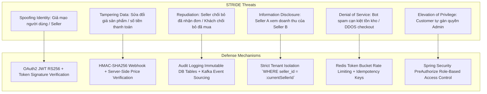

# MÔ HÌNH ĐE DỌA AN NINH & BẢO MẬT (SECURITY THREAT MODEL & DEFENSE)
**Hệ thống:** CommerceFlow Security Framework  
**Chuẩn:** STRIDE Threat Model / OWASP API Security Top 10  
**Phiên bản:** 1.0.0  

---

## 1. MÔ HÌNH ĐE DỌA STRIDE (THREAT MODEL ANALYSIS)



---

## 2. KIẾN TRÚC XÁC THỰC & PHÂN QUYỀN (JWT & RBAC)

1. **Chuẩn mã hóa JWT (RS256)**:
   - `identity-service` nắm giữ Private Key để ký (Sign) token khi người dùng đăng nhập thành công.
   - Các Microservices và API Gateway chỉ tải Public Key (thông qua JWKS Endpoint `/oauth2/jwks`) để xác thực chữ ký (Verify) hoàn toàn độc lập mà không cần gọi ngược về Auth Server.
2. **Cơ chế Thu hồi Token (Token Revocation & Blacklist)**:
   - Khi người dùng bấm Logout hoặc đổi mật khẩu: Token ID (`jti`) được đưa vào Redis Blacklist với TTL bằng đúng thời gian sống còn lại của JWT.
   - API Gateway kiểm tra Redis trước khi chuyển tiếp request vào mạng nội bộ.

---

## 3. CÔ LẬP DỮ LIỆU ĐA NGƯỜI BÁN (SELLER DATA ISOLATION & ANTI-IDOR)

Lỗ hổng nghiêm trọng nhất trên sàn thương mại điện tử là **IDOR (Insecure Direct Object Reference)**, nơi Seller A đổi `subOrderId` trên URL để xem thông tin khách hàng hoặc doanh thu của Seller B.

### Cơ chế phòng vệ bắt buộc:
1. **Spring Data JPA Custom Auditing & Query Filter**:
   Mọi truy vấn dữ liệu từ `seller-service` hoặc `order-service` bắt buộc phải tiêm ngữ cảnh bảo mật từ JWT:
   ```java
   @Query("SELECT s FROM SubOrder s WHERE s.id = :subOrderId AND s.sellerId = :authenticatedSellerId")
   Optional<SubOrder> findByIdAndSellerId(@Param("subOrderId") UUID subOrderId, 
                                          @Param("authenticatedSellerId") UUID authenticatedSellerId);
   ```
2. Nếu bản ghi tồn tại nhưng `sellerId` không khớp, hệ thống trả về mã lỗi `403 Forbidden` và lập tức ghi nhận Security Incident Alert.

---

## 4. BẢO MẬT WEBHOOK & TÍCH HỢP BÊN NGOÀI (HMAC-SHA256)

Khi Mock Payment Provider hoặc Ngân hàng gửi callback webhook, dữ liệu không đi qua JWT mà sử dụng mã xác thực thông điệp theo hàm băm:
- **Header**: `X-Signature: hex(hmac_sha256(request_body, secret_key))`
- **Xác thực tại Payment Service**:
  ```java
  String computedSignature = HmacUtils.hmacSha256Hex(sharedSecret, requestBody);
  if (!MessageDigest.isEqual(computedSignature.getBytes(), receivedSignature.getBytes())) {
      throw new BadSignatureSecurityException("Invalid Webhook Signature!");
  }
  ```
- Sử dụng hàm `MessageDigest.isEqual()` để phòng chống tấn công dò tìm thời gian (Timing Attacks).
