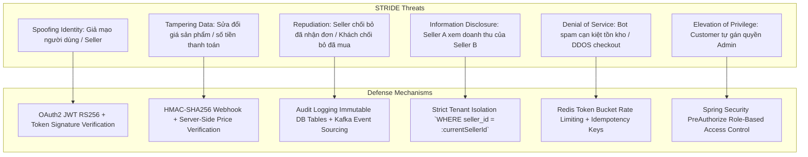

# MÔ HÌNH ĐE DỌA AN NINH & BẢO MẬT (SECURITY THREAT MODEL & DEFENSE)
**Hệ thống:** CommerceFlow Security Framework  
**Chuẩn:** STRIDE Threat Model / OWASP API Security Top 10  
**Phiên bản:** 1.0.0  

---

## 1. MÔ HÌNH ĐE DỌA STRIDE (THREAT MODEL ANALYSIS)



---

## 2. KIẾN TRÚC XÁC THỰC & PHÂN QUYỀN STATELESS (OIDC & DECOUPLED AUTH)

Kiến trúc bảo mật danh tính của CommerceFlow được thiết kế theo **3 nguyên tắc bất biến**:

### 2.1. Nguyên tắc 1: JWT chuẩn OIDC Claims (RFC 7519 / OpenID Connect)
* Toàn bộ token phát hành từ `identity-service` chứa đầy đủ các claims tiêu chuẩn:
  - `sub`: User UUID định danh (`users.id`).
  - `iss`: Issuer định danh nguồn cấp phát (`https://auth.commerceflow.com`).
  - `aud`: Audience dịch vụ mục tiêu (`commerce-api`).
  - `exp`: UNIX epoch expiration timestamp (mặc định 3600s = 1 giờ).
  - `iat`: UNIX epoch issued at timestamp.
  - `jti`: JWT Unique ID (UUIDv7 string) phục vụ thu hồi và tra cứu danh sách đen (Blacklist).
  - `preferred_username`: Số điện thoại hoặc username người dùng.
  - `email`: Địa chỉ email.
  - `roles`: Mảng các quyền ứng dụng (`["ROLE_CUSTOMER", "ROLE_SELLER", "ROLE_ADMIN"]`).
  - `realm_access`: Cấu trúc OIDC tương thích Keycloak (`{"roles": ["ROLE_CUSTOMER"]}`).
  - `token_type`: Phân loại token (`access` hoặc `refresh`).

### 2.2. Nguyên tắc 2: Tách lớp AuthProvider & RoleClaimsAdapter Interface
* **Không hard-code logic đăng nhập, xác thực hoặc sinh token vào business service**.
* Tầng bảo mật được đóng gói qua 3 interface độc lập tại `common-model`:
  - `AuthProvider`: Định nghĩa các hàm `authenticate()`, `refreshToken()`, `revokeToken()`, `validate()`. Triển khai mặc định: `DatabaseAuthProvider` (sử dụng JPA và `BCryptPasswordEncoder`).
  - `TokenProvider`: Định nghĩa việc tạo và thẩm định JWT (`JwtTokenProvider`).
  - `RoleClaimsAdapter`: Định nghĩa trích xuất quyền từ claims (`DefaultRoleClaimsAdapter`). Hỗ trợ cả định dạng chuẩn OIDC `roles`, Keycloak `realm_access.roles`, và OAuth2 `scope`.
* **Lợi ích kiến trúc**: Khi doanh nghiệp quyết định chuyển đổi từ Auth In-house sang các giải pháp IdP chuyên dụng (**Keycloak, Okta, Auth0**), đội ngũ phát triển chỉ cần thay đổi Issuer/JWKS URL và triển khai một `RoleClaimsAdapter` mới mà **hoàn toàn không phải sửa đổi luồng nghiệp vụ kinh doanh** của các microservices.

### 2.3. Nguyên tắc 3: Phân quyền dựa trên Claims/Roles thay vì phụ thuộc DB Users
* **Stateless Authorization**: Tại API Gateway và các Resource Server downstream (`api-service`), filter giải mã chữ ký JWT và trích xuất claims trực tiếp vào đối tượng `UserPrincipal` trong `SecurityContextHolder`.
* **Zero Database Overhead**: Quá trình kiểm tra quyền `@PreAuthorize("hasRole('SELLER')")` hoặc `hasRole('ADMIN')` diễn ra 100% trong bộ nhớ (In-memory) từ JWT claims, loại bỏ hoàn toàn các truy vấn `SELECT * FROM users WHERE id = ?` gây quá tải cơ sở dữ liệu trên từng HTTP request.

### 2.4. Cơ chế Thu hồi Token (Token Revocation & Redis Blacklist)
* Khi người dùng thực hiện Logout hoặc đổi mật khẩu: Token ID (`jti`) được đưa vào Redis Blacklist với TTL bằng đúng thời gian sống còn lại (`exp - now`).
* API Gateway và downstream filter kiểm tra sự tồn tại của `jti` trên Redis trước khi cho phép xử lý tiếp các thao tác nhạy cảm.
* Điểm cuối JWKS (`/.well-known/jwks.json`, `/oauth2/jwks`) cho phép các dịch vụ tải khóa công khai phục vụ xác minh chữ ký mà không phụ thuộc vào kết nối trực tiếp đến cơ sở dữ liệu.

---

## 3. CÔ LẬP DỮ LIỆU ĐA NGƯỜI BÁN (SELLER DATA ISOLATION & ANTI-IDOR)

Lỗ hổng nghiêm trọng nhất trên sàn thương mại điện tử là **IDOR (Insecure Direct Object Reference)**, nơi Seller A đổi `subOrderId` trên URL để xem thông tin khách hàng hoặc doanh thu của Seller B.

### Cơ chế phòng vệ bắt buộc:
1. **Spring Data JPA Custom Auditing & Query Filter**:
   Mọi truy vấn dữ liệu từ `seller-service` hoặc `order-service` bắt buộc phải tiêm ngữ cảnh bảo mật từ JWT:
   ```java
   @Query("SELECT s FROM SubOrder s WHERE s.id = :subOrderId AND s.sellerId = :authenticatedSellerId")
   Optional<SubOrder> findByIdAndSellerId(@Param("subOrderId") UUID subOrderId, 
                                          @Param("authenticatedSellerId") UUID authenticatedSellerId);
   ```
2. Nếu bản ghi tồn tại nhưng `sellerId` không khớp, hệ thống trả về mã lỗi `403 Forbidden` và lập tức ghi nhận Security Incident Alert.

---

## 4. BẢO MẬT WEBHOOK & TÍCH HỢP BÊN NGOÀI (HMAC-SHA256)

Khi Mock Payment Provider hoặc Ngân hàng gửi callback webhook, dữ liệu không đi qua JWT mà sử dụng mã xác thực thông điệp theo hàm băm:
- **Header**: `X-Signature: hex(hmac_sha256(request_body, secret_key))`
- **Xác thực tại Payment Service**:
  ```java
  String computedSignature = HmacUtils.hmacSha256Hex(sharedSecret, requestBody);
  if (!MessageDigest.isEqual(computedSignature.getBytes(), receivedSignature.getBytes())) {
      throw new BadSignatureSecurityException("Invalid Webhook Signature!");
  }
  ```
- Sử dụng hàm `MessageDigest.isEqual()` để phòng chống tấn công dò tìm thời gian (Timing Attacks).
