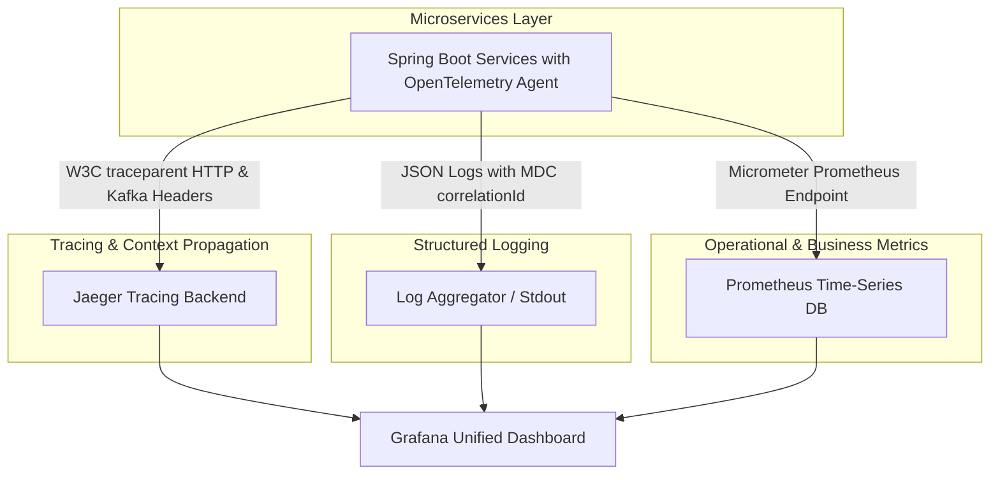

# CHIẾN LƯỢC QUAN SÁT HỆ THỐNG (OBSERVABILITY & MONITORING STRATEGY)
**Hệ thống:** CommerceFlow Observability Platform  
**Công nghệ:** OpenTelemetry + Jaeger + Prometheus + Grafana  
**Phiên bản:** 1.0.0  

---

## 1. MÔ HÌNH QUAN SÁT PHÂN TÁN BA TRỤ CỘT (THREE PILLARS OF OBSERVABILITY)



---

## 2. TRACE PROPAGATION XUYÊN SUỐT HTTP & KAFKA

Để theo dõi một giao dịch checkout từ khi khách bấm nút trên trình duyệt cho tới khi Kafka consumer cập nhật kho và gửi email:
1. **HTTP Headers (W3C Standard)**:
   - `traceparent: 00-4bf92f3577b34da6a3ce929d0e0e4736-00f067aa0ba902b7-01`
   - `X-Correlation-ID: <UUID>`
2. **Kafka Record Headers**:
   - Khi phát event lên Kafka, OpenTelemetry Producer Interceptor tự động tiêm context vào Kafka Headers:
     - `traceparent`: Truyền span context sang Consumer.
     - `correlation_id`: ID nghiệp vụ duy nhất của đơn hàng.
3. **MDC Logging (Mapped Diagnostic Context)**:
   Mọi log entry đều được định dạng JSON chuẩn hóa:
   ```json
   {
     "@timestamp": "2026-11-19T14:24:00.123Z",
     "level": "INFO",
     "service": "order-service",
     "traceId": "4bf92f3577b34da6a3ce929d0e0e4736",
     "spanId": "00f067aa0ba902b7",
     "correlationId": "9b1deb4d-3b7d-4bad-9bdd-2b0d7b3dcb6d",
     "orderId": "9b1deb4d-3b7d-4bad-9bdd-2b0d7b3dcb6d",
     "message": "Order successfully persisted in DB and outbox record created"
   }
   ```

---

## 3. DANH MỤC METRICS VẬN HÀNH & KINH DOANH (OPERATIONAL & BUSINESS METRICS)

### 3.1. Business Metrics (Đo lường sức khỏe kinh doanh)
| Tên Metric | Kiểu | Mô tả |
|---|---|---|
| `commerceflow_orders_created_total` | Counter | Tổng số đơn hàng được khởi tạo |
| `commerceflow_checkout_success_rate` | Gauge | Tỷ lệ đơn checkout thành công bước thanh toán |
| `commerceflow_overselling_violations_total` | Counter | Số lần vi phạm âm kho (**Bắt buộc = 0**) |
| `commerceflow_saga_compensation_total` | Counter | Số lần Saga phải kích hoạt rollback do lỗi |
| `commerceflow_payment_success_rate` | Gauge | Tỷ lệ thanh toán thành công qua Webhook |

### 3.2. Kafka & Technical Metrics
| Tên Metric | Ngưỡng cảnh báo (Alert Threshold) | Hành động khi vi phạm |
|---|---|---|
| `kafka_consumer_records_lag` | `> 5,000 records` trong 3 phút | PagerDuty Alert: Consumer bị nghẽn, cần scale pods |
| `kafka_dlq_messages_rate` | `> 0 message / phút` | Cảnh báo khẩn cấp: Xuất hiện Poison Pill |
| `db_connection_pool_usage` | `> 80%` | Cảnh báo nghẽn database connection |
| `http_server_requests_seconds_p99` | `> 500ms` | Cảnh báo suy giảm hiệu năng API Gateway |
