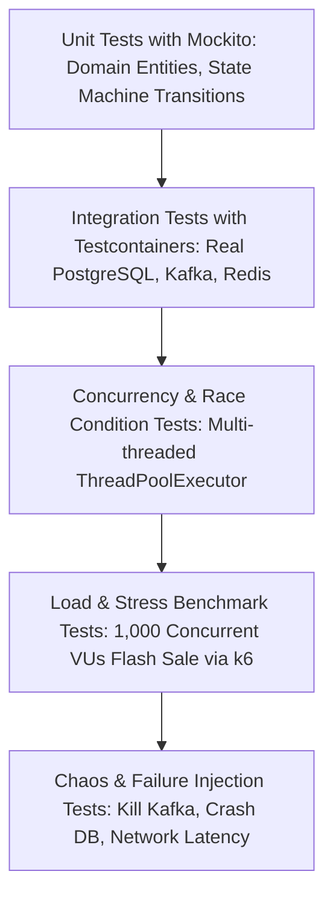

# CHIẾN LƯỢC KIỂM THỬ HỆ PHÂN TÁN (DISTRIBUTED TESTING STRATEGY)
**Hệ thống:** CommerceFlow Quality Assurance Architecture  
**Công cụ:** JUnit 5 + Mockito + Testcontainers (PostgreSQL, Kafka, Redis) + Awaitility + k6  
**Phiên bản:** 1.0.0  

---

## 1. MÔ HÌNH KIM TỰ THÁP KIỂM THỬ (TESTING PYRAMID)



---

## 2. KIỂM THỬ TƯƠNG TRANH & RACE CONDITION BẰNG TESTCONTAINERS

Để đảm bảo các kịch bản phân tán được kiểm chứng trong môi trường thực tế (Real Infrastructure), 100% Integration Test sử dụng **Testcontainers**:
- `PostgreSQLContainer("postgres:16-alpine")`
- `KafkaContainer("confluentinc/cp-kafka:7.6.0")`
- `GenericContainer("redis:7.2-alpine")`

### Mẫu kiểm thử xác minh Zero Overselling với 1,000 threads đồng thời:
```java
@Test
@DisplayName("Đảm bảo không bao giờ âm kho khi 1000 threads cùng tranh chấp 10 items")
void given10ItemsInStock_when1000ThreadsCheckoutConcurrently_thenZeroOverselling() throws Exception {
    String testSku = "SKU-TEST-FLASH-SALE-01";
    int initialStock = 10;
    int concurrentUsers = 1000;

    inventoryRepository.save(new Inventory(testSku, initialStock, 0));

    ExecutorService executor = Executors.newFixedThreadPool(50);
    CountDownLatch readyLatch = new CountDownLatch(concurrentUsers);
    CountDownLatch startLatch = new CountDownLatch(1);
    AtomicInteger successCount = new AtomicInteger(0);
    AtomicInteger failureCount = new AtomicInteger(0);

    for (int i = 0; i < concurrentUsers; i++) {
        final UUID orderId = UUID.randomUUID();
        executor.submit(() -> {
            readyLatch.countDown();
            try {
                startLatch.await(); // Đảm bảo toàn bộ 1,000 threads xuất phát tại cùng 1 mili-giây
                boolean reserved = inventoryService.reserveStock(orderId, testSku, 1);
                if (reserved) successCount.incrementAndGet();
                else failureCount.incrementAndGet();
            } catch (Exception e) {
                failureCount.incrementAndGet();
            }
        });
    }

    readyLatch.await();
    startLatch.countDown(); // Bắn tín hiệu kích hoạt đồng loạt
    executor.shutdown();
    executor.awaitTermination(30, TimeUnit.SECONDS);

    // Bất biến kiểm định nghiêm ngặt:
    assertEquals(10, successCount.get(), "Số lượng đơn giữ hàng thành công bắt buộc phải đúng bằng 10");
    assertEquals(990, failureCount.get(), "990 requests còn lại phải bị từ chối");

    Inventory finalInventory = inventoryRepository.findById(testSku).orElseThrow();
    assertEquals(10, finalInventory.getPhysicalQuantity());
    assertEquals(10, finalInventory.getReservedQuantity());
    assertEquals(0, finalInventory.getAvailableQuantity(), "Tồn kho khả dụng không bao giờ được âm!");
}
```

---

## 3. BỘ KIỂM THỬ XÁC ĐỊNH LỖI PHÂN TÁN (DETERMINISTIC FAILURE TESTS)

| Tên Test Case | Mục đích kiểm chứng | Phương pháp giả lập | Kết quả mong đợi |
|---|---|---|---|
| `testDuplicateOrderEventHandledOnce` | Ngăn chặn trừ kho lặp khi Kafka gửi lại event | Bắn cùng 1 `OrderCreatedEvent` có `messageId` trùng nhau 3 lần vào topic | Consumer xử lý lần 1 thành công; lần 2 và 3 vi phạm Unique Inbox DB $\rightarrow$ Ack ngay mà không trừ kho thêm. |
| `testPaymentTimeoutAutoReleaseStock` | Tự động trả kho khi khách không trả tiền sau 15 phút | Tua nhanh thời gian bằng Mock Clock hoặc set TTL = 2 giây trong test | Sweeper kích hoạt, `reserved_quantity` giảm về 0, đơn hàng chuyển sang `EXPIRED`. |
| `testOrchestratorRestartSagaRecovery` | Phục hồi tiến trình Saga sau khi service bị kill | Kích hoạt Saga đến bước 2 $\rightarrow$ Gọi `applicationContext.close()` $\rightarrow$ Khởi động context mới | Saga Recovery Worker tìm thấy bản ghi `IN_PROGRESS`, tự động gửi tiếp bước 3. |
| `testLatePaymentTriggersAutoRefund` | Đơn đã hết hạn nhưng webhook báo tiền vào | Chuyển Order sang `EXPIRED` trước khi bắn `PaymentCapturedEvent` | Orchestrator phát hiện đơn đã hủy, tự động gọi Payment Service phát lệnh Refund. |
