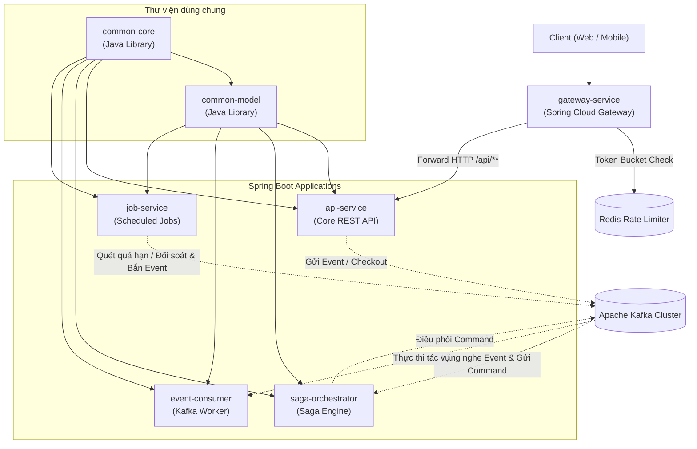
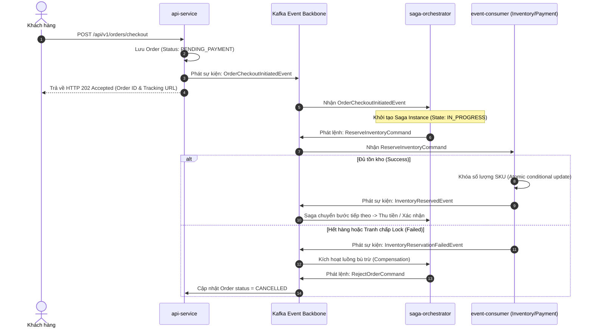

# CommerceFlow — Enterprise Distributed E-Commerce Marketplace

> Nền tảng thương mại điện tử đa người bán (Multi-vendor Marketplace) thế hệ mới, áp dụng kiến trúc **Event-Driven Microservices**, **Saga Orchestration** và **Database-per-Service** giải quyết bài toán giao dịch phân tán, chống bán vượt (Zero Overselling) và đảm bảo tính nhất quán dữ liệu (Eventual Consistency).

---

## 📑 Mục lục
1. [Cấu trúc Bundle 7 Projects](#1-cấu-trúc-bundle-7-projects)
2. [Chi tiết thư viện & Phụ thuộc từng Project](#2-chi-tiết-thư-viện--phụ-thuộc-từng-project)
3. [Mô hình Luồng điều phối Saga (Checkout Flow)](#3-mô-hình-luồng-điều-phối-saga-checkout-flow)
4. [Bản đồ Kho tài liệu Kiến trúc (docs/)](#4-bản-đồ-kho-tài-liệu-kiến-trúc-docs)
5. [Yêu cầu môi trường & Công nghệ sử dụng](#5-yêu-cầu-môi-trường--công-nghệ-sử-dụng)

---

## 1. Cấu trúc Bundle 7 Projects

Để hiện thực hóa 11 microservices trong tài liệu đặc tả mà không gây cồng kềnh hạ tầng khi phát triển, hệ thống được module hóa thành **7 project/module** cốt lõi:

```
CommerceSystem/
├── common-core/              # [Library] Thư viện tiện ích dùng chung (Utils, Parse, Format, Exceptions)
├── common-model/             # [Library] Models, DTOs, Event Contracts, Commands, Enums dùng chung
├── gateway-service/          # [Edge Gateway] Spring Cloud Gateway, Redis Token Bucket Rate Limiting & Routing
├── api-service/              # [Application] REST API Core Service (Checkout, Catalog, Order queries, Webhook)
├── saga-orchestrator/        # [Application] Bộ não điều phối Saga State Machine & Transaction Rollback
├── event-consumer/           # [Application] Kafka Worker xử lý logic Inventory, Shipping & Notification
├── job-service/              # [Application] Background Jobs, Scheduled Tasks & Housekeeping Worker
├── docs/                     # [Documentation] 17 tập tài liệu kiến trúc & đặc tả chi tiết
└── pom.xml                   # Root Maven POM quản lý phiên bản và build tập trung
```

### Sơ đồ phụ thuộc giữa các module (Dependency Graph):



---

## 2. Chi tiết thư viện & Phụ thuộc từng Project

### 2.1. `common-core` (Thư viện Core Utilities)
* **Loại artifact**: Standard Java JAR (Library).
* **Trách nhiệm**:
  - `DateTimeUtils`: Parse/format ngày giờ ISO-8601, chuyển đổi múi giờ `Asia/Ho_Chi_Minh`.
  - `JsonUtils`: Serialize/Deserialize JSON chuẩn hóa với Jackson `JavaTimeModule`.
  - `CurrencyUtils`: Parse/format tiền tệ Việt Nam Đồng (`#,##0 ₫`), xử lý tính toán số học an toàn với `BigDecimal`.
  - `StringUtils`: Tạo SEO Slug sản phẩm, làm mờ thông tin nhạy cảm (Email, Phone, Số thẻ).
  - `BaseException` & `ErrorCode`: Phân cấp Exception và mã lỗi chuẩn hóa toàn hệ thống.
* **Thư viện cần tích hợp**:
  - `com.fasterxml.jackson.core:jackson-databind`
  - `com.fasterxml.jackson.datatype:jackson-datatype-jsr310`
  - `org.apache.commons:commons-lang3`
  - `org.slf4j:slf4j-api`
  - `org.projectlombok:lombok`

---

### 2.2. `common-model` (Thư viện Model & Contract)
* **Loại artifact**: Standard Java JAR (Library).
* **Trách nhiệm**:
  - **DTOs & Response**: `ApiResponse<T>` (phong bì API chuẩn), `PageResponse<T>` (phân trang).
  - **Kafka Event Envelope**: `EventEnvelope<T>` tuân thủ CloudEvents (`eventId`, `eventType`, `correlationId`, `causationId`, `sourceService`, `timestamp`, `payload`).
  - **Saga Commands & Events**: Các hợp đồng giao tiếp giữa Orchestrator và các Worker (`OrderCheckoutInitiatedEvent`, `ReserveInventoryCommand`, `PaymentProcessedEvent`...).
  - **Enums**: `OrderStatus`, `PaymentStatus`, `PaymentMethod`, `EventType`...
* **Thư viện cần tích hợp**:
  - Phụ thuộc nội bộ: `common-core`
  - `jakarta.validation:jakarta.validation-api`
  - `com.fasterxml.jackson.core:jackson-annotations`
  - `org.projectlombok:lombok`

---

### 2.3. `gateway-service` (Edge API Gateway & Redis Rate Limiter)
* **Loại artifact**: Spring Boot Executable JAR (Reactive WebFlux / Netty).
* **Port mặc định**: `8080`
* **Trách nhiệm**:
  - Cửa ngõ bảo mật duy nhất tiếp nhận HTTP Traffic từ Client (Web React, Mobile Flutter).
  - Phân tán tải và định tuyến (Routing & Reverse Proxy) tới các dịch vụ phía sau (`api-service`).
  - Chống bot, chống DDoS, bảo vệ tài nguyên qua **Redis Token Bucket Rate Limiting**.
  - Rate limit linh hoạt theo **User ID** (cho đặt hàng, thanh toán) và theo **Client IP** (cho xem sản phẩm public).
  - Xử lý CORS, Forward HTTP Headers (`X-Correlation-ID`, `X-User-Id`).
* **Thư viện Spring Boot cần tích hợp**:
  - `org.springframework.cloud:spring-cloud-starter-gateway`
  - `org.springframework.boot:spring-boot-starter-data-redis-reactive`
  - `org.projectlombok:lombok`

---

### 2.4. `api-service` (Project Core REST API Service)
* **Loại artifact**: Spring Boot Executable JAR (Core Business API).
* **Port mặc định**: `8081`
* **Trách nhiệm**:
  - Tiếp nhận HTTP Request từ API Gateway chuyển tiếp vào.
  - Endpoint đặt hàng `POST /api/v1/orders/checkout`.
  - Tra cứu thông tin đơn hàng, danh mục sản phẩm, giỏ hàng.
  - Tiếp nhận Webhook thanh toán từ cổng trung gian (`POST /api/v1/payments/webhook`).
  - Gắn `X-Correlation-ID` cho mọi request và đẩy sự kiện khởi tạo vào Kafka.
* **Thư viện Spring Boot cần tích hợp**:
  - Phụ thuộc nội bộ: `common-core`, `common-model`
  - `org.springframework.boot:spring-boot-starter-web`
  - `org.springframework.boot:spring-boot-starter-validation`
  - `org.springframework.boot:spring-boot-starter-data-jpa`
  - `org.postgresql:postgresql`
  - `org.springframework.kafka:spring-kafka`
  - `org.springframework.boot:spring-boot-starter-actuator`
  - `org.projectlombok:lombok`

---

### 2.5. `saga-orchestrator` (Bộ não điều phối Saga State Machine)
* **Loại artifact**: Spring Boot Executable JAR (Saga Engine).
* **Port mặc định**: `8082`
* **Trách nhiệm**:
  - Quản lý vòng đời trạng thái của giao dịch phân tán (Saga Instance State Machine).
  - Lắng nghe `order.checkout.initiated` $\rightarrow$ Phát lệnh `ReserveInventoryCommand` sang kho $\rightarrow$ Phát lệnh `InitiatePaymentCommand` sang thanh toán.
  - **Xử lý bù trừ (Compensation / Rollback)**: Nếu kho hết hàng hoặc thanh toán thất bại, tự động phát lệnh nhả kho (`ReleaseInventoryCommand`), hủy đơn (`CancelOrderCommand`) và hoàn tiền (`RefundPaymentCommand`).
  - Lưu trữ trạng thái Saga vào DB (`saga_instances`, `saga_step_executions`) để phục hồi khi có sự cố.
* **Thư viện Spring Boot cần tích hợp**:
  - Phụ thuộc nội bộ: `common-core`, `common-model`
  - `org.springframework.kafka:spring-kafka`
  - `org.springframework.boot:spring-boot-starter-data-jpa`
  - `org.postgresql:postgresql`
  - `org.springframework.boot:spring-boot-starter-web` (Cung cấp API `/internal/sagas/{orderId}`)
  - `org.projectlombok:lombok`

---

### 2.6. `event-consumer` (Project xử lý logic nhận Event Kafka)
* **Loại artifact**: Spring Boot Executable JAR (Worker nền).
* **Port mặc định**: `8083` (hoặc chạy Headless mode).
* **Trách nhiệm**:
  - Lắng nghe Kafka Topic xử lý logic nghiệp vụ không đồng bộ:
    - **Inventory Consumer**: Thực thi khóa tạm (Reservation), trừ tồn kho vật lý (Commit), nhả kho khi hủy (Release) với cơ chế kiểm soát tương tranh (Conditional Updates).
    - **Shipping Consumer**: Lắng nghe sự kiện thanh toán thành công để tự động tạo vận đơn với đơn vị vận chuyển (SPX, GHN, GHTK).
    - **Notification Consumer**: Lắng nghe các mốc sự kiện để gửi Email/SMS/Push thông báo cho khách hàng và người bán.
  - Đảm bảo tính **Idempotency** (chống xử lý trùng lặp khi Kafka rebalance hoặc retry).
* **Thư viện Spring Boot cần tích hợp**:
  - Phụ thuộc nội bộ: `common-core`, `common-model`
  - `org.springframework.kafka:spring-kafka`
  - `org.springframework.boot:spring-boot-starter`
  - `org.springframework.boot:spring-boot-starter-actuator`
  - `org.projectlombok:lombok`

---

### 2.7. `job-service` (Project Scheduled Background Jobs & Housekeeping)
* **Loại artifact**: Spring Boot Executable JAR (Batch / Cron Worker).
* **Port mặc định**: `8083` (hoặc chạy Headless mode).
* **Trách nhiệm**:
  - **Order Expiration TTL (BR-ORD-005)**: Quét các đơn hàng ở trạng thái `PENDING_PAYMENT` quá hạn (sau 15 phút, hoặc 3 phút với Flash Sale) $\rightarrow$ Tự động bắn event kích hoạt hủy đơn và hoàn trả tồn kho.
  - **Payment Reconciliation Job**: Quét đối soát định kỳ giữa Cổng thanh toán và Database để phát hiện các giao dịch thành công nhưng bị trễ Webhook $\rightarrow$ Tái kích hoạt luồng xác nhận đơn.
  - **Escrow Release Job**: Quét các đơn hàng đã giao thành công và kết thúc thời hạn khiếu nại (3-7 ngày) $\rightarrow$ Tự động chuyển tiền từ tài khoản ký quỹ (Escrow) vào số dư ví của Shop.
  - **Outbox/Inbox Housekeeping (ADR-002)**: Quét và dọn dẹp (xóa hoặc chuyển sang cold storage) các bản ghi `outbox` và `inbox` đã xử lý thành công để tránh phình dung lượng PostgreSQL.
  - **Saga Sweeper Job (Failure Recovery)**: Định kỳ quét các Saga Instance bị treo (`status = 'IN_PROGRESS'`) quá lâu do instance cũ bị crash $\rightarrow$ Đánh thức hoặc kích hoạt luồng bồi hoàn bù trừ.
* **Thư viện Spring Boot cần tích hợp**:
  - Phụ thuộc nội bộ: `common-core`, `common-model`
  - `org.springframework.boot:spring-boot-starter`
  - `org.springframework.boot:spring-boot-starter-quartz` (Quartz Scheduler v2.5.x)
  - `org.springframework.kafka:spring-kafka`
  - `org.projectlombok:lombok`
  - *(Khuyến nghị)* `net.javacrumbs.shedlock:shedlock-spring` (kết hợp Redis để khóa phân tán khi scale nhiều instance tránh chạy trùng job).

---

## 3. Mô hình Luồng điều phối Saga (Checkout Flow)



---

## 4. Bản đồ Kho tài liệu Kiến trúc (docs/)

Hệ thống tài liệu đầy đủ được tổ chức tại thư mục [`docs/`](file:///d:/Home/CommerceSystem/docs):

| Thư mục | Tên tài liệu | Nội dung chi tiết |
|---|---|---|
| [`00-overview/`](file:///d:/Home/CommerceSystem/docs/00-overview/README.md) | Tổng quan hệ thống | Giới thiệu CommerceFlow, bản đồ tài liệu, nguyên tắc bất biến |
| [`01-business/`](file:///d:/Home/CommerceSystem/docs/01-business/BRD.md) | Nghiệp vụ sàn TMĐT | BRD, ma trận quy tắc kinh doanh, đặc tả Use Cases |
| [`02-requirements/`](file:///d:/Home/CommerceSystem/docs/02-requirements/SRS.md) | Yêu cầu kỹ thuật | SRS, yêu cầu chức năng 9 phân hệ, yêu cầu phi chức năng (SLAs) |
| [`03-architecture/`](file:///d:/Home/CommerceSystem/docs/03-architecture/system-architecture.md) | Kiến trúc tổng thể | C4 Container, Bounded Contexts, thiết kế Saga chi tiết |
| [`04-microservices/`](file:///d:/Home/CommerceSystem/docs/04-microservices/microservices-design.md) | Đặc tả Microservices | Chi tiết trách nhiệm, database và API 11 microservices |
| [`05-kafka/`](file:///d:/Home/CommerceSystem/docs/05-kafka/event-contracts.md) | Kafka & Sự kiện | Phân vùng (Partitioning), Event Envelope, JSON Schemas hợp đồng |
| [`06-api/`](file:///d:/Home/CommerceSystem/docs/06-api/api-specifications.md) | Đặc tả REST API | API Gateway, Customer, Seller, Shipping, Webhook |
| [`07-database/`](file:///d:/Home/CommerceSystem/docs/07-database/erd-and-data-models.md) | Cơ sở dữ liệu | ERD, Data Models PostgreSQL, Outbox/Inbox patterns |
| [`08-sequence/`](file:///d:/Home/CommerceSystem/docs/08-sequence/sequence-diagrams.md) | Sơ đồ tuần tự | Luồng Checkout, Đóng gói giao hàng, Khiếu nại, Hoàn tiền |
| [`09-state-machines/`](file:///d:/Home/CommerceSystem/docs/09-state-machines/state-machines.md) | Máy trạng thái | State Machine của Order, Inventory, Payment, Shipping |
| [`10-reliability/`](file:///d:/Home/CommerceSystem/docs/10-reliability/distributed-scenarios-deep-dive.md) | Độ tin cậy & Phục hồi | 12 kịch bản phân tán chuyên sâu, ma trận xử lý sự cố |
| [`11-adr/`](file:///d:/Home/CommerceSystem/docs/11-adr/ADR-001-hybrid-saga-orchestration.md) | Kiến trúc quyết định (ADR) | ADR-001 (Saga), ADR-002 (Outbox/CDC), ADR-003 (Tách đơn)... |

---

## 5. Yêu cầu môi trường & Công nghệ sử dụng

* **Java**: OpenJDK 21 LTS (hỗ trợ Virtual Threads / Project Loom)
* **Build Tool**: Apache Maven 3.9+
* **Spring Framework**: Spring Boot 3.3.x / Spring 6.x
* **Message Broker**: Apache Kafka 3.7+ (KRaft mode)
* **Database**: PostgreSQL 16 (Hỗ trợ JSONB, Partitioning, Row-level locking)
* **In-Memory Cache**: Redis 7.2 (Distributed Cache & Redlock)
