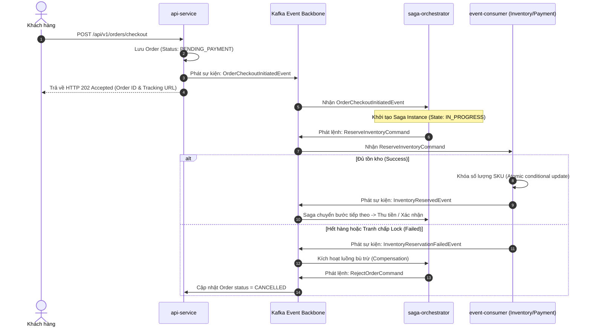

# CommerceFlow — Enterprise Distributed E-Commerce Marketplace

> Nền tảng thương mại điện tử đa người bán (Multi-vendor Marketplace) thế hệ mới, áp dụng kiến trúc **Event-Driven Microservices**, **Saga Orchestration** và **Database-per-Service** giải quyết bài toán giao dịch phân tán, chống bán vượt (Zero Overselling) và đảm bảo tính nhất quán dữ liệu (Eventual Consistency).

---

## 📑 Mục lục
1. [Cấu trúc Bundle 8 Projects](#1-cấu-trúc-bundle-8-projects)
2. [Chi tiết thư viện & Phụ thuộc từng Project](#2-chi-tiết-thư-viện--phụ-thuộc-từng-project)
3. [Mô hình Luồng điều phối Saga (Checkout Flow)](#3-mô-hình-luồng-điều-phối-saga-checkout-flow)
4. [Bản đồ Kho tài liệu Kiến trúc (docs/)](#4-bản-đồ-kho-tài-liệu-kiến-trúc-docs)
5. [Quản lý Table Entity & Thực thi Database Migration (common-model)](#5-quản-lý-table-entity--thực-thi-database-migration-common-model)
6. [Yêu cầu môi trường & Công nghệ sử dụng](#6-yêu-cầu-môi-trường--công-nghệ-sử-dụng)

---

## 1. Cấu trúc Bundle 8 Projects

Hệ thống được tổ chức dạng Maven multi-module chuẩn hóa tại thư mục `projects/` với **8 project/module** cốt lõi:

```
CommerceSystem/
├── projects/
│   ├── common-core/              # [Library] Thư viện tiện ích dùng chung (Utils, Parse, Format, Exceptions, ApiResponse)
│   ├── common-model/             # [Library] Định nghĩa Table Entities (JPA ORM), Flyway Migrations, DTOs, Event Contracts, OIDC Claims & Security Interfaces
│   ├── gateway-service/          # [Edge Gateway] Spring Cloud Gateway, Redis Token Bucket Rate Limiting & Stateless Token Relay
│   ├── identity-service/         # [Application] Identity & Auth Service (OIDC Claims, Decoupled AuthProvider, Claims-based Authorization)
│   ├── api-service/              # [Application] REST API Core Service (Checkout, Catalog, Order queries, Webhook)
│   ├── saga-orchestrator/        # [Application] Bộ não điều phối Saga State Machine & Transaction Rollback
│   ├── event-consumer/           # [Application] Kafka Worker xử lý logic Inventory, Shipping & Notification
│   └── job-service/              # [Application] Background Jobs, Scheduled Tasks & Housekeeping Worker
├── docs/                         # [Documentation] 17 tập tài liệu kiến trúc & đặc tả chi tiết
└── pom.xml                       # Root Maven POM quản lý phiên bản và build tập trung
```

### Sơ đồ phụ thuộc giữa các module (Dependency Graph):

```mermaid
graph TD
    Client["Client (Web / Mobile)"] -->|1. Đăng nhập / Lấy JWT Token| Identity["identity-service (Port 8084)<br/>- OIDC Claims (sub, iss, roles, jti)<br/>- AuthProvider Interface<br/>- JWKS Endpoint"]
    Client -->|2. Gửi Request kèm Bearer JWT| GW["gateway-service (Port 8080)<br/>(Spring Cloud Gateway)"]
    GW -->|Token Bucket Check| Redis[("Redis Rate Limiter")]
    GW -->|Forward HTTP /api/** (Header Relay)| API["api-service (Port 8081)<br/>(Core REST API)"]

    subgraph SharedLibraries["Thư viện dùng chung"]
        Core["common-core<br/>(Java Library)"]
        Model["common-model<br/>(Entities, Migrations, Security Base)"]
    end

    subgraph Applications["Spring Boot Applications"]
        Identity
        API
        Saga["saga-orchestrator (Port 8082)<br/>(Saga Engine)"]
        Consumer["event-consumer (Port 8083)<br/>(Kafka Worker)"]
        Job["job-service (Port 8085)<br/>(Scheduled Jobs)"]
    end

    Core --> Model
    Model --> Identity
    Model --> API
    Model --> Saga
    Model --> Consumer
    Model --> Job
    Core --> Identity
    Core --> API
    Core --> Saga
    Core --> Consumer
    Core --> Job

    Kafka[("Apache Kafka Cluster")]
    API -. Gửi Event / Checkout .-> Kafka
    Kafka -. Lắng nghe Event & Gửi Command .-> Saga
    Saga -. Điều phối Command .-> Kafka
    Kafka -. Thực thi tác vụ .-> Consumer
    Job -. Quét quá hạn / Đối soát & Bắn Event .-> Kafka
```

---

## 2. Chi tiết thư viện & Phụ thuộc từng Project

### 2.1. `common-core` (Thư viện Core Utilities)
* **Loại artifact**: Standard Java JAR (Library).
* **Trách nhiệm**:
  - `ApiResponse<T>`: Phong bì chuẩn hóa cho toàn bộ REST API (`code`, `message`, `data`, `timestamp`).
  - `DateTimeUtils`: Parse/format ngày giờ ISO-8601, chuyển đổi múi giờ `Asia/Ho_Chi_Minh`.
  - `JsonUtils`: Serialize/Deserialize JSON chuẩn hóa với Jackson `JavaTimeModule`.
  - `CurrencyUtils`: Parse/format tiền tệ Việt Nam Đồng (`#,##0 ₫`), xử lý tính toán số học an toàn với `BigDecimal`.
  - `StringUtils`: Tạo SEO Slug sản phẩm, làm mờ thông tin nhạy cảm (Email, Phone, Số thẻ).
  - `BaseException` & `ErrorCode`: Phân cấp Exception và mã lỗi chuẩn hóa toàn hệ thống.
* **Thư viện tích hợp**:
  - `com.fasterxml.jackson.core:jackson-databind`
  - `com.fasterxml.jackson.datatype:jackson-datatype-jsr310`
  - `org.apache.commons:commons-lang3`
  - `org.slf4j:slf4j-api`
  - `org.projectlombok:lombok`

---

### 2.2. `common-model` (Thư viện Table Entities, Database Migration & Base Security Contracts)
* **Loại artifact**: Standard Java JAR (Library).
* **Trách nhiệm cốt lõi**:
  - **Định nghĩa Table / JPA Entities tập trung**: Là nguồn chân lý duy nhất (Single Source of Truth) định nghĩa toàn bộ Entity ORM (`@Entity`) đại diện cho các bảng dữ liệu của tất cả 10 Bounded Contexts trong hệ thống:
    - *Identity & Customer*: `User`, `CustomerProfile`, `CustomerAddress`.
    - *Seller & Shop*: `Shop`, `SellerAddress`, `ShopCategory`.
    - *Product Catalog*: `Category`, `Brand`, `Product`, `ProductImage`, `ProductOption`, `ProductOptionValue`, `ProductSku`, `SkuOptionCombination`.
    - *Inventory*: `Inventory`, `InventoryReservation`, `InventoryAuditLog`.
    - *Order*: `ParentOrder`, `SubOrder`, `OrderItem`.
    - *Saga Orchestrator*: `SagaInstance`, `SagaStepExecution`.
    - *Payment & Escrow*: `PaymentTransaction`, `EscrowLedger`, `PaymentRefund`.
    - *Promotion*: `Campaign`, `FlashSale`, `FlashSaleItem`, `Voucher`, `VoucherCondition`, `VoucherRedemption`.
    - *Shipping*: `ShippingCarrier`, `Shipment`, `ShipmentTrackingEvent`.
    - *Review*: `ProductReview`, `ReviewMedia`, `ReviewReply`.
    - *Base Class*: `BaseEntity` (chuẩn hóa kiểm toán `created_at`, `updated_at`, auditing listeners).
  - **3 Nguyên tắc Base Security Contracts**:
    1. **OidcStandardClaims**: Định nghĩa hằng số claims chuẩn OIDC RFC 7519 (`sub`, `iss`, `aud`, `exp`, `iat`, `jti`, `preferred_username`, `email`, `roles`, `realm_access`).
    2. **Tách lớp Auth Interfaces**: `AuthProvider`, `TokenProvider`, `RoleClaimsAdapter`, `DefaultRoleClaimsAdapter` — tách hoàn toàn logic xác thực/sinh token khỏi nghiệp vụ kinh doanh.
    3. **UserPrincipal & Claims-based Authorization**: `UserPrincipal` lưu trữ định danh và tập quyền (`roles`) được bóc tách trực tiếp từ claims, cho phép các microservices phân quyền stateless không cần truy vấn bảng `users`.
  - **Quản lý & Thực thi Database Migration (Flyway)**:
    - Quản lý tập trung toàn bộ các bản DDL Migration từ `V1` đến `V10` tại thư mục `src/main/resources/db/migration/`.
    - Tích hợp `flyway-maven-plugin` hỗ trợ chạy migration trực tiếp từ Maven: `mvn flyway:migrate -pl projects/common-model`.
    - Cung cấp tiện ích Java `DatabaseMigrationRunner` phục vụ chạy migration độc lập hoặc tích hợp trong CI/CD pipeline.
  - **Kafka Event Envelope**: `EventEnvelope<T>` tuân thủ CloudEvents (`eventId`, `eventType`, `correlationId`, `causationId`, `sourceService`, `timestamp`, `payload`).
  - **Saga Commands & Events**: Các hợp đồng giao tiếp giữa Orchestrator và các Worker (`OrderCheckoutInitiatedEvent`, `ReserveInventoryCommand`, `PaymentProcessedEvent`...).
  - **Enums toàn hệ thống**: `ParentOrderStatus`, `SubOrderStatus`, `PaymentTransactionStatus`, `PaymentMethod`, `SagaStatus`, `SagaType`, `ShipmentStatus`, `InventoryReservationStatus`, `ProductStatus`, `UserRole`, `UserStatus`...
* **Thư viện tích hợp**:
  - Phụ thuộc nội bộ: `common-core`
  - `org.springframework.boot:spring-boot-starter-data-jpa`
  - `org.postgresql:postgresql`
  - `org.flywaydb:flyway-core`
  - `org.flywaydb:flyway-database-postgresql`
  - `org.flywaydb:flyway-maven-plugin`
  - `jakarta.validation:jakarta.validation-api`
  - `com.fasterxml.jackson.core:jackson-annotations`
  - `org.projectlombok:lombok`

---

### 2.3. `gateway-service` (Edge API Gateway & Redis Rate Limiter)
* **Loại artifact**: Spring Boot Executable JAR (Reactive WebFlux / Netty).
* **Port mặc định**: `8080`
* **Trách nhiệm**:
  - Cửa ngõ bảo mật tiếp nhận HTTP Traffic từ Client (Web React, Mobile Flutter).
  - Phân tán tải và định tuyến (Routing & Reverse Proxy) tới `api-service`, `identity-service`.
  - Chống bot, chống DDoS qua **Redis Token Bucket Rate Limiting**.
  - Rate limit linh hoạt theo **User ID** (cho đặt hàng, thanh toán) và theo **Client IP** (cho xem sản phẩm public).
  - Xử lý CORS, Forward HTTP Headers (`Authorization`, `X-Correlation-ID`, `X-User-Id`).
* **Thư viện Spring Boot tích hợp**:
  - `org.springframework.cloud:spring-cloud-starter-gateway`
  - `org.springframework.boot:spring-boot-starter-data-redis-reactive`
  - `org.projectlombok:lombok`

---

### 2.4. `identity-service` (Identity & Authentication Service)
* **Loại artifact**: Spring Boot Executable JAR (Security & IdP Service).
* **Port mặc định**: `8084`
* **Trách nhiệm**:
  - Xác thực người dùng, cấp phát và quản lý vòng đời JWT Token theo 3 nguyên tắc kiến trúc:
    1. **JWT chuẩn OIDC claims**: Token phát hành chứa đủ các claims `sub` (User ID), `iss` (Issuer), `aud` (Audience), `exp`, `iat`, `jti` (Revocation ID), `preferred_username`, `email`, `roles`, và `realm_access` (tương thích Keycloak).
    2. **Tách lớp AuthProvider & RoleClaimsAdapter**: Nghiệp vụ login/refresh/logout được đóng gói qua interface `AuthProvider` và `TokenProvider`. Trong tương lai, khi chuyển đổi sang Keycloak, Okta hoặc Auth0, hệ thống chỉ cần thay đổi cấu hình Issuer/JWKS và adapter map role mà không phải sửa luồng nghiệp vụ.
    3. **Phân quyền dựa trên claims/roles (Stateless)**: Các endpoint kiểm tra quyền trực tiếp từ `UserPrincipal` trong SecurityContext mà không truy vấn lại DB `users`.
  - Cung cấp các endpoint:
    - `POST /api/v1/auth/register`: Đăng ký tài khoản khách hàng/người bán mới.
    - `POST /api/v1/auth/login`: Xác thực credentials và cấp phát Access Token + Refresh Token.
    - `POST /api/v1/auth/refresh`: Cấp mới cặp token từ Refresh Token hợp lệ.
    - `POST /api/v1/auth/logout`: Thu hồi token và đẩy JTI vào danh sách thu hồi.
    - `GET /api/v1/auth/me`: Tra cứu thông tin danh tính từ JWT claims của phiên hiện tại.
    - `GET /.well-known/jwks.json` & `/oauth2/jwks`: Cung cấp public key descriptor cho các dịch vụ downstream xác thực chữ ký token.
* **Thư viện Spring Boot tích hợp**:
  - Phụ thuộc nội bộ: `common-core`, `common-model`
  - `org.springframework.boot:spring-boot-starter-web`
  - `org.springframework.boot:spring-boot-starter-security`
  - `org.springframework.boot:spring-boot-starter-validation`
  - `org.springframework.boot:spring-boot-starter-data-jpa`
  - `org.postgresql:postgresql`
  - `io.jsonwebtoken:jjwt-api:0.12.6`, `jjwt-impl:0.12.6`, `jjwt-jackson:0.12.6`
  - `org.projectlombok:lombok`

---

### 2.5. `api-service` (Project Core REST API Service)
* **Loại artifact**: Spring Boot Executable JAR (Core Business API).
* **Port mặc định**: `8081`
* **Trách nhiệm**:
  - Tiếp nhận HTTP Request từ API Gateway chuyển tiếp vào.
  - Endpoint đặt hàng `POST /api/v1/orders/checkout`.
  - Tra cứu thông tin đơn hàng, danh mục sản phẩm, giỏ hàng.
  - Tiếp nhận Webhook thanh toán từ cổng trung gian (`POST /api/v1/payments/webhook`).
  - Gắn `X-Correlation-ID` cho mọi request và đẩy sự kiện khởi tạo vào Kafka.
* **Thư viện Spring Boot tích hợp**:
  - Phụ thuộc nội bộ: `common-core`, `common-model`
  - `org.springframework.boot:spring-boot-starter-web`
  - `org.springframework.boot:spring-boot-starter-validation`
  - `org.springframework.boot:spring-boot-starter-data-jpa`
  - `org.postgresql:postgresql`
  - `org.springframework.kafka:spring-kafka`
  - `org.springframework.boot:spring-boot-starter-actuator`
  - `org.projectlombok:lombok`

---

### 2.6. `saga-orchestrator` (Bộ não điều phối Saga State Machine)
* **Loại artifact**: Spring Boot Executable JAR (Saga Engine).
* **Port mặc định**: `8082`
* **Trách nhiệm**:
  - Quản lý vòng đời trạng thái của giao dịch phân tán (Saga Instance State Machine).
  - Lắng nghe `order.checkout.initiated` $\rightarrow$ Phát lệnh `ReserveInventoryCommand` sang kho $\rightarrow$ Phát lệnh `InitiatePaymentCommand` sang thanh toán.
  - **Xử lý bù trừ (Compensation / Rollback)**: Nếu kho hết hàng hoặc thanh toán thất bại, tự động phát lệnh nhả kho (`ReleaseInventoryCommand`), hủy đơn (`CancelOrderCommand`) và hoàn tiền (`RefundPaymentCommand`).
  - Lưu trữ trạng thái Saga vào DB (`saga_instances`, `saga_step_executions`) để phục hồi khi có sự cố.
* **Thư viện Spring Boot tích hợp**:
  - Phụ thuộc nội bộ: `common-core`, `common-model`
  - `org.springframework.kafka:spring-kafka`
  - `org.springframework.boot:spring-boot-starter-data-jpa`
  - `org.postgresql:postgresql`
  - `org.springframework.boot:spring-boot-starter-web` (Cung cấp API `/internal/sagas/{orderId}`)
  - `org.projectlombok:lombok`

---

### 2.7. `event-consumer` (Project xử lý logic nhận Event Kafka)
* **Loại artifact**: Spring Boot Executable JAR (Worker nền).
* **Port mặc định**: `8083` (hoặc chạy Headless mode).
* **Trách nhiệm**:
  - Lắng nghe Kafka Topic xử lý logic nghiệp vụ không đồng bộ:
    - **Inventory Consumer**: Thực thi khóa tạm (Reservation), trừ tồn kho vật lý (Commit), nhả kho khi hủy (Release) với cơ chế kiểm soát tương tranh (Conditional Updates).
    - **Shipping Consumer**: Lắng nghe sự kiện thanh toán thành công để tự động tạo vận đơn với đơn vị vận chuyển (SPX, GHN, GHTK).
    - **Notification Consumer**: Lắng nghe các mốc sự kiện để gửi Email/SMS/Push thông báo cho khách hàng và người bán.
  - Đảm bảo tính **Idempotency** (chống xử lý trùng lặp khi Kafka rebalance hoặc retry).
* **Thư viện Spring Boot tích hợp**:
  - Phụ thuộc nội bộ: `common-core`, `common-model`
  - `org.springframework.kafka:spring-kafka`
  - `org.springframework.boot:spring-boot-starter`
  - `org.springframework.boot:spring-boot-starter-actuator`
  - `org.projectlombok:lombok`

---

### 2.8. `job-service` (Project Scheduled Background Jobs & Housekeeping)
* **Loại artifact**: Spring Boot Executable JAR (Batch / Cron Worker).
* **Port mặc định**: `8085` (hoặc chạy Headless mode).
* **Trách nhiệm**:
  - **Order Expiration TTL (BR-ORD-005)**: Quét các đơn hàng ở trạng thái `PENDING_PAYMENT` quá hạn $\rightarrow$ Bắn event kích hoạt hủy đơn và hoàn trả tồn kho.
  - **Payment Reconciliation Job**: Quét đối soát định kỳ giữa Cổng thanh toán và Database $\rightarrow$ Tái kích hoạt luồng xác nhận đơn khi trễ Webhook.
  - **Escrow Release Job**: Quét các đơn hàng đã giao thành công và kết thúc thời hạn khiếu nại $\rightarrow$ Tự động chuyển tiền vào ví Shop.
  - **Outbox/Inbox Housekeeping (ADR-002)**: Quét và dọn dẹp các bản ghi outbox/inbox đã xử lý thành công.
  - **Saga Sweeper Job (Failure Recovery)**: Định kỳ quét các Saga Instance bị treo quá lâu để đánh thức hoặc kích hoạt luồng bồi hoàn bù trừ.
* **Thư viện Spring Boot tích hợp**:
  - Phụ thuộc nội bộ: `common-core`, `common-model`
  - `org.springframework.boot:spring-boot-starter`
  - `org.springframework.boot:spring-boot-starter-quartz` (Quartz Scheduler v2.5.x)
  - `org.springframework.kafka:spring-kafka`
  - `org.projectlombok:lombok`

---

## 3. Mô hình Luồng điều phối Saga (Checkout Flow)



---

## 4. Bản đồ Kho tài liệu Kiến trúc (docs/)

Hệ thống tài liệu đầy đủ được tổ chức tại thư mục [`docs/`](file:///d:/Home/CommerceSystem/docs):

| Thư mục | Tên tài liệu | Nội dung chi tiết |
|---|---|---|
| [`00-overview/`](file:///d:/Home/CommerceSystem/docs/00-overview/README.md) | Tổng quan hệ thống | Giới thiệu CommerceFlow, bản đồ tài liệu, kiến trúc Bundle 8 Projects |
| [`01-business/`](file:///d:/Home/CommerceSystem/docs/01-business/BRD.md) | Nghiệp vụ sàn TMĐT | BRD, ma trận quy tắc kinh doanh, đặc tả Use Cases |
| [`02-requirements/`](file:///d:/Home/CommerceSystem/docs/02-requirements/SRS.md) | Yêu cầu kỹ thuật | SRS, yêu cầu chức năng 9 phân hệ, yêu cầu phi chức năng (SLAs) |
| [`03-architecture/`](file:///d:/Home/CommerceSystem/docs/03-architecture/system-architecture.md) | Kiến trúc tổng thể | C4 Container, Bounded Contexts, thiết kế Identity & Saga chi tiết |
| [`04-microservices/`](file:///d:/Home/CommerceSystem/docs/04-microservices/microservices-design.md) | Đặc tả Microservices | Chi tiết trách nhiệm, database và API 11 microservices & identity-service |
| [`05-kafka/`](file:///d:/Home/CommerceSystem/docs/05-kafka/event-contracts.md) | Kafka & Sự kiện | Phân vùng (Partitioning), Event Envelope, JSON Schemas hợp đồng |
| [`06-api/`](file:///d:/Home/CommerceSystem/docs/06-api/api-specifications.md) | Đặc tả REST API | API Gateway, Identity, Customer, Seller, Shipping, Webhook |
| [`07-database/`](file:///d:/Home/CommerceSystem/docs/07-database/erd-and-data-models.md) | Cơ sở dữ liệu | ERD, Data Models PostgreSQL, Outbox/Inbox patterns |
| [`08-sequence/`](file:///d:/Home/CommerceSystem/docs/08-sequence/sequence-diagrams.md) | Sơ đồ tuần tự | Luồng Checkout, Đóng gói giao hàng, Khiếu nại, Hoàn tiền |
| [`09-state-machines/`](file:///d:/Home/CommerceSystem/docs/09-state-machines/state-machines.md) | Máy trạng thái | State Machine của Order, Inventory, Payment, Shipping |
| [`10-reliability/`](file:///d:/Home/CommerceSystem/docs/10-reliability/distributed-scenarios-deep-dive.md) | Độ tin cậy & Phục hồi | 12 kịch bản phân tán chuyên sâu, ma trận xử lý sự cố |
| [`11-adr/`](file:///d:/Home/CommerceSystem/docs/11-adr/ADR-001-hybrid-saga-orchestration.md) | Kiến trúc quyết định (ADR) | ADR-001 (Saga), ADR-002 (Outbox/CDC), ADR-007 (OIDC & Decoupled Auth)... |
| [`12-security/`](file:///d:/Home/CommerceSystem/docs/12-security/security-threat-model.md) | Bảo mật & Threat Model | STRIDE, OIDC Claims, Claims-based RBAC & Stateless Token Verification |

---

## 5. Quản lý Table Entity & Thực thi Database Migration (`common-model`)

Module **`common-model`** đóng vai trò là nguồn chân lý duy nhất (Single Source of Truth) cho toàn bộ schema và ORM mapping của hệ thống CommerceFlow.

### 5.1. Cấu trúc lưu trữ
* **Table Entities**: Toàn bộ các thực thể JPA (`@Entity`) đại diện cho các bảng dữ liệu của 10 Bounded Contexts được định nghĩa tại `projects/common-model/src/main/java/com/commerce/common_model/entity/`.
* **Flyway Migration Scripts**: Toàn bộ các tệp DDL migration theo chuẩn versioning được lưu trữ tại `projects/common-model/src/main/resources/db/migration/`:
  - `V1__init_customer_identity_schema.sql`: Schema người dùng, hồ sơ khách hàng, địa chỉ, outbox/inbox.
  - `V2__init_seller_shop_schema.sql`: Schema gian hàng, kho lấy/trả hàng, danh mục shop.
  - `V3__init_product_catalog_schema.sql`: Cây danh mục, thương hiệu, SPU, SKU, ảnh, phân loại biến thể.
  - `V4__init_inventory_schema.sql`: Tồn kho vật lý/khả dụng, phiên khóa kho, nhật ký kiểm toán.
  - `V5__init_order_schema.sql`: Đơn hàng cha (Parent Order), đơn hàng con (Sub Order), chi tiết đơn hàng (Order Items).
  - `V6__init_saga_orchestrator_schema.sql`: Phiên Saga phân tán, nhật ký từng bước thực thi (Step Executions).
  - `V7__init_payment_schema.sql`: Giao dịch thanh toán cổng, tài khoản ký quỹ sàn (Escrow), hoàn tiền.
  - `V8__init_promotion_schema.sql`: Chiến dịch, Flash Sale, Voucher sàn/shop, điều kiện áp dụng, hạn ngạch.
  - `V9__init_shipping_schema.sql`: Đơn vị vận chuyển, vận đơn giao hàng, nhật ký hành trình.
  - `V10__init_review_schema.sql`: Đánh giá 1-5 sao, hình ảnh/video feedback, phản hồi của gian hàng.

### 5.2. Các cách thực thi Migration

#### Cách 1: Sử dụng Flyway Maven Plugin (Khuyến nghị cho DevOps & CI/CD)
```bash
# Thực thi migrate toàn bộ bảng vào cơ sở dữ liệu
mvn flyway:migrate -pl projects/common-model

# Kiểm tra trạng thái các phiên bản migration
mvn flyway:info -pl projects/common-model

# Tùy biến thông tin kết nối qua tham số dòng lệnh hoặc biến môi trường
mvn flyway:migrate -pl projects/common-model \
  -Dflyway.url=jdbc:postgresql://localhost:5432/commerce_db \
  -Dflyway.user=postgres \
  -Dflyway.password=postgres
```

#### Cách 2: Chạy Java Application Runner độc lập
```bash
# Chạy class DatabaseMigrationRunner trong common-model
mvn compile exec:java -pl projects/common-model -Dexec.mainClass="com.commerce.common_model.migration.DatabaseMigrationRunner"
```

#### Cách 3: Tự động chạy khi khởi động các Microservices
Khi `identity-service`, `api-service`, `event-consumer` hoặc `saga-orchestrator` khởi động với Flyway được kích hoạt (`spring.flyway.enabled=true`), Flyway sẽ tự động quét classpath `db/migration` từ dependency `common-model` và áp dụng các migration mới nhất.

---

## 6. Yêu cầu môi trường & Công nghệ sử dụng

* **Java**: OpenJDK 21 LTS (hỗ trợ Virtual Threads / Project Loom)
* **Build Tool**: Apache Maven 3.9+
* **Spring Framework**: Spring Boot 4.2.x / Spring Framework 7.x
* **Security & Token**: JJWT 0.12.6, BCrypt Password Encoder, OIDC Standard Claims
* **Message Broker**: Apache Kafka 3.7+ (KRaft mode)
* **Database**: PostgreSQL 16 (Hỗ trợ JSONB, Partitioning, Row-level locking)
* **In-Memory Cache**: Redis 7.2 (Distributed Cache & Redlock)
